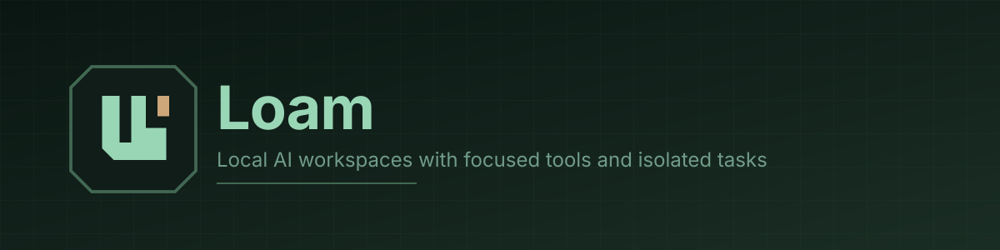
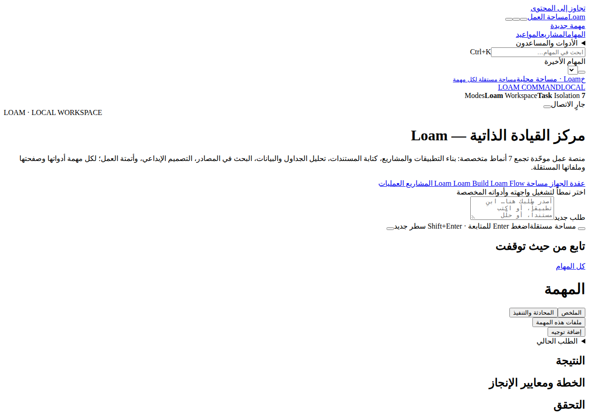
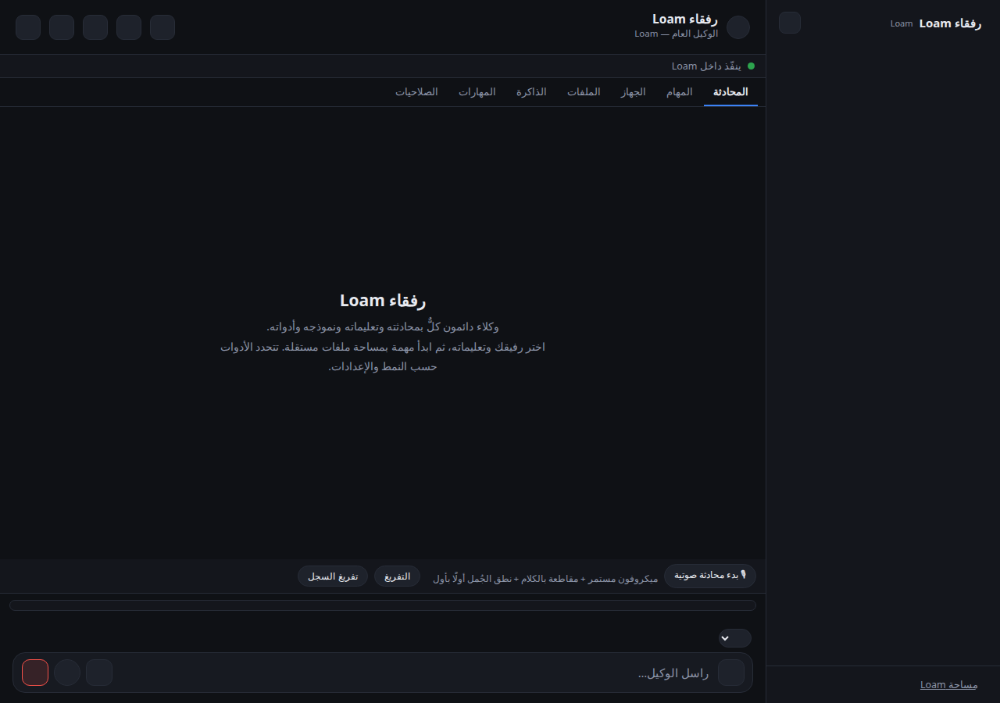
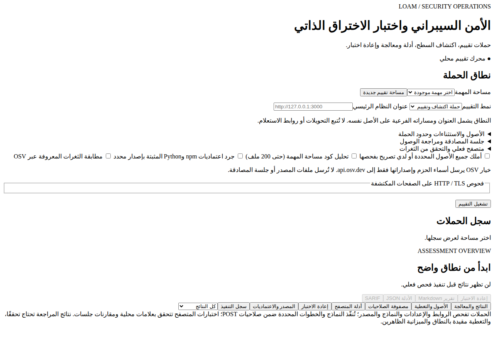
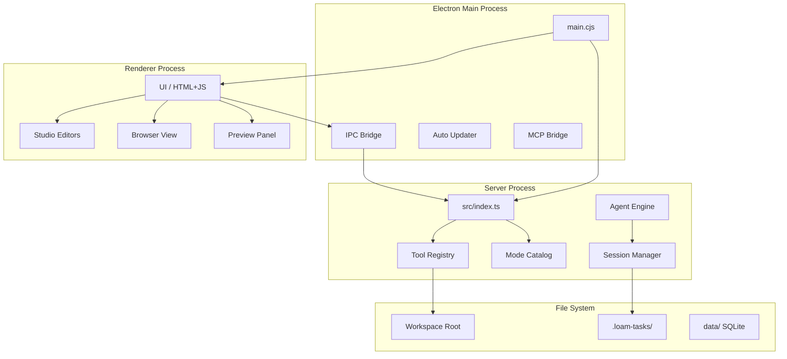

# Loam



[](https://github.com/yourusername/loam)
[](https://www.electronjs.org/)
[](https://nodejs.org/)
[]()
[]()

**Loam** is a local AI agent desktop application built with Electron. It provides specialized workspaces (modes) with focused tool sets and isolated task environments, enabling AI agents to work effectively on different types of projects without mixing contexts.


*Loam's main interface with task management and file workspace*

## Features

### 🎯 Specialized Modes

Loam organizes work into **8 distinct modes**, each with its own tools and interface optimized for specific tasks:

- **🔍 Explore** (`ask`) - Read-only workspace for understanding code, asking questions, and planning without making changes
- **📚 Research** (`research`) - Web search, source gathering, and documentation with browser automation tools
- **🔨 Build** (`build`) - Full development environment with file editing, shell commands, git operations, testing, and local preview
- **✍️ Write** (`write`) - Document creation and editing with integrated office tools (Word, Excel, PowerPoint via Craft editors)
- **📊 Data** (`data`) - Data analysis, spreadsheet manipulation, and visualization with live spreadsheet editing
- **🎨 Studio** (`media`) - Creative work including 3D scene composition, image/video generation, and design tools
- **🔐 Security** (`security`) - Security assessment tools with limited, authorized penetration testing capabilities
- **⚡ Flow** (`automate`) - Browser automation, workflow recording, and task scheduling

Each mode enforces its own tool permissions at the server level, ensuring agents can't accidentally use inappropriate tools for the task.

<details>
<summary>View Mode Screenshots</summary>


*Agent companions and team management*


*Security mode with penetration testing tools*


*Integrated terminal for build and shell commands*


*Mobile app development workspace*

</details>

### 🗂️ Task Isolation

Every conversation creates an isolated task workspace at `<workspace>/.loam-tasks/<taskId>/`:
- Separate file storage per task
- Attachments stay within their task folder
- Resume and continue conversations without mixing contexts
- Task metadata stored in SQLite for persistence

### 🛠️ Comprehensive Tool System

Loam provides specialized tools organized by capability:

- **File Operations**: Read, write, edit, search, move, delete with multi-file editing support
- **Browser Automation**: Playwright-powered browser control with screenshots, interaction recording, and data extraction
- **Shell & Execution**: Safe command execution with configurable sandboxing and timeouts
- **Git Integration**: Branch, commit, diff, PR creation, CI watching, and code review workflows
- **Preview & Testing**: Local dev server with hot reload, screenshot capture, and testing support
- **Documentation**: Context7 integration for live documentation lookup from 1000+ libraries
- **Office Integration**: Native document, spreadsheet, and presentation editing via Craft editors
- **MCP Support**: Model Context Protocol server integration for extensibility
- **Design & Media**: 3D scene composition, image generation, video editing capabilities
- **Security Tools**: Authorized penetration testing and security assessment capabilities

### 🧠 MiroFish Swarm Intelligence

A model-backed market simulation and research system for testing ideas with simulated user personas:
- **Seed Stage**: Extracts locale, entities, and personas from natural language briefs using model inference
- **Simulation Stage**: Runs N agents over R rounds, each agent turn is a real model call with persona context, memory, and social feed
- **Report Stage**: Computes metrics from recorded simulation logs (no hard-coded numbers)
- **Deterministic Fallback**: Rule-based paths available when model is unavailable
- **Full Pipeline**: Three-stage pipeline (seed → simulate → report) with honest reporting of what was model-backed vs rule-based

Code: `src/tools/mirofish/pipeline.ts`, `src/tools/mirofish/seed.ts`, `src/tools/mirofish/simulate.ts`

### 🔗 Integration Support

- **MCP Servers**: Filesystem, memory, sequential-thinking, and custom integrations
- **External Services**: Configurable integration system for third-party APIs
- **Model Providers**: Local Ollama models with cloud model fallback
- **Mobile Bridge**: Local service bridge for mobile app development workflows

## 📦 Installation & Setup

### Prerequisites

- **Node.js** 22.13.0 or newer
- **npm** (included with Node.js)
- A local model service (e.g., [Ollama](https://ollama.ai/)) or cloud API key

### Quick Start

1. **Clone the repository**
   ```bash
   git clone https://github.com/yourusername/loam.git
   cd loam
   ```

2. **Install dependencies**
   ```bash
   npm install
   ```

3. **Configure your models**
   ```bash
   cp config.example.json config.json
   # Edit config.json with your model service details
   ```

4. **Run in development mode**
   
   For web interface:
   ```bash
   npm start
   # Open the printed URL in your browser
   ```
   
   For desktop app:
   ```bash
   npm run desktop
   ```

### Building for Distribution

Build the desktop application:
```bash
npm run dist
```

The packaged app will be created in the `dist/` directory.

## 🏗️ Architecture

Loam follows the Electron multi-process architecture with several key components:



### Directory Structure

```
loam/
├── electron/           # Electron main process
│   ├── main.cjs       # Application entry point
│   ├── preload.cjs    # Preload script for renderer
│   ├── ipc-constants.cjs
│   ├── mcp-bridge.cjs # MCP server integration
│   └── updater.cjs    # Auto-update logic
├── src/               # Server-side code
│   ├── index.ts       # Server entry point
│   ├── agent/         # Agent execution engine
│   ├── tools/         # Tool implementations
│   ├── modes/         # Mode definitions & routing
│   ├── server/        # HTTP/WebSocket server
│   ├── session/       # Session management
│   ├── memory/        # Vector memory system
│   ├── llm/           # LLM client abstractions
│   └── ...
├── ui/                # Frontend HTML/CSS/JS
│   ├── index.html     # Main UI entry
│   ├── app.js         # Application controller
│   ├── loam.css       # Styles
│   └── ...
├── packages/
│   └── web/           # Next.js web version (optional)
├── docs/              # Documentation
├── skills/            # Agent skill definitions
└── addons/            # MCP server addons
```

### Key Components

- **Main Process** (`electron/main.cjs`): Electron entry point, window management, IPC coordination, auto-updates
- **Server** (`src/index.ts`): Core agent server with tool registry, mode enforcement, session handling
- **Tool Registry** (`src/tools/`): All tool implementations with type safety and permission checks
- **Mode Catalog** (`src/modes/catalog.ts`): Mode definitions with tool allowlists and UI configurations
- **Agent Engine** (`src/agent/`): Execution loop, planning, tool calling, and result handling
- **UI Layer** (`ui/`): Renderer process interface with task views, editors, and panels

## 🧪 Development & Testing

### Run Tests

```bash
# Type checking
npm run typecheck

# Integration tests
npm run test:memory
npm run test:bridges
npm run test:wiki

# Full verification suite
npm run verify:loam
```

### Available Scripts

- `npm start` - Start web server in development
- `npm run dev` - Start with hot reload (tsx watch)
- `npm run desktop` - Launch Electron desktop app
- `npm run build:server` - Build server bundle
- `npm run dist` - Build distributable desktop app
- `npm run typecheck` - Run TypeScript type checking
- `npm run check:*` - Various verification scripts
- `npm run test:*` - Test suites for specific modules

### Configuration

Loam uses `config.json` for runtime configuration. Key settings:

- **model**: Primary model name (e.g., `qwen2.5:14b`)
- **fallbackModel**: Fallback when primary unavailable
- **ollamaUrl**: Local Ollama service URL
- **cloudModel**: Cloud provider configuration (OpenRouter, etc.)
- **workspace**: Task workspace root directory
- **policy**: Security policies (command restrictions, timeouts, sandbox mode)
- **mcpServers**: MCP server configurations
- **browser**: Playwright browser settings

See `config.example.json` for all available options and defaults.

## 🤝 Contributing

Contributions are welcome! Here's how you can help:

1. **Fork the repository**
2. **Create a feature branch** (`git checkout -b feature/amazing-feature`)
3. **Make your changes** and ensure tests pass
4. **Commit your changes** (`git commit -m 'Add amazing feature'`)
5. **Push to the branch** (`git push origin feature/amazing-feature`)
6. **Open a Pull Request**

### Development Guidelines

- Keep code changes minimal and focused
- Add tests for new functionality
- Update documentation for user-facing changes
- Follow existing code style and patterns
- Respect the mode-based tool permission system
- Don't break task isolation boundaries

## 📄 License

**License not yet specified.** Please contact the project maintainers for licensing information before using this software in production or redistributing it.

## 🔗 Related Projects

- [Manus](https://github.com/cursor/manus) - Related AI agent system
- [Electron](https://www.electronjs.org/) - Desktop application framework
- [Model Context Protocol](https://modelcontextprotocol.io/) - MCP specification

## 📚 Documentation

Additional documentation can be found in the `docs/` directory:

- Architecture details and design decisions
- Security assessments and audit reports
- Integration guides
- Development guides and verification procedures

---

**Note**: This is a local-first AI agent application. All task data, conversations, and files stay on your machine unless you explicitly configure cloud model providers.
