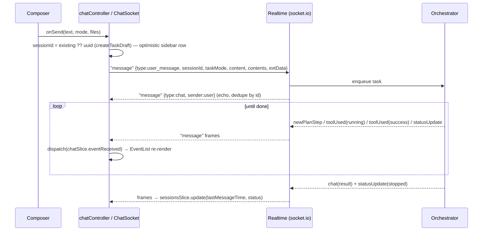
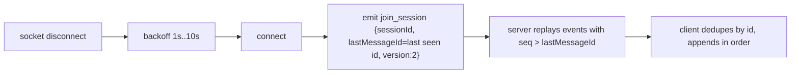

# BUILD_SPEC: Desktop AI-agent workspace (clean-room rebuild modelled on Manus Studio 2.0.8)

> **Status labels used in this document**
> - **[O]** Observed: directly evidenced in the shipped Manus Studio 2.0.8 artifact (provenance in §13.1).
> - **[O-RT]** Observed at runtime: seen live in Manus Studio 2.0.7 (Windows) over CDP on 2026-10-19 (provenance summarised in §13.1). Where `[O]` and `[O-RT]` differ, `[O-RT]` wins for UI and wire behaviour.
> - **[I]** Inferred: reasoned from observed facts; not directly proven.
> - **[U]** Unknown: not determinable from static analysis.
> - **[DD]** Design decision: a deliberate choice for this rebuild, used wherever the original is Unknown or must not be copied.
>
> Source artifact: `Manus-Setup-2.0.8.zip` (macOS arm64), sha256 `d7815508d329fb91d842a1d09468926f14c5931b91c71247bfcb3de975038bdc`, from `https://download.manus.im/` (official electron-updater feed). Analysis was static only: no execution, no login, no real accounts, no DRM bypass.
> **Self-contained:** this file is the only input an implementer needs. Every screen is described in text (§5.9); no screenshot, evidence file or external path is required.
> Clean-room rule: all code in this document is newly written. No Manus source, bundle code, images, icons, sounds or font files are reproduced. Fonts are referenced by open-license family name only. UI copy strings are reproduced as interface requirements, with the brand replaced by the `{product}` placeholder.

---

## 0. Instructions for the implementing model

1. **Read the whole document before writing code.** Build in the phase order of §11. Each agent owns only the paths listed for it.
2. **Fidelity rules**
   - Reproduce every **[O]** behaviour, token value, string, IPC name and API shape exactly.
   - Where an item is **[I]**, implement the inference, but keep it isolated behind a named constant or adapter so it can be corrected.
   - Where an item is **[U]**, implement the labelled **[DD]** alternative and nothing else.
3. **Never** copy code, SVGs, images, sounds or fonts from the original app. Write every component from the reference code in §6. Use system fonts plus the open-licensed families named in §4 (Google Fonts / OFL).
4. **Product name:** use `{product}` = `Agent Studio` **[DD]**. Every user-visible string goes through `t()` (see §6.1) with `{product}` interpolation. The deep-link scheme is `agentstudio://` **[DD]**; the original's is `manus://` **[O]**.
5. **The backend is not the original's.** The server-side agent runtime (§8.5) is a new, original design **[DD]**. Only the wire protocol the client depends on (Connect-JSON RPC + socket.io `"message"` envelope) mirrors the original **[O]**, so client code written against §8 stays valid.
6. **Arabic/RTL is a first-class requirement:** `dir="rtl"` layouts, logical CSS properties (`ps-/pe-/ms-/me-`, `start/end`), and the `ar` locale shipped from day one (the original ships 24 locales, ar included **[O]**).
7. **Security baseline:** keep the original's webPreferences **[O]** (`sandbox`, `contextIsolation`, no `nodeIntegration`). Harden the fuses that the original leaves open (§10.4) **[DD]**.
8. **Definition of done:** every acceptance criterion in §11 passes, every command in §12 exits 0, and the visual checklist (§12.3) is ticked in both light and dark mode, in both `en` and `ar`.
9. **When something is ambiguous, do not invent behaviour.** Add a `// TODO(spec-gap): <question>` and list it in the PR description.

---

## 1. Product summary

**What it is [O]:** a desktop (Electron) shell around a Next.js web app for a general-purpose autonomous AI agent. Users:
- assign *tasks* in a chat-style composer;
- watch the agent plan and use tools (terminal, browser, search, files, connectors) in a live event timeline;
- receive files and artifacts.

The desktop shell adds local capabilities the web app lacks. The original calls the main one "My Computer":
- folder-scoped local file access, with **Allow once / Always allow** approvals;
- a local terminal (node-pty);
- an in-app browser with password and passkey managers;
- computer-use helpers, screen capture and "send to {product}";
- a floating activity indicator;
- global voice input and global shortcuts;
- an auto-updater;
- deep-link login.

**Primary surfaces [O]** (static pages in `frontend/out`):

| Route | Window | Purpose |
|---|---|---|
| `/login` | main | Sign-in hand-off to the system browser |
| `/app` (+ client paths) | main / task | Main workspace: sidebar, home composer, task view |
| `/presenter` | presenter | Slides presenter |
| `/screen-live-viewer` | screenLiveViewer | Live view / remote control of a computer |
| `/desktop-activity-indicator` | desktopActivityIndicator (600×788 transparent panel) | Floating running-task indicator |
| `/` | — | Index/redirect **[I]** |

**In-app sections [O]** (navbar `tabKey`s): `newTask`, `task`, `project`, `agents`, `automation`, `computers`, `skills`, `library`, `websites`, `plugins`, `personalization`, `computerUse`.

**Scope of this rebuild [DD]:**
- **MVP:** login, the main workspace (sidebar, home, task view with live event stream, file preview panel), projects, My Computer (folders + approvals + terminal), settings (General, Account, Appearance, Data controls, My Computer, Usage), updater UI, activity indicator, `en` + `ar`.
- **Out of MVP** (stubs that show "Coming soon"): agents, automation/scheduled tasks, skills, library, websites/webdev, plugins, slides/presenter, screen-live, phone, email, billing.

---

## 2. Pinned stack

| Layer | Original | Rebuild |
|---|---|---|
| Desktop runtime | Electron **43.6.0** (Chromium 150.0.7871.250) **[O]**; the same pair also appears in the live UA of Windows build 2.0.7 (`ManusStudio/2.0.7 … Electron/43.6.0`) **[O-RT]** | Electron `43.6.0` **[O→pin]** |
| Main-process language | TypeScript compiled to CommonJS (`dist/*.js`) **[O]** | TypeScript 5.9 → CJS via `tsc` **[DD]** |
| Renderer framework | Next.js **16.3.3** App Router, static export, Turbopack chunks **[O]** | Next.js `16.3.3`, `output: 'export'` **[O→pin]** |
| React | react-dom `19.3.0-canary-cbb046ab-20260731` **[O]** | React `19.2.x` stable **[DD]** (do not ship canary) |
| State | Redux Toolkit (slices: `sessions`, `websocket`, `chat`, `project`, `auth`, …) **[O]** | `@reduxjs/toolkit` `2.x` + `react-redux` `9.x` **[DD versions]** |
| Styling | Tailwind-v3-style utilities + CSS variables (`--ui-*`, semantic colour vars) **[O]** | Tailwind CSS `3.4.x` + `tokens.css` (§4) **[DD]** |
| RPC | Connect protocol, JSON codec, protobuf-es v2 descriptors **[O]** | `@connectrpc/connect` `2.x`, `@connectrpc/connect-web` `2.x`, `@bufbuild/protobuf` `2.x` **[DD versions]** |
| Realtime | socket.io-client `^4.8.1`, websocket transport **[O]** | `socket.io-client` `4.8.x` **[O→pin]** |
| Validation | zod `3.25.76` (main) **[O]** | zod `3.25.76` **[O→pin]** |
| Terminal | node-pty `1.2.0-beta.15` + xterm **[O]** | `node-pty` `1.2.0-beta.15`, `@xterm/xterm` `5.x` **[DD]** |
| Updater | electron-updater `^6.3.9`, generic provider **[O]** | `electron-updater` `6.x` **[O→pin]** |
| Logging | electron-log `^5.4.0` **[O]** | `electron-log` `5.x` |
| Window state | electron-window-state `^5.0.3` **[O]** | same |
| Math / canvas / live | KaTeX 0.16.47, Konva 10.3.0 **[I]**, LiveKit client 2.22.2 **[O]** | KaTeX `0.16.x` only (canvas/live out of MVP) |
| Node for tooling | — | Node `22.x` (>=22.19), pnpm `10.x` **[DD]** |
| Tests | [U] | Vitest `3.x`, Playwright `1.5x` (`_electron`), `@testing-library/react` **[DD]** |
| Mock backend | n/a | Node 22 + `@connectrpc/connect-node` + `socket.io` 4.8 (§8.4) **[DD]** |
| Backend (real) | not in client **[U]** | New design (§8.5): Fastify + Connect + socket.io + Postgres 16 + Redis 7 **[DD]** |

---

## 3. Full file tree **[DD]** (mirrors the original's module boundaries where observed **[O]**)

```
agent-studio/
├─ package.json                      # pnpm workspace root
├─ pnpm-workspace.yaml
├─ .nvmrc                            # 22
├─ tsconfig.base.json
├─ proto/                            # .proto subset used by MVP (session, user, project, desktop, device_authorization)
│  ├─ session/v1/{session,session_base,session_event,project,project_common}.proto
│  ├─ user/v1/{user,user_auth,user_auth_public}.proto
│  ├─ desktop/v1/desktop.proto
│  └─ device_authorization/v1/device_authorization.proto
├─ buf.gen.yaml                      # protoc-gen-es → packages/shared/gen
├─ packages/
│  ├─ shared/                        # isomorphic types + constants
│  │  ├─ src/gen/                    # generated protobuf-es (do not edit)
│  │  ├─ src/socket.ts               # socket envelope + event union (§7.2)
│  │  ├─ src/ipc.ts                  # IPC namespace contract (§8.3)
│  │  ├─ src/env.ts                  # endpoint config (§10.5)
│  │  └─ src/i18n/{en.json,ar.json,index.ts}
│  ├─ desktop/                       # Electron main + preload
│  │  ├─ src/index.ts                # app bootstrap (single instance, protocol, windows)
│  │  ├─ src/preload.ts              # contextBridge: desktopSync, __apis, __events, desktopLocalStorage, desktopAuthStorage
│  │  ├─ src/ipc/{registry.ts,constants.ts,emitScopedEvent.ts}
│  │  ├─ src/ipc/handlers/{auth,window,system,updater,theme,appearance,desktopOperator,terminal,keepAwake,shortcut,env,diagnosticLogs,desktopActivityIndicator}.ts
│  │  ├─ src/ipc/events/{auth,navigation,menu,updater,window,system,theme,terminal,myComputer,desktopActivityIndicator}.ts
│  │  ├─ src/auth/{authService.ts,desktopLoginToken.ts,deviceCredentialStore.ts}
│  │  ├─ src/storage/storageHelper.ts   # userData/localStorage.json + session cookie
│  │  ├─ src/deepLinks.ts
│  │  ├─ src/protocol/appProtocol.ts    # app://<host> → frontend/out
│  │  ├─ src/windows/{WindowManager.ts,windowConfig.ts,MainWindow.ts,TaskWindow.ts,ActivityIndicatorWindow.ts}
│  │  ├─ src/operator/{operatorManager.ts,workspaceFileWatcher.ts,folderGrants.ts}
│  │  ├─ src/terminal/LocalTerminalManager.ts
│  │  ├─ src/updater/autoUpdaterManager.ts
│  │  ├─ src/utils/{trustedUrls.ts,logger.ts,envHelper.ts}
│  │  └─ electron-builder.yml
│  ├─ web/                           # Next.js renderer (static export, served at app://agent)
│  │  ├─ next.config.ts
│  │  ├─ tailwind.config.ts
│  │  ├─ app/{layout.tsx,page.tsx,login/page.tsx,app/page.tsx,desktop-activity-indicator/page.tsx}
│  │  ├─ src/styles/{tokens.css,globals.css}
│  │  ├─ src/store/{index.ts,authSlice.ts,sessionsSlice.ts,websocketSlice.ts,chatSlice.ts,projectSlice.ts,uiSlice.ts}
│  │  ├─ src/services/{rpc.ts,chatSocket.ts,notifierSocket.ts,desktopApis.ts}
│  │  ├─ src/controllers/{sessionsController.ts,chatController.ts,authController.ts,projectController.ts,myComputerController.ts}
│  │  ├─ src/components/ui/{Button,IconButton,Input,Textarea,Dialog,Menu,Tooltip,Toast,Switch,Tabs,Avatar,Badge,Spinner,Skeleton,EmptyState}.tsx
│  │  ├─ src/components/shell/{TitleBar,Sidebar,SidebarTaskItem,SidebarSection,SearchTasks,UpdatePopover}.tsx
│  │  ├─ src/components/chat/{Composer,EventList,ChatBubble,ToolUsedRow,StatusUpdateRow,PlanStep,AttachmentChip,ApprovalCard}.tsx
│  │  ├─ src/components/panels/{FilePreviewPanel,TerminalPanel}.tsx
│  │  ├─ src/components/settings/{SettingsDialog,GeneralPane,AccountPane,AppearancePane,DataControlsPane,MyComputerPane,UsagePane}.tsx
│  │  ├─ src/features/login/LoginScreen.tsx
│  │  ├─ src/features/activity/ActivityIndicator.tsx
│  │  ├─ src/i18n/{t.ts,useLocale.ts}
│  │  └─ public/fonts/                # OFL fonts downloaded at build time (§4.3), not committed from the original
│  └─ mock-server/                   # dev/test backend implementing §8
│     ├─ src/index.ts
│     ├─ src/rpc/{userAuth.ts,session.ts,project.ts,desktop.ts}
│     ├─ src/socket/chat.ts
│     ├─ src/agent/scriptedAgent.ts
│     └─ src/db/{schema.sql,seed.ts,memoryStore.ts}
├─ services/agent-backend/           # §8.5 real backend (Phase 5, optional)
└─ tests/
   ├─ unit/…  ├─ e2e/{login.spec.ts,task.spec.ts,mycomputer.spec.ts,rtl.spec.ts}
   └─ visual/baselines/{light,dark}/{en,ar}/*.png
```
## 4. Full design tokens

All values are **[O]**: extracted from the original's CSS bundles Token *names* are kept so components match the original's naming; the file is re-authored by generator, not copied. Group order: colour (light), colour (dark), UI density/type, shadows.

### 4.1 `packages/web/src/styles/tokens.css`

```css
/* Values as observed; do not hand-edit. */
:root {
  --Button-black: #1a1a19;
  --Button-blue: #0081f2;
  --Button-blue-disabled: #7cbdf5;
  --Button-border-error: #f25a5a80;
  --Button-border-secondary: #0000001f;
  --Button-secondary-blue: #0081f21a;
  --Button-white: #fff;
  --accent-send-button: var(--Button-black);
  --accent-send-icon: var(--icon-onblack);
  --accent-user-message: var(--fill-white);
  --accent-user-message-border: var(--border-main);
  --accent-user-message-border-width: 1px;
  --accent-user-message-new: var(--fill-white);
  --activity-indicator-action-background: #ebebea;
  --activity-indicator-badge-background: #fff9;
  --activity-indicator-badge-foreground: #34322d;
  --activity-indicator-badge-shadow: #00000040;
  --activity-indicator-card-background: #ffffffe6;
  --activity-indicator-card-background-hover: #fffffff5;
  --activity-indicator-card-border: #ffffffa6;
  --activity-indicator-control-background: #37352f0f;
  --activity-indicator-description: #5f5d58;
  --activity-indicator-error: #fb494f;
  --activity-indicator-error-background: #f25a5a14;
  --activity-indicator-native-hover: #ffffff1f;
  --activity-indicator-running: #0081f2;
  --activity-indicator-shadow-sm: #0000002e;
  --activity-indicator-shadow-xs: #0000000a;
  --activity-indicator-success: #25ba3b;
  --activity-indicator-success-background: #25ba3b1f;
  --activity-indicator-success-expanded: #15b32c;
  --activity-indicator-title: #34322d;
  --activity-indicator-warning: #efa201;
  --activity-indicator-warning-background: #efa2011f;
  --activity-indicator-warning-icon: #f1a403;
  --ansi-cyan: #0f9aa8;
  --ansi-magenta: #a855c7;
  --background-agents-invite: #ebebeb;
  --background-app-banner: linear-gradient(180deg, #f7f7f7 0%, #ececec 100%);
  --background-canvas-bg: #f0f0ef;
  --background-card: #fafafa;
  --background-card-gray: #fafafa;
  --background-chat-reaction: #ececeb;
  --background-chat-with-image-toolbar: #f8f8f71f;
  --background-code-bg: #f0f0ef;
  --background-dialog-mask: #0000004d;
  --background-drag-overlay: #ffffff80;
  --background-event-visual-kit: linear-gradient(120deg, #fff7ea 0%, #fbeedb 58%, #e4edf5 100%);
  --background-file-previewer-image: #575756;
  --background-game-card-caption: linear-gradient(180deg, #0000, #000c);
  --background-game-category-badge: #0000008f;
  --background-game-promo: #1a1a19;
  --background-game-promo-preview: #041b47;
  --background-game-publish-popover: linear-gradient(198.057deg, #000000b8 4.6304%, #0000005a 45.848%, #0003 67.499%), linear-gradient(90deg, #3c3c3ccc 0%, #3c3c3ccc 100%);
  --background-game-share-popover: linear-gradient(193.956deg, #000000b8 4.6304%, #0000005a 45.848%, #0003 67.499%), linear-gradient(90deg, #3c3c3ccc 0%, #3c3c3ccc 100%);
  --background-game-tab-active: #141414d9;
  --background-game-tab-inactive: #14141466;
  --background-gray-login: #f8f8f7;
  --background-gray-main: #f8f8f7;
  --background-gray-mobile: #f5f5f5;
  --background-gray-secondary: #f3f3f3;
  --background-image-preview-toolbar: #333333d9;
  --background-live-events: linear-gradient(180deg, var(--background-gray-secondary), var(--background-live-events-end));
  --background-live-events-end: #ededed;
  --background-mask-black: #000000a6;
  --background-mask-white: #ffffffa6;
  --background-menu-gray: #f8f8f7;
  --background-menu-tooltips: #000000e6;
  --background-menu-white: #fff;
  --background-nav: #f0f0f0;
  --background-preview-mask: #000000d9;
  --background-promotion: linear-gradient(90deg, #edf7ff 0%, #e9f6fd 100%);
  --background-screen-live: #000;
  --background-selection: #b8d3f8;
  --background-share-header: linear-gradient(0deg, #f8f8f700 0%, #f8f8f7 45.05%);
  --background-studio-only-badge: #000;
  --background-text-edit-panel: linear-gradient(180deg, #fff0 0%, var(--background-menu-white) 100%);
  --background-thinking: linear-gradient(90deg, var(--text-primary) 0%, #d9d8d8 50.48%, var(--text-primary) 99.04%);
  --background-tool-used: linear-gradient(176deg, #fff0 5.88%, #fff9 51.28%, #fff0 94.95%);
  --background-tool-used-image-loading: #000;
  --background-tsp-card-gray: #37352f0a;
  --background-tsp-menu-white: #ffffff14;
  --background-video-campaign-artwork: #141414;
  --background-video-campaign-preview: #1f1f1f;
  --background-video-player: #000;
  --border-blue: #0081f247;
  --border-dark: #00000024;
  --border-dark-opaque: #dbdbdb;
  --border-event-visual-kit: #eadfcb;
  --border-game-gallery: #00000014;
  --border-game-promo-preview: #8f8f8f4f;
  --border-image-preview-toolbar: #ffffff1f;
  --border-input-active: #0000004d;
  --border-light: #0000000a;
  --border-light-opaque: #f5f5f5;
  --border-main: #0000000f;
  --border-menu-arrow: #0000000f;
  --border-primary: #4f59661f;
  --border-video-campaign-artwork: #00000052;
  --border-white: #fff3;
  --brand-android: #418377;
  --fill-black: #28282973;
  --fill-blue: #0081f214;
  --fill-gray: #f8f8f7;
  --fill-on-dark-surface-hover: #ffffff1a;
  --fill-overlay-card-button-hover: #ffffff4d;
  --fill-overlay-white: #ffffff59;
  --fill-overlay-white-border: #fff3;
  --fill-progress-success: #66b175;
  --fill-remote-computer-action: #0000004d;
  --fill-tsp-gray-dark: #37352f14;
  --fill-tsp-gray-light: #37352f05;
  --fill-tsp-gray-main: #37352f0a;
  --fill-tsp-white-dark: #37352f14;
  --fill-tsp-white-light: #37352f0a;
  --fill-tsp-white-main: #37352f0f;
  --fill-tsp-white-surface: #37352f08;
  --fill-white: #fff;
  --fill-white-primary: #fff;
  --function-error: #fb494f;
  --function-error-tsp: #f25a5a14;
  --function-merged: #8269cb;
  --function-merged-tsp: #8269cb1f;
  --function-success: #25ba3b;
  --function-success-tsp: #25ba3b14;
  --function-warning: #efa201;
  --function-warning-tsp: #efa2011f;
  --game-dev-theme-color: #1f1f1f;
  --gradient-bg-mask-gray-0: #eaeaeb00;
  --gradient-input-solid: #ececeb;
  --gradual-dark-20: #0003;
  --gradual-gray-0: #fff0;
  --gradual-gray-100: #fff0;
  --gradual-white-0: #fff0;
  --gradual-white-menu-0: #fff0;
  --icon-blue: #0081f2;
  --icon-disable: #a6a6a6;
  --icon-live-event-entry-secondary: #5e5e5b;
  --icon-onblack: #fff;
  --icon-primary: #1a1a1a;
  --icon-secondary: #4d4d4d;
  --icon-tertiary: #737373;
  --icon-video-play: #34322d;
  --icon-white: #fff;
  --icon-white-tsp: #ffffff60;
  --illustration-app-download-agents: #e9e5d0;
  --illustration-app-download-agents-title: #4b1717;
  --illustration-app-download-cue-desktop: #ececec;
  --illustration-app-download-cue-mobile: #f1eae5;
  --illustration-app-download-logo: #fff;
  --illustration-app-download-mobile: #d3dbe0;
  --illustration-app-download-mobile-title: #334554;
  --illustration-app-download-phone-screen: #f8f8f7;
  --illustration-app-download-studio: #d3d3d3;
  --illustration-app-download-text: #34322d;
  --illustration-cloud-desktop-linux: linear-gradient(135deg, #35123e 0%, #772953 55%, #dd7138 100%);
  --illustration-cloud-desktop-mac: linear-gradient(135deg, #234d85 0%, #68acc6 40%, #e5b5a8 65%, #ab526e 100%);
  --illustration-cloud-desktop-windows: radial-gradient(ellipse at 80% 35%, #4cd2f6 0%, #087abe 35%, #073b80 65%, #062452 100%);
  --illustration-device-frame: #1a1a19;
  --illustration-studio-create-paper: linear-gradient(180deg, #ffffff0a 0%, #ffffff1a 100%), linear-gradient(180deg, #0000001a 0%, #00000005 100%);
  --invitation-background: #f5f5f5;
  --logo-color: #34322d;
  --overlay-card-bar-from: #0006;
  --overlay-card-bar-to: #a5a5a566;
  --ring-video-campaign-artwork: #fefefe52;
  --shadow-Highlight: #0000;
  --shadow-L: #0000003d;
  --shadow-M: #0000000f;
  --shadow-S: #0000000a;
  --shadow-XS: #00000005;
  --shadow-game-tab-active: inset 0 -3px 7.1px #ffffff29, inset 0 .6px 1px #ffffff73;
  --shadow-game-tab-inactive: inset 0 -1px 1px #ffffff08, inset 0 .6px 1px #ffffff1f;
  --shadows-card-border: #16191d1f;
  --shadows-card-border-2: #16191d1f;
  --shadows-danger-1: #fed7d7;
  --shadows-danger-2: #ee3a3a;
  --shadows-drop-1: #16191d08;
  --shadows-drop-2: #16191d0a;
  --shadows-drop-3: #16191d14;
  --shadows-drop-4: #16191d1f;
  --shadows-highlight-1: #cce5ff;
  --shadows-highlight-2: #1487fa;
  --shadows-inner-0: #fff0;
  --shadows-inner-1: #16191d14;
  --shadows-inner-2: #16191d1f;
  --slides-stage-ink: #34322d;
  --tab-active-black: #1a1a19;
  --tab-active-white: #ffffffd9;
  --tab-fill: #0000000a;
  --text-blue: #0081f2;
  --text-blue-dark: #005fb3;
  --text-disable: #a6a6a6;
  --text-event-visual-kit-accent: #a2453a;
  --text-features-primary: #34322d;
  --text-features-secondary: #5e5e5b;
  --text-features-tertiary: #858481;
  --text-game-header-muted: #acacac;
  --text-live-event-entry-disable: #b9b9b7;
  --text-live-event-entry-primary: #34322d;
  --text-live-event-entry-tertiary: #858481;
  --text-onblack: #fff;
  --text-primary: #1a1a1a;
  --text-quaternary: #8c8c8c;
  --text-remote-computer-access: #34322d;
  --text-secondary: #4d4d4d;
  --text-shining: #e5e5e5;
  --text-tertiary: #737373;
  --text-white: #fff;
  --text-white-tsp: #fff9;
  --theme-text-primary: #262626;
}
.dark {
  --Button-black: #fffffff2;
  --Button-blue: #1a93fe;
  --Button-blue-disabled: #215d93;
  --Button-border-error: #eb4d4d29;
  --Button-border-secondary: #ffffff1f;
  --Button-secondary-blue: #1a93fe1f;
  --Button-white: #ffffff14;
  --accent-user-message: var(--fill-tsp-white-main);
  --accent-user-message-border: transparent;
  --accent-user-message-border-width: 0px;
  --ansi-cyan: #35c2d1;
  --ansi-magenta: #c98bea;
  --background-app-banner: linear-gradient(180deg, #f7f7f7 0%, #ececec 100%);
  --background-canvas-bg: #1c1c1c;
  --background-card: #1c1c1c;
  --background-card-gray: #1c1c1c;
  --background-chat-reaction: #272727;
  --background-chat-with-image-toolbar: #1717171f;
  --background-code-bg: #1c1c1c;
  --background-dialog-mask: #0009;
  --background-drag-overlay: #00000080;
  --background-file-previewer-image: #040404;
  --background-game-promo: #000;
  --background-gray-login: #050505;
  --background-gray-main: #1a1a1a;
  --background-gray-mobile: #171718;
  --background-gray-secondary: #313131;
  --background-live-events-end: #242424;
  --background-mask-black: #00000073;
  --background-mask-white: #3f3f3f52;
  --background-menu-gray: #1a1a1a;
  --background-menu-tooltips: #000000e6;
  --background-menu-white: #242424;
  --background-nav: #1f1f1f;
  --background-preview-mask: #000000d9;
  --background-promotion: linear-gradient(90deg, #183359 0%, #1b415a 100%);
  --background-selection: #6580a5;
  --background-share-header: linear-gradient(var(--background-gray-main) 0%, var(--background-gray-main) 45.05%);
  --background-text-edit-panel: linear-gradient(180deg, #0000 0%, var(--background-menu-white) 100%);
  --background-thinking: linear-gradient(90deg, var(--text-primary) 0%, #d9d8d8 50.48%, var(--text-primary) 99.04%);
  --background-tool-used: linear-gradient(176deg, #28282800 5.88%, #ffffff14 51.28%, #28282800 94.95%);
  --background-tool-used-image-loading: #fff;
  --background-tsp-card-gray: #ffffff0f;
  --background-tsp-menu-white: #ffffff0f;
  --background-video-player: #000;
  --border-blue: #1a93fe47;
  --border-dark: #ffffff1f;
  --border-dark-opaque: #3f3f3f;
  --border-game-gallery: var(--border-main);
  --border-input-active: #ffffff52;
  --border-light: #ffffff08;
  --border-light-opaque: #2b2b2b;
  --border-main: #ffffff0f;
  --border-menu-arrow: #ffffff24;
  --border-primary: #56565f52;
  --border-white: #00000014;
  --fill-black: #28282973;
  --fill-blue: #1a93fe1f;
  --fill-gray: #1c1c1c;
  --fill-overlay-white: #ffffff14;
  --fill-overlay-white-border: #ffffff14;
  --fill-progress-success: #66b175;
  --fill-tsp-gray-dark: #0000004d;
  --fill-tsp-gray-light: #0000001f;
  --fill-tsp-gray-main: #0003;
  --fill-tsp-white-dark: #ffffff14;
  --fill-tsp-white-light: #ffffff0a;
  --fill-tsp-white-main: #ffffff0f;
  --fill-tsp-white-surface: #ffffff08;
  --fill-white: #242424;
  --fill-white-primary: #404040;
  --function-error: #eb4d4d;
  --function-error-tsp: #eb4d4d1f;
  --function-merged: #a991ee;
  --function-merged-tsp: #a991ee29;
  --function-success: #5eb92d;
  --function-success-tsp: #5eb92d1f;
  --function-warning: #ffbf36;
  --function-warning-tsp: #ffbf361f;
  --gradient-bg-mask-gray-0: #1f1f1f00;
  --gradient-input-solid: #232323;
  --gradual-dark-20: #fff3;
  --gradual-gray-0: #1c1c1c00;
  --gradual-gray-100: #1c1c1c;
  --gradual-white-0: #1a1a1a00;
  --gradual-white-menu-0: #1f1f1f00;
  --icon-blue: #1a93fe;
  --icon-disable: #595959;
  --icon-live-event-entry-secondary: var(--icon-secondary);
  --icon-onblack: #000000d9;
  --icon-primary: #e6e6e6;
  --icon-secondary: #b3b3b3;
  --icon-tertiary: #8c8c8c;
  --icon-white: #fff;
  --icon-white-tsp: #ffffff60;
  --illustration-app-download-agents: #b0ad9d;
  --invitation-background: var(--background-gray-main);
  --logo-color: #dadada;
  --overlay-card-bar-from: #47474766;
  --overlay-card-bar-to: #20202066;
  --shadow-Highlight: #ffffff24;
  --shadow-L: #0006;
  --shadow-M: #00000047;
  --shadow-S: #00000029;
  --shadow-XS: #00000014;
  --shadows-card-border: #ffffff1f;
  --shadows-card-border-2: #fff0;
  --shadows-danger-1: #8f1919;
  --shadows-danger-2: #ee3a3a;
  --shadows-drop-1: #0000001f;
  --shadows-drop-2: #0003;
  --shadows-drop-3: #00000047;
  --shadows-drop-4: #0000005c;
  --shadows-highlight-1: #1b61a6;
  --shadows-highlight-2: #1487fa;
  --shadows-inner-0: #ffffff1f;
  --shadows-inner-1: #ffffff14;
  --shadows-inner-2: #ffffff1f;
  --slides-stage-ink: #e6e4de;
  --tab-active-black: #fff;
  --tab-active-white: #ffffff14;
  --tab-fill: #ffffff0a;
  --text-blue: #1a93fe;
  --text-blue-dark: #489ce6;
  --text-disable: #595959;
  --text-features-primary: var(--text-primary);
  --text-features-secondary: var(--text-secondary);
  --text-features-tertiary: var(--text-tertiary);
  --text-game-header-muted: #acacac;
  --text-live-event-entry-disable: var(--text-disable);
  --text-live-event-entry-primary: var(--text-primary);
  --text-live-event-entry-tertiary: var(--text-tertiary);
  --text-onblack: #000000e5;
  --text-primary: #e6e6e6;
  --text-quaternary: #7a7a7a;
  --text-secondary: #b3b3b3;
  --text-shining: #474747;
  --text-tertiary: #8c8c8c;
  --text-white: #fff;
  --text-white-tsp: #fff9;
  --theme-text-primary: #dbdbdb;
}
[--ui-density-nav-icon-scale\:1\] {
  --ui-density-nav-icon-scale: 1;
}
:root {
  --ui-font-size-xs: 12px;
  --ui-line-height-xs: 16px;
  --ui-font-size-label: 13px;
  --ui-line-height-label: 18px;
  --ui-font-size-sm: 14px;
  --ui-line-height-sm: 20px;
  --ui-font-size-body-sm: 14px;
  --ui-line-height-body-sm: 22px;
  --ui-font-size-base: 16px;
  --ui-line-height-base: 24px;
  --ui-font-size-title-base: 16px;
  --ui-line-height-title-base: 22px;
  --ui-font-size-lg: 18px;
  --ui-line-height-lg: 28px;
  --ui-font-size-title-lg: 18px;
  --ui-line-height-title-lg: 24px;
  --ui-font-size-xl: 20px;
  --ui-line-height-xl: 28px;
  --ui-font-size-headline-sm: 20px;
  --ui-line-height-headline-sm: 25px;
  --ui-font-size-2xl: 24px;
  --ui-line-height-2xl: 32px;
  --ui-font-size-headline-base: 24px;
  --ui-line-height-headline-base: 30px;
  --ui-font-size-headline-lg: 28px;
  --ui-line-height-headline-lg: 34px;
  --ui-font-size-3xl: 30px;
  --ui-line-height-3xl: 36px;
  --ui-titlebar-height: 48px;
  --ui-density-outer-padding: 8px;
  --ui-density-row-height: 36px;
  --ui-density-small-row-height: 32px;
  --ui-density-menu-item-padding-y: 8px;
  --ui-density-large-control-height: 40px;
  --ui-density-row-radius: 10px;
  --ui-density-small-radius: 8px;
  --ui-density-card-radius: 12px;
  --ui-density-composer-radius: 22px;
  --ui-density-row-gap: 8px;
  --ui-density-nav-item-padding-start: 8px;
  --ui-density-nav-item-gap: 8px;
  --ui-density-nav-icon-box-size: 20px;
  --ui-density-nav-icon-scale: 1;
  --ui-density-input-gap: 10px;
  --ui-density-input-editor-min-height: 50px;
  --ui-density-home-input-editor-min-height: 50px;
  --ui-density-chat-input-fallback-height: 152px;
  --ui-density-chat-block-padding-top: 4px;
  --ui-density-chat-block-padding-bottom: 8px;
  --ui-density-section-gap: 12px;
  --ui-density-nav-section-gap: 12px;
  --ui-density-reference-chip-gap: 6px;
  --ui-density-reference-chip-padding-x: 6px;
  --ui-density-reference-chip-padding-y: 2px;
  --ui-density-content-padding: 12px;
  --ui-density-content-padding-x: 24px;
  --ui-density-bubble-padding-y: 12px;
  --ui-density-suggestion-padding-y: 9px;
  --ui-density-option-gap: 16px;
  --ui-density-section-padding-start: 10px;
  --ui-density-section-row-gap: 12px;
}
.is-desktop {
  --ui-font-scale: 1;
  --ui-density-chat-input-fallback-height: 140px;
}
[data-interface-density=standard] {
  --ui-density-nav-item-padding-start: 9px;
  --ui-density-nav-item-gap: 12px;
  --ui-density-nav-icon-box-size: 18px;
  --ui-density-bubble-padding-y: 8px;
}
[data-interface-density=compact] {
  --ui-density-outer-padding: 6px;
  --ui-density-row-height: 32px;
  --ui-density-small-row-height: 28px;
  --ui-density-menu-item-padding-y: 6px;
  --ui-density-large-control-height: 36px;
  --ui-density-row-gap: 6px;
  --ui-density-nav-item-padding-start: 6px;
  --ui-density-nav-item-gap: 8px;
  --ui-density-nav-icon-box-size: 18px;
  --ui-density-nav-icon-scale: .8889;
  --ui-density-input-gap: 8px;
  --ui-density-input-editor-min-height: 50px;
  --ui-density-home-input-editor-min-height: 44px;
  --ui-density-chat-input-fallback-height: 124px;
  --ui-density-chat-block-padding-top: 2px;
  --ui-density-chat-block-padding-bottom: 4px;
  --ui-density-section-gap: 8px;
  --ui-density-nav-section-gap: 14px;
  --ui-density-reference-chip-gap: 4px;
  --ui-density-reference-chip-padding-x: 4px;
  --ui-density-reference-chip-padding-y: 1px;
  --ui-density-content-padding: 10px;
  --ui-density-content-padding-x: 20px;
  --ui-density-bubble-padding-y: 6px;
  --ui-density-suggestion-padding-y: 6px;
  --ui-density-option-gap: 12px;
  --ui-density-section-padding-start: 8px;
  --ui-density-section-row-gap: 8px;
}
.chat-input-editor {
  --ui-font-size-base: var(--ui-font-size-body-sm);
  --ui-line-height-base: var(--ui-line-height-body-sm);
}
```

### 4.2 Shadows, radii, type utilities **[O]**

```css
.shadow-card { box-shadow: 0 0 0 1px var(--shadow-Highlight), 0 0 0 1px var(--shadow-M), 0 1px 2px 0 var(--shadow-S), 0 2px 4px 0 var(--shadow-S); }
.shadow-menu { box-shadow: 0 0 0 1px var(--shadow-Highlight), 0 0 0 1px var(--shadow-M), 0 24px 24px -12px var(--shadow-S), 0 3px 3px -1.5px var(--shadow-M), 0 10px 20px 1px var(--shadow-S); }
.shadow-layer { box-shadow: 0 0 0 1px var(--shadow-Highlight), 0 0 0 .5px var(--shadow-M), 0 24px 24px -12px var(--shadow-S), 0 3px 3px -1.5px var(--shadow-M), 0 10px 20px 1px var(--shadow-S); }
```

Radius usage frequency in the JS bundles **[O]** (implementation guidance: 8px is the default control radius, 12px for cards, 10px for list rows, full for pills and avatars):

| class | uses |
|---|---|
| `rounded-[8px]` | 861 |
| `rounded` | 686 |
| `rounded-[12px]` | 682 |
| `rounded-full` | 622 |
| `rounded-lg` | 299 |
| `rounded-[10px]` | 252 |
| `rounded-[6px]` | 239 |
| `rounded-[4px]` | 202 |
| `rounded-xl` | 170 |
| `rounded-[16px]` | 101 |
| `rounded-md` | 82 |
| `rounded-none` | 70 |
| `rounded-[20px]` | 57 |
| `rounded-2xl` | 44 |

### 4.3 Typography **[O]** / fonts **[DD]**

- UI font stack **[O]**: `-apple-system, BlinkMacSystemFont, "Segoe UI Variable Display", "Segoe UI", Helvetica, Arial, sans-serif` (system fonts; nothing is bundled).
- Semantic text classes **[O]** use `font-weight: 590` for titles and headlines (`.text-title-*`, `.text-headline-*`) and 400 for body and label. Sizes come from the `--ui-font-size-*` / `--ui-line-height-*` vars in §4.1:

| Class | Size / line-height (px) |
|---|---|
| xs | 12 / 16 |
| label | 13 / 18 |
| sm | 14 / 20 |
| body-sm | 14 / 22 |
| base | 16 / 24 |
| title-base | 16 / 22 |
| lg | 18 / 28 |
| title-lg | 18 / 24 |
| xl | 20 / 28 |
| headline-sm | 20 / 25 |
| 2xl | 24 / 32 |
| headline-base | 24 / 30 |
| headline-lg | 28 / 34 |
| 3xl | 30 / 36 |

- Arabic **[DD]**: append `"Noto Sans Arabic"` (SIL OFL 1.1, Google Fonts) to the stack under `:lang(ar)`. Monospace **[DD]**: `"JetBrains Mono"` (OFL), falling back to `ui-monospace, SFMono-Regular, Menlo, monospace`. Both are fetched at build time by `scripts/fetch-fonts.mjs` from Google Fonts and are not taken from the original.
- Serif display face: the original uses a licensed brand serif in marketing headlines **[I]**. **[DD]:** no serif; use `.text-headline-lg`.

### 4.4 `packages/web/tailwind.config.ts` **[DD]** (maps the tokens above to utilities)

```ts
import type { Config } from 'tailwindcss';

const v = (name: string) => `var(--${name})`;

export default {
  darkMode: 'class',
  content: ['./app/**/*.{ts,tsx}', './src/**/*.{ts,tsx}'],
  theme: {
    extend: {
      fontSize: Object.fromEntries(
        ['xs', 'sm', 'base', 'lg', 'xl', '2xl', '3xl'].map((k) => [
          k,
          [v(`ui-font-size-${k}`), { lineHeight: v(`ui-line-height-${k}`) }],
        ]),
      ),
      borderRadius: { row: '10px', control: '8px', card: '12px', composer: '22px' },
      colors: {
        bg: { main: v('background-gray-main'), menu: v('background-menu-white'), nav: v('background-nav') },
        text: {
          primary: v('text-primary'), secondary: v('text-secondary'),
          tertiary: v('text-tertiary'), disable: v('text-disable'), onblack: v('text-onblack'),
        },
        border: { main: v('border-main'), light: v('border-light'), dark: v('border-dark') },
        fill: { tsp: v('fill-tsp-white-main'), hover: v('fill-tsp-gray-main') },
        func: { error: v('function-error'), success: v('function-success'), warning: v('function-warning') },
      },
      spacing: { titlebar: '48px', row: '36px', 'row-sm': '32px', control: '40px' },
    },
  },
  plugins: [],
} satisfies Config;
```

> Token-name check **[O]**: every token referenced above was verified to exist in `design-tokens.json` (`:root`).

### 4.5 Density **[O]**

The `[data-interface-density=standard|compact]` attribute on `<html>` switches the `--ui-*` row heights and paddings (values in §4.1).
- Default: `standard`.
- Settings > Appearance > Interface density toggles it **[I]**.
- `.is-desktop` (set on `<html>` when running under Electron) adds the titlebar offsets **[O]**.

---

## 5. Screens

Conventions:
- Wireframes are not to scale; widths are in px where known.
- `[…]` marks a control; `‹…›` marks dynamic content.
- Literal strings are the English source keys of the original i18n catalog **[O]** (the keys *are* the English text). Each string has its Arabic value from the original `ar` catalog **[O]**, reproduced as the translation requirement.
- Only `{product}` is substituted.
- Each screen lists its states.

### 5.0 Global window chrome **[O]** / **[O-RT]**

- Main window: default 1440×900, min 600×400, `titleBarStyle: hiddenInset`, traffic lights at {x:16, y:16} on macOS. Closing hides the window instead of quitting (`closeAction: hide`) **[O]**.
- Task window: 1280×840 **[O]**. The live session ran in a 1280×840 viewport at DPR 1 **[O-RT]**.
- Title bar: `--ui-titlebar-height: 48px` **[O-RT]**. On **Windows** the top bar row is 40px. The sidebar `<nav>` starts at y=40. Custom minimise/maximise/close buttons sit at the right; sidebar toggle, back, forward and search sit at the left **[O-RT]**.
- macOS left inset for the traffic lights: `DESKTOP_NAVBAR_TRAFFIC_LIGHTS_WIDTH = 80` **[O]**.
- `<html>` carries `class="is-desktop … light|dark"`, `data-accent-color="default"`, `data-interface-density="compact"` (the default seen live), and an inline style of `--ui-font-scale` and `--ui-font-size-*` variables (user font-size setting) **[O-RT]**.
- In RTL the traffic lights stay physically left (macOS); the navbar content mirrors **[DD]**.

```
┌──────────────────────────────────────────────────────────────────────────────┐
│ [⇤] [←] [→] [🔍]                                              [–] [▢] [✕]  │ 40px (Windows) / 48px var
├──────────────┬───────────────────────────────────────────────────────────────┤
│ SIDEBAR      │ CONTENT  (top bar: [Manus 2.0 ▾] model switcher … [✦ 18.1K] [⧉]) │
│ 240px [O-RT] │                                                               │
└──────────────┴───────────────────────────────────────────────────────────────┘
```

### 5.1 Login (`/login`) **[O]** (module ElectronLoginPage)

```
┌──────────────────────────────────────────────┐
│ ● ● ●                         [Dev environment]  (badge, dev builds only)
│                                              │
│                 ‹logo 48px›                  │
│          Sign in to {product}                │  .text-headline-base
│                                              │
│        [        Sign in         ]            │  primary button, 40px, radius 8
│                                              │
│          Having trouble logging in?          │  link → help popover
│                                              │
│  By continuing, you agree to our Terms of    │  .text-xs tertiary, <terms>/<privacy> links
│  Service and have read our Privacy Policy.   │
└──────────────────────────────────────────────┘
```

**Behaviour [O]:**
1. Clicking **Sign in** builds `{webBase}/login?from=desktop&type=signIn&nonce=<crypto.randomUUID()>`. Sign up uses `type=signUp`.
2. It stores `login_nonce` through `desktopLocalStorage.setItem`.
3. It calls `desktopApis.system.openExternal(url)`.
4. The browser completes auth and redirects to `{scheme}://…?token=…&nonce=…`.
5. Main compares the nonce with `login_nonce` (mismatch → `auth.loginFailed {error:'nonce_mismatch'}`) **[O]**. It then calls `GenerateTempAuthCode` (Bearer loginToken) → `ExchangeTokenByCode` → session token **[O]**, stores the token (httpOnly cookie `session_id` + `safeStorage` copy **[DD]**) and emits `auth.loginSuccess`. The renderer navigates to `/app`. Other errors: `token_exchange_failed`, `token_persist_failed` **[O]**.

**States:** idle · waiting-for-browser (button shows spinner + "Sign in" disabled **[I]**) · error toast · environment switch dialog ("Switch environment?" / "Switch and restart").

### 5.2 Main workspace: Home / New task (`/app`, tabKey `newTask`) **[O-RT]**

```
┌───────────────────┬──────────────────────────────────────────────────────────┐
│ ✎ New task  Ctrl+⇧+O                [Manus 2.0 ▾]                 [✦ 18.1K] [⧉] │
│ 🖥 Computers        │          ‹product wordmark›          ╭ promo card (rotating) ╮│
│ ◎ Agents   (badge)  │                                       ╰───────────────────────╯│
│ 🔍 Search          │  ╭ Build ›                ╮  ╭───────────────────────╮       │
│ ▤ Library           │  │ Websites, apps, games  │  │   ‹folder illustration›│       │
│ ⚘ Creations         │  ╰────────────────────────╯  │ Start from a local file│       │
│ ⚙ Automations       │  ╭ Create ›               ╮  │ Click or drag local    │       │
│ ⊞ Plugins           │  │ Slides, images, videos │  │ files here             │       │
│ ⋯ More              │  ╰────────────────────────╯  ╰───────────────────────╯       │
│                     │  [ use-case card ] [ use-case card ] [ use-case card ]   … View all · N ideas
│ Projects            │  ┌ context bar ─────────────────────────────────────────┐ │
│ ⊕ New project       │  │ 🖥 This PC · ▣ Choose project · 📁 Downloads · ⑂ branch · ☐ Worktree │
│ Tasks               │  ╭──────────────────────────────────────────────────────╮ │
│  ‹task row› ×N      │  │ Assign a task or type / for more                     │ │ composer, radius 22
│ ╭ referral card ──╮ │  │ [+] [connectors +N] [🛡 Approve for me]        [🎙] [↑] │ │
│ ╰─────────────────╯ │  ╰──────────────────────────────────────────────────────╯ │
│ ‹avatar› ‹name› [⧉][🔔]                                                         │
└───────────────────┴──────────────────────────────────────────────────────────┘
```

Measurements **[O-RT]**:

| Element | Value |
|---|---|
| Sidebar | width 240px; inner column 228px at x=6; background `--background-nav` (#f0f0f0 light / #1f1f1f dark) |
| Sidebar row (compact) | height 32px, radius 10px, padding 0 2px 0 6px, 14px/21px text; active/hover background `rgba(55,53,47,.04)` |
| Section header ("Projects", "Tasks") | height 32px, padding 2px 2px 2px 8px |
| Home cards | radius 12px, padding 12px, gap 20px, background `--fill-tsp-white-light` → hover `--fill-tsp-white-main` |
| Composer | 768px wide, radius 22px, border 1px #e5e7eb, shadow `0 12px 32px rgba(0,0,0,.02)`, editor 14px/22px |
| Body text | 14px/21px, colour #1a1a1a; `<html>` 16px/24px |
| Top-bar buttons (Share etc.) | height 32px, radius 8px, padding 0 8px, 14px/18px weight 500 |

**Sidebar [O-RT]:**
- Primary items: New task (shortcut hint `Ctrl+⇧+O`), Computers, Agents (with a "Cue!" badge), Search, Library, Creations, Automations, Plugins, More.
- Sections: **Projects** (New project) and **Tasks**, a flat list of recent tasks; the static build's Today/Yesterday grouping appears in the search dialog.
- Footer: referral card ("Share {product} with friends and get 500 credits each!") and user strip (avatar, name, devices icon, notifications bell).
- Clicking the name opens the account menu: name/plan switcher, plan card with **Upgrade**, Credits ›, Account, Settings, Homepage ↗, Get help ↗, Docs ↗, **Sign out**.

**Rebuild note [DD]:** keep the MVP sidebar of §6.4, but use **240px** width and 32px compact rows. The bucket grouping (Today, …) moves to the search dialog, as observed.

**Composer modes:** `taskMode` ∈ `standard | lite | max | discuss | cascade` **[O]**. Live frames sent `taskMode:"standard"` while the server echoed `cascade` **[O-RT]**. The visible mode control is a model switcher labelled "Manus 2.0" in the top bar; its menu items were not opened **[U]**. MVP exposes `standard`, `lite` and `max` **[DD]**.

**States:** empty (no tasks → sidebar shows "No content"), loading (skeleton list/cards), offline (no app-level banner appeared within 8s of emulated offline **[O-RT]**). **[DD]** show a toast and disable send while offline.

### 5.3 Task view (`/app/<sessionUid>`, tabKey `task`) **[O-RT]**

```
┌───────────────────┬──────────────────────────────────────────────────────────┐
│ sidebar (active   │ [Manus 2.0 ▾]                         [↗ Share] [▥] [⋯] [⧉] │
│ row highlighted)  │                         ╭ 📄 file.txt  Text · 129 B ╮      │ attachment card (user side)
│                   │              ╭──────────────────────────────────────╮     │
│                   │              │ ‹user message›                       │     │ bubble radius 12 12 4 12, white
│                   │              ╰──────────────────────────────────────╯     │
│                   │ ‹product glyph + wordmark›                               │
│                   │ Worked for 1s ›                                          │ grey #737373
│                   │ ‹assistant text›                                         │ 14/22
│                   │ ✓ Task completed │ [⧉] [⇄] Fri, 8:32 AM   How was this result? ☆☆☆☆☆ │ green #25ba3b
│                   │ 💬 ‹follow-up suggestion›                            →   │ from toolUsed{tool:'suggestion'}
│                   │ 💬 ‹follow-up suggestion›                            →   │
│                   │ ╭──────────────────────────────────────────────────────╮ │
│                   │ │ [▾] ✓ Task completed / ● Working / ◼ Stopped         │ │ status strip above composer
│                   │ ├──────────────────────────────────────────────────────┤ │
│                   │ │ Message {product}                                    │ │
│                   │ │ [+] [connectors +N] [🛡 Approve for me] [☁ Cloud | 🖥 This PC · Downloads]  [🎙] [↑ / ■] │
│                   │ ╰──────────────────────────────────────────────────────╯ │
└───────────────────┴──────────────────────────────────────────────────────────┘
```

**Live states [O-RT]:**
- **Running:** "{name} is thinking" with animated dots under the product name. The status strip shows "● Working" (blue dot). The send button becomes a black round stop button (■). The sidebar row shows a spinner icon.
- **Completed:** "Worked for Ns ›", the result text, "✓ Task completed", copy and share icons, a timestamp, "How was this result?" with 5 stars, and 3 follow-up suggestion rows.
- **Stopped:** "{productName} stopped — send message to continue". The status strip shows "Stopped".
- **Title:** the server generates the session title from the prompt ("Say hello in one sentence" → "Write a one-sentence greeting") **[O-RT]**.
- The right-hand computer panel stayed closed in both runs, because no tool view was needed **[O-RT]**. The layout in the static build **[O]** still applies when tools run.

**Event rendering:** per §7.2 rendering rules. Tool status icons **[O]**: `success` ✓ · `running`/`pending` spinner · `error`/`failed` ✕ · `cancelled`/`stopped` ◼ · `rollback` ↶.

### 5.4 My Computer (Settings > My Computer; approval cards in chat) **[O]**

```
Settings ▸ My Computer
┌────────────────────────────────────────────────────────────┐
│ My Computer                                                │
│ Add folders for quick access when starting tasks on this   │
│ computer.                                                  │
│ ┌────────────────────────────────────────────────────────┐ │
│ │ 📁 ~/Documents/reports                  [Remove folder]│ │
│ │ 📁 ~/code/site                          [Remove folder]│ │
│ └────────────────────────────────────────────────────────┘ │
│ [+ Add folder]                                             │
└────────────────────────────────────────────────────────────┘

Approval card (in event list, when the agent requests a path outside the granted folders)
╭──────────────────────────────────────────────────────────╮
│ 🔒 Folder access request                                 │
│ ‹agent wants to read/write›  ‹/abs/path›                 │
│ [Deny]   [Allow once]   [Always allow in {product}]      │
╰──────────────────────────────────────────────────────────╯
```

**States:** no folders · folders listed · request pending · "Folder access unavailable" (path missing or permission denied by the OS).

### 5.5 Settings dialog **[O-RT]**

```
┌──────────────────────────────────────────────────────────────────────────────┐
│ ‹avatar› ‹name› Personal ▾ │ ‹Section title›                           [✕]  │ 1024×756, radius 16
│ [🔍 Search]                │                                                 │ bg --background-gray-main
│ Account                    │  ‹rows: label + description on the left,        │ shadow-menu
│   Account                  │   control (select / toggle / segmented /        │
│   Usage & Billing          │   button) on the right›                         │
│ Settings                   │                                                 │
│   General · Appearance · Shortcuts                                           │
│ Capabilities               │                                                 │
│   Personalization · Connectors · Skills · Mail Manus · Computers             │
│ Assets                     │                                                 │
│   Email · Phone · Wallet   │                                                 │
│ Data & Integrations        │                                                 │
│   Data controls · Integrations · Developers · In-App Browser · About         │
│ Get help ↗   [English ▾]   │                                                 │
└──────────────────────────────────────────────────────────────────────────────┘
```

- Dialog **[O-RT]**: 1024×756, centred, `rounded-[16px]`, background #f8f8f7 (light), `shadow-menu`.
- Groups and items exactly as above (18 sections).
- Settings > General **[O-RT]**: Language (English); Chat preferences › "Default action while a task is running" (Send without interrupting / queued / interrupting); Communication preferences: Browser notifications, Sound alert, Receive product updates.
- Settings > Appearance **[O-RT]**: Theme (Light / Dark / Auto, "on this computer"), Accent color (Default), UI font size (12–16px), Interface density (Compact), Activity indicator toggle.
- Settings > Data controls **[O-RT]**: Worktree management.
- Settings > Computers **[O-RT]**: Cloud computers and Local computers, each with an online status.
- **MVP [DD]:** General, Account, Appearance, Data controls, Computers (= My Computer folders) and Usage & Billing (read-only). Every other section shows the EmptyState "Coming soon". The dialog uses the observed 1024×756 / radius 16 / `shadow-menu`.

### 5.6 Update popover **[O]**

Anchored to the title bar. States in order: `checking` ("Checking for updates…") → `available` ("Important update available", [Update now]) → `downloading` ("Preparing update… {progress}%") → `downloaded` ([Restart and update]) → `restarting` ("Restarting…"). On failure it shows "Unable to update. Please try again."

### 5.7 Desktop activity indicator (`/desktop-activity-indicator`) **[O]**

A transparent, always-on-top 600×788 panel. It shows running and recent tasks as compact cards; only the cards are interactive and the rest of the panel is click-through.

```
        ╭────────────────────────────────────────────╮
        │ ◉ ‹task title›             Thinking   [■]  │  [■] = Stop task
        │ ✓ ‹task title›        Task completed  [Open]│
        │ ⏸ ‹task title›   Waiting for user...  [Open]│
        │                               [Mark as read]│
        ╰────────────────────────────────────────────╯
```

### 5.8 Literal strings per screen (en → ar) **[O]**

**login**

| en | ar |
|---|---|
| Sign in to {product} | تسجيل الدخول إلى {product} |
| Sign in | تسجيل الدخول |
| Having trouble logging in? | هل تواجه مشكلة في تسجيل الدخول؟ |
| Tap the top-right menu or copy the link to open it in your default browser. | اضغط على القائمة في الزاوية العليا اليمنى أو انسخ الرابط ثم افتحه في متصفحك الافتراضي. |
| By continuing, you agree to our <terms>Terms of Service</terms> and have read our <privacy>Privacy Policy</privacy>. | بالمتابعة، فإنك توافق على <terms>شروط الخدمة</terms> الخاصة بنا وتؤكد أنك قد قرأت <privacy>سياسة الخصوصية</privacy> الخاصة بنا. |
| Dev environment | بيئة التطوير |
| Switch environment? | هل تريد تبديل البيئة؟ |
| Switch and restart | التبديل وإعادة التشغيل |
| Failed to switch environment. Please try again. | فشل في تبديل البيئة. يرجى المحاولة مرة أخرى. |

**sidebar**

| en | ar |
|---|---|
| New task | مهمة جديدة |
| Search tasks... | البحث عن المهام... |
| Search | بحث |
| All tasks | كل المهام |
| Favorites | المفضلة |
| Projects | المشاريع |
| New project | مشروع جديد |
| Agents | الوكلاء |
| Automation | الأتمتة |
| Library | مكتبة |
| Skills | مهارات |
| Computers | أجهزة الكمبيوتر |
| Plugins | الإضافات |
| Websites | المواقع الإلكترونية |
| Personalization | تخصيص |
| Today | اليوم |
| Yesterday | الأمس |
| Last 7 days | آخر 7 أيام |
| Last 30 days | آخر 30 يومًا |
| Older | أقدم |
| No content | لا يوجد محتوى |
| This is an archived task | هذه مهمة مؤرشفة |

**composer**

| en | ar |
|---|---|
| Assign a task or ask anything | قم بتعيين مهمة أو اسأل أي شيء |
| Assign a task or type / for more | قم بتعيين مهمة أو اكتب / لمزيد من الخيارات |
| Ask anything | اسأل أي شيء |
| Add files | إضافة ملفات |
| Add files and more | إضافة ملفات والمزيد |

**task**

| en | ar |
|---|---|
| Thinking | التفكير |
| Working | يعمل |
| Task completed | تم إكمال المهمة |
| Stop task | إيقاف المهمة |
| Stop | إيقاف |
| Resume | استئناف |
| Retry | إعادة المحاولة |
| Share | مشاركة |
| Replay | إعادة تشغيل |
| Waiting for user... | في انتظار المستخدم... |

**my_computer**

| en | ar |
|---|---|
| My Computer | جهاز الكمبيوتر الخاص بي |
| Add folder | إضافة مجلد |
| Add folders for quick access when starting tasks on this computer. | أضف مجلدات للوصول السريع عند بدء المهام على هذا الجهاز. |
| Remove folder | إزالة المجلد |
| Folder access request | طلب الوصول إلى المجلد |
| Folder access unavailable | الوصول إلى المجلد غير متاح |
| Allow once | السماح مرة واحدة |
| Always allow in {product} | السماح دائمًا في {product} |
| Deny | رفض |

**settings**

| en | ar |
|---|---|
| Settings | الإعدادات |
| General | عام |
| Account | الحساب |
| Usage | الاستخدام |
| Data controls | التحكم بالبيانات |
| Appearance | المظهر |
| Theme | السمة |
| Light | فاتح |
| Dark | داكن |
| Auto | تلقائي |
| Language | اللغة |
| Personalization | تخصيص |
| Email | البريد الإلكتروني |
| Phone | هاتف |
| In-App Browser | متصفح داخل التطبيق |
| Cloud browser | متصفح السحابة |
| Connected devices | الأجهزة المتصلة |
| Keyboard shortcuts | اختصارات لوحة المفاتيح |
| Check for updates | التحقق من التحديثات |
| Version | الإصدار |
| Log out | تسجيل الخروج |
| Delete account | حذف الحساب |

**updater**

| en | ar |
|---|---|
| Checking for updates… | جارٍ التحقق من التحديثات… |
| Important update available | يتوفر تحديث مهم |
| Update now | التحديث الآن |
| Restart and update | إعادة التشغيل والتحديث |
| Restarting… | جارٍ إعادة التشغيل… |
| Preparing update… {progress}% | جارٍ تجهيز التحديث… {progress}% |
| Unable to update. Please try again. | تعذر التحديث. يرجى المحاولة مرة أخرى. |
| The update is not available yet. Please try again shortly. | التحديث غير متوفر حاليًا. يرجى المحاولة مرة أخرى بعد قليل. |
| Version {version} or later | الإصدار {version} أو أحدث |
| Open {store} | افتح {store} |

**activity_indicator**

| en | ar |
|---|---|
| Thinking | التفكير |
| Task completed | تم إكمال المهمة |
| Waiting for user... | في انتظار المستخدم... |
| Stop task | إيقاف المهمة |
| Mark as read | وضع علامة كمقروء |
| Open | فتح |
| Expand | توسيع |
| Collapse | طي |
| Close | إغلاق |
| Error | خطأ |

**presenter**

| en | ar |
|---|---|
| Previous (←) | السابق (←) |
| Next (→) | التالي (→) |
| Play | تشغيل |
| Pause | إيقاف مؤقت |
| Reset | إعادة تعيين |
| End show | إنهاء العرض |
| End of the presentation | نهاية العرض التقديمي |
| Enter your presentation speaker notes | أدخل ملاحظاتك التقديمية |

**screen_live**

| en | ar |
|---|---|
| Computer | جهاز الكمبيوتر |
| Could not open remote control. Open it again from My computers. | تعذر فتح التحكم عن بُعد. افتحه مرة أخرى من أجهزة الكمبيوتر الخاصة بي. |

**runtime_2_0_7 [O-RT]** (strings seen on screen during the live session ; key and Arabic value from the original catalog. Server-generated status briefs such as "Manus is running", "Manus finished working" and "Manus has stopped" come from `statusUpdate.brief` and are not catalog keys.)

| en | ar |
|---|---|
| Message {product} | أرسل رسالة إلى {product} |
| Tell {product} what to do with the file | أخبر {product} بما يجب فعله بالملف |
| {name} is thinking | {name} يفكر |
| {productName} stopped — send message to continue | {productName} توقف — أرسل رسالة للمتابعة |
| Worked for {duration} | عمل لمدة {duration} |
| How was this result? | كيف كانت هذه النتيجة؟ |
| Run this task on | شغّل هذه المهمة على |
| This PC | هذا الكمبيوتر |
| Cloud | السحابة |
| Other computer | كمبيوتر آخر |
| Approve for me | الموافقة عني |
| Choose project | اختر المشروع |
| Worktree | شجرة العمل |
| Working | يعمل |
| Stopped | متوقف |
| Start from a local file | البدء من ملف محلي |
| Click or drag local files here | انقر أو اسحب الملفات المحلية هنا |
| Build | بناء |
| Websites, apps, and games | المواقع الإلكترونية والتطبيقات والألعاب |
| Create | إنشاء |
| Slides, images, and videos | الشرائح والصور والفيديوهات |
| Creations | الإنشاءات |
| Automations | الأتمتة |
| More | المزيد |
| Share {product} with friends and get 500 credits each! | شارك {product} مع الأصدقاء واحصلوا جميعًا على 500 رصيد! |
| Usage & Billing | الاستخدام والفوترة |
| Shortcuts | الاختصارات |
| Connectors | الموصلات |
| Wallet | المحفظة |
| Integrations | دمج |
| Developers | المطورون |
| About | حول |
| Accent color | لون التمييز |
| UI font size | حجم خط واجهة المستخدم |
| Interface density | كثافة الواجهة |
| Compact | مضغوط |
| Default action while a task is running | الإجراء الافتراضي أثناء تشغيل المهمة |
| Send without interrupting | الإرسال دون مقاطعة |
| Sign out | تسجيل الخروج |
| Upgrade | ترقية |
| Credits | الأرصدة |
| Docs | المستندات |
| Homepage | الصفحة الرئيسية |
| Get help | الحصول على المساعدة |

The original ships 24 locales × 15,853 keys; the en/ar strings the MVP needs are all listed in this section. Ship only the keys the MVP uses (`packages/shared/src/i18n/{en,ar}.json`), generated by `scripts/extract-i18n.mjs` from the `t()` calls **[DD]**. Placeholders use ICU-lite `{name}`; rich-text tags `<terms>…</terms>` map to React elements.

### 5.9 Screen-by-screen visual descriptions **[O-RT]** (reference viewport 1280×840, Windows, light theme unless stated)

Coordinates are in CSS px from the window's top-left at 1280×840 (zoom 100%). Tokens refer to §4.1; hex values are the light values (dark in brackets).

**S1 Window chrome (all screens).** Row 0–40px: background `--background-nav` #f0f0f0 [#1f1f1f] across the sidebar, `--background-gray-main` #f8f8f7 [#1a1a1a] over content; no bottom border. Left cluster at x=12…130, 16px lucide icons in `--icon-secondary` #4d4d4d [#b3b3b3], 28×28 hit boxes, 8px gap: PanelLeft (toggle sidebar), ArrowLeft, ArrowRight (disabled at 40% opacity when history is empty), Search. Right cluster (Windows only): Minus, Square, X glyphs, each 46×40, hover fill `--fill-tsp-white-dark` #37352f14 [#ffffff14]; close hovers #e81123 with white glyph. The whole row is a drag region except the buttons.

**S2 Sidebar (all main screens).** x=0…240, from y=40 to bottom, background `--background-nav` #f0f0f0 [#1f1f1f], 1px right border `--border-main` #0000000f [#ffffff0f]. Padding 8px. Primary list, each row 32px high, radius 10, padding-inline 6px, 16px icon + 8px gap + 14px/20px label in `--text-primary` #1a1a1a [#e6e6e6], weight 400: New task (SquarePen; shortcut hint "Ctrl+⇧+O" right-aligned 12px `--text-tertiary` #737373 [#8c8c8c] on hover/active), Computers (Monitor), Agents (round blue bot glyph; trailing pill "Cue!" 11px weight 600 on `--fill-tsp-white-dark` #37352f14 [#ffffff14], radius 999, padding 0 6px), Search (Search), Library (LibraryBig), Creations (Shapes), Automations (Workflow), Plugins (Blocks), More (Ellipsis). Active row background rgba(55,53,47,.04) [rgba(255,255,255,.06)]. 16px gap, section header "Projects" (32px row, 12px weight 500 `--text-tertiary` #737373 [#8c8c8c]), row "New project" (FolderPlus). Section "Tasks" header, then the task list (rows 32px, title truncated with ellipsis; running tasks show a 6px blue dot `--icon-blue` #0081f2 [#1a93fe]; unread tasks bold). Footer pinned at bottom, 48px: avatar 24px circle + display name 14px (opens account menu), then right-aligned 28px icon buttons MonitorSmartphone (devices) and Bell (notifications).

**S3 Home / New task.** Content column centred in x=240…1280, max width 768px (x≈376…1144 at 1280). Top bar (y=40…80, in content): left "Manus 2.0"-style model switcher = `{product} 2.0` 14px weight 500 + ChevronDown 14px; right: credits chip (Sparkles 14px + "18.1K"-style number, 12px weight 500, 1px `--border-main` #0000000f [#ffffff0f], radius 8, height 28, padding 0 8) and PanelRight toggle. Hero row y≈90…120: product wordmark (render as text `{product} studio`, 32px, serif fallback stack, `--text-primary` #1a1a1a [#e6e6e6]) left; right a dark promo card 200×44, radius 10, bg #1a1a1a, white 13px title + 11px #a3a3a3 subtitle, 28px thumbnail left (rotates every 6s). Grid y≈138…354, gap 12: left column two cards 388×104 each ("Build ›" / "Websites, apps, and games"; "Create ›" / "Slides, images, and videos"), each radius 12, padding 16, bg `--fill-tsp-white-main` #37352f0f [#ffffff0f], 20px coloured glyph top-left (blue hammer / orange dots), title 14px weight 600, subtitle 12px `--text-tertiary` #737373 [#8c8c8c], faint line-art illustration right side at 15% opacity; right card 216×216 "Start from a local file" / "Click or drag local files here" with a 64px grey folder glyph centred, dashed drop highlight 1.5px `--Button-blue` #0081f2 [#1a93fe] on drag-over. Template row y≈376…512: three cards 200×112 thumbnails radius 10 with a top-left pill (glyph + "Video"/"App"/"Slides", 11px white on rgba(0,0,0,.55), radius 6), caption under each 13px weight 500 centred. Composer block at bottom, 16px from the window bottom: context bar 32px (Laptop "This PC", FolderGit "Choose project", Folder "Downloads", branch selector, checkbox "Worktree"; 12px `--text-secondary` #4d4d4d [#b3b3b3], 16px gaps), then composer §S7.

**S4 Task view – running.** Same chrome. Top bar right: "Share" (Share icon + label, 13px, ghost button 32px), FileChartColumn icon button (task files), Ellipsis, PanelRight. Messages column max-width 768px centred. User message right-aligned: optional attachment card first (240×48, radius 12, 1px `--border-main` #0000000f [#ffffff0f], white bg `--background-menu-white` #fff [#242424]; 28px blue doc glyph, filename 13px weight 500 truncated, meta "Text · 129 B" 11px `--text-tertiary` #737373 [#8c8c8c]), then bubble (bg #fff [#242424], 1px `--border-main` #0000000f [#ffffff0f], radius 12 12 4 12, padding 6×10, 14/21). 24px below: assistant header = 20px product glyph + product name 15px weight 600 serif. Under it the live status "{product} is thinking" 13px `--text-tertiary` #737373 [#8c8c8c] followed by three 3px dots animating (opacity 0.3→1, 1.2s stagger). Above the composer, a strip (height 32): left a 56×40 thumbnail card of the computer view (Monitor glyph centred, radius 10, 1px border), then "● Working" — 8px dot `--Button-blue` #0081f2 [#1a93fe] pulsing + 13px label. Composer send button is replaced by a 32px black circle with a 10px white square (Stop).

**S5 Task view – completed.** Assistant text 14/22 `--text-primary` #1a1a1a [#e6e6e6], no bubble. Row below (height 28): CircleCheck/Check 14px + "Task completed" 13px #25ba3b; 1px 16px vertical divider; Copy and Repeat2 icon buttons 24px; time "5:21 PM" 12px `--text-tertiary` #737373 [#8c8c8c]; right-aligned "How was this result?" 13px `--text-secondary` #4d4d4d [#b3b3b3] + 5 stars 16px #d4d4d4 (hover fills amber #f5a623). Then follow-up suggestion rows: each 36px, MessageCircleMore 14px + text 13px `--text-secondary` #4d4d4d [#b3b3b3], ArrowRight 14px at the far right, 1px `--border-main` #0000000f [#ffffff0f] separator between rows, hover bg `--fill-tsp-white-light` #37352f0a [#ffffff0a]. Strip above composer: collapse button (ChevronDown in a 20×16 bordered box) + "✓ Task completed" in #25ba3b. A "Worked for 12s ›" link (13px #737373) appears in long tasks.

**S6 Task view – stopped.** Status line under the assistant header: CirclePause 14px + "{product} stopped — send message to continue" 13px in `--function-warning` #efa201 [#ffbf36]. Strip above the composer: CirclePause + "Stopped" 13px `--text-tertiary` #737373 [#8c8c8c]. Send button returns (32px circle, ArrowUp, disabled grey #d4d4d4 until text is entered; tooltip "Send" black pill with "↵" hint on hover).

**S7 Composer (home + task).** Width 100% of the 768px column; card radius 22, 1px #e5e7eb [rgba(255,255,255,.08)], bg `--background-menu-white` #fff [#242424], shadow 0 12px 32px rgba(0,0,0,.02). Textarea area min-height 56, padding 12 16, 14/22, placeholder `--text-disable` #a6a6a6 [#595959]. Footer row 48px, padding 0 12: Plus 32px circle button (1px border) → plus menu; connector cluster pill (GitHub, Gmail, Calendar glyphs 14px overlapping + "+4" 11px) height 28 radius 999 1px border; "Approve for me" (ShieldCheck 14px + 12px label, toggle-able, active = `--Button-blue` #0081f2 [#1a93fe] text); execution target "This PC · Downloads" (Laptop 14px + 12px label) in task view; right side: emoji/sticker button (home only), Mic 16px, send circle 32px (bg `--fill-tsp-white-dark` #37352f14 [#ffffff14] disabled, `--text-primary` #1a1a1a [#e6e6e6] black enabled with white ArrowUp).

**S8 Settings dialog.** Modal over a 40% black backdrop rgba(0,0,0,.4) [rgba(0,0,0,.6)]; dialog 1024×756 centred, radius 16, `shadow-menu`, bg `--background-gray-main` #f8f8f7 [#1a1a1a]. Left nav 176px wide (x=0…176 inside the dialog), bg `--background-nav` #f0f0f0 [#1f1f1f], padding 12: profile header (avatar + name), search field 32px radius 8 1px border with Search icon + "Search" placeholder, then groups with 12px weight 500 `--text-tertiary` #737373 [#8c8c8c] headers: Account (Account – User; Usage & Billing – Sparkles), Settings (General – SlidersHorizontal; Appearance – Palette; Shortcuts – Keyboard), Capabilities (Personalization – Blocks-like; Connectors – Unplug; Skills; Integrations; Mail {product}; Email; Phone; Wallet), Computers (My Computer/Computers; In-app browser), Data (Data controls; Developers), About. Rows 30px radius 8, 14px; active bg `--fill-tsp-white-dark` #37352f14 [#ffffff14]. Content pane padding 24 32: title 20px weight 600, 1px divider, section titles 15px weight 600, row label 14px weight 500 with 12px `--text-tertiary` #737373 [#8c8c8c] description; controls right-aligned: select 32px radius 8 bg `--fill-tsp-white-main` #37352f0f [#ffffff0f] ("English", "Send without interrupting" with ChevronDown); switches 36×20 on = `--icon-blue` #0081f2 [#1a93fe]. Close X 16px top-right at 16px inset. General pane content: Language select; "Chat preferences" → "Default action while a task is running" select; "Communication preferences" → Browser notifications, Sound alert, Receive product updates switches.

**S9 Search dialog.** 680×440 radius 20, centred at 20% from top, bg `--background-menu-white` #fff [#242424], shadow-menu. Input row 52px (Search icon + 16px input "Search tasks…"), divider, results list rows 40px (MessageSquare icon + title 14px + right time 12px `--text-tertiary` #737373 [#8c8c8c]), keyboard-highlighted row bg `--fill-tsp-white-dark` #37352f14 [#ffffff14]. Empty: centred "No results" 13px.

**S10 Account menu.** Popover 260px wide anchored above the sidebar footer, radius 12, shadow-menu, padding 6. Top: name + plan switcher; plan card (radius 10, bg `--fill-tsp-white-main` #37352f0f [#ffffff0f], plan name 13px weight 600, "Upgrade" small black button); rows 32px: "Credits ›", "Account", "Settings", "Homepage ↗", "Get help ↗", "Docs ↗"; divider; "Sign out" in `--function-error` #fb494f [#eb4d4d].

**S11 Navigation pages (Computers, Agents, Library, Creations, Automations, Plugins).** Content centred column max 720px. Example Agents: 64px app glyph tile radius 16 with shadow, title 32px weight 600 "Meet {name}", 15px `--text-secondary` #4d4d4d [#b3b3b3] paragraph centred, an invite card (full width, 64px, radius 12, 1px border: 32px blue icon tile, title 14px weight 600 + subtitle 12px, right a code chip 120×40 radius 10 bg `--fill-tsp-white-main` #37352f0f [#ffffff0f] with 16px monospace code and Copy icon), a 450×250 promo media panel radius 16 with light-blue gradient, then two black pill buttons 40px ("Download for desktop", "Get the mobile app"). Library/Creations: grid of cards 3 columns, 12px gap, radius 12. Automations: list with "New automation" button top-right. **Loading state** for every page: grey skeleton blocks (`--fill-tsp-white-dark` #37352f14 [#ffffff14], radius 8, shimmer 1.5s) in the same layout for ≤ 1 s.

**S12 Approval cards (in chat).** See §6.7 and §7.2.2: max-width 560, radius 16, 0.5px `--border-dark` #00000024 [#ffffff1f], bg `--background-menu-white` #fff [#242424], padding 16, gap 16.

**S13 Dark theme.** All surfaces swap to the `.dark` token values; no layout change. Observed live: gray-main #1a1a1a, menu-white #242424, nav #1f1f1f, text #e6e6e6. Success green and warning amber unchanged.

**S14 Arabic (RTL)** **[O-RT run 2]**. Switching Settings › General › Language to العربية sets `<html lang="ar" dir="rtl">` immediately (no reload) and persists via `UserService/SetUserClientConfig {locale:"ar"}`. The font stack is unchanged (system stack; Arabic glyphs come from Segoe UI on Windows). Everything mirrors as a whole: the sidebar sits at the right edge (x=1040…1280, still 240px), the window title row puts close/maximise/minimise at the far **left** and the sidebar toggle/back/forward/search cluster at the far right; back/forward arrows are mirrored; the top bar has the model switcher ("Manus 2.0" + chevron) at the right and the credits chip + panel toggle at the left; composer controls are mirrored (send button at the left, "+" at the right), and the context bar reads right-to-left (هذا الكمبيوتر, اختر المشروع, Downloads, branch, شجرة العمل). User bubbles align to the **left**, assistant content to the right; status rows ("تم إكمال المهمة" in success green, "عمل لمدة 49s ‹"), star rating ("كيف كانت هذه النتيجة؟") and follow-up rows mirror (arrow at the left pointing left). Shortcut hints stay LTR ("Ctrl+⇧+O"), numerals stay Western, mixed-direction user text (English task titles) is bidi-isolated per line and truncated from the visual end. The right panel (browser/file viewer) moves to the left half. Use logical utilities (`ms-/me-/ps-/pe-/start-/end-`) only.

**S15 Model menu** **[O-RT run 2]** (click the top-bar switcher). Popover 366×232 at x=256,y=76 (4px below the trigger), radius 12, bg `--background-menu-white`, `shadow-menu` (= 0 0 0 1px rgba(0,0,0,.06), 0 24px 24px -12px rgba(0,0,0,.04), 0 3px 3px -1.5px rgba(0,0,0,.06), 0 10px 20px 1px rgba(0,0,0,.04)), `backdrop-filter: blur(40px)`, padding 4, gap 4. Rows 358×52, radius 8, padding 8 8 8 12, hover `--fill-tsp-white-light`, focus ring 2px inset `--border-dark`; title 14px/400 `--text-primary`, description 12px `--text-tertiary` (max-width 220); a 26px right slot shows a 16px Check for the selected row. Items, in order: "{product} 2.0 Max" – "High-performance agent designed for complex tasks."; "{product} 2.0" – "Versatile agent capable of most tasks." (default, checked); "{product} 2.0 Lite" – "A lightweight agent for everyday tasks."; "{product} Flex · <model name>" – "Bring your own model API key to power {product}." (BYOK; models from `flex.v1.FlexService/ListFlexModels {providerId, flexCredentialUid}`). Selecting persists immediately: `SetUserClientConfig {agentMode:"AGENT_MODE_MAX"|"AGENT_MODE_STANDARD"|…}`; the trigger label becomes the item title.

**S16 Max effort control** **[O-RT run 2]**. When Max is selected, a second trigger appears right of the model label showing the current effort ("High" + chevron). It opens a 260×126 panel (radius 12, padding 12, `shadow-menu`, bg `--background-menu-white`): a 236×62 canvas strip (radius 8, bg `--fill-tsp-white-light`, animated effort visual) with an overlaid label "EFFORT" (9px, weight 500, uppercase, letter-spacing .14em, `--text-tertiary`, at 8px/8px), then 8px below a 32px segmented control (radius 8, 1px `--border-main`, bg `--fill-tsp-gray-main`, padding 1, 12px text) with four equal segments "Medium" / "High" / "Extra" / "Ultra"; the active segment has a white thumb (`--fill-white`, radius 6, shadow 0 .5px 3px `--shadow-S`) and `--text-primary` text, others `--text-tertiary` (hover `--text-secondary`). Default observed: High.

**S17 Local permission menu** **[O-RT run 2]** (click the composer's permission chip). Popover min-width 240 / max 320 (observed 294×160), radius 12, 0.5px `--border-dark`, bg `--background-menu-white`, padding 4, shadow 0 4px 11px `--shadow-S`. Three rows (radius 8, padding-x 8, padding-y `--ui-density-menu-item-padding-y`, hover `--fill-tsp-white-main`), each icon 16 + title 14px and a 12px `--text-tertiary` description: Hand icon "Ask for approval" – "Always asks for approval before local actions."; ShieldCheck "Approve for me" – "Reviews and auto-approves safe local actions." (default); ShieldAlert "Full access" – "Runs local actions without approval." (title and description in `--function-error`). Selected row shows a 20px Check at the end. The chip label follows the mode (Hand + "Ask for approval" / ShieldCheck + "Approve for me"); in a narrow task composer only the icon is shown. On home it persists `SetUserClientConfig {localPermissionMode:"ask_for_approval"|"approve_for_me"|"full_access"}`; inside a task it sends socket `change_local_permission_mode {sessionId, mode}` and the server answers `localPermissionModeChangeResult {mode, previousMode, success, sourceUserId, fromEventId}`.

**S18 Task view with tools + right panel** **[O-RT run 2]**. Under the assistant header: "Working for 27s" / after completion "Worked for 57s ›" (13px `--text-tertiary`, chevron opens the step log); an intro sentence; a collapsed tool summary row "Read 2 files · Searched 1 query · Ran 1 command ›" (13px `--text-tertiary`); live step rows (24px: 16px tool icon in a circle + `brief` text 13px `--text-secondary`, e.g. Compass icon "Verify today's date with a second source."); a live-status row with a 12px blue rounded square animating + "Thinking" (from `liveStatus.text`). Knowledge use shows "Knowledge recalled (1) ›" with a Lightbulb icon (`resourceAccessed`). Inline code in assistant text renders as a 4px-radius chip with `--fill-tsp-white-dark` background and mono 12px. File outputs render as attachment cards (240×56: blue doc glyph, name 13px/500 linked in `--text-blue`, meta "Text · 91 B") plus a full-width "View all files in this task" button (FileSearch icon, 40px, radius 12, 1px border). When the agent uses the browser, the window splits: chat column narrows to ~520px and a right panel (x≈760…1280) opens with a 4px blue vertical activity rule on its left edge while the agent is driving it. Panel tab strip 40px (tabs 160px with favicon/glyph + title + ×, "+" new tab, chevron, then expand and close-panel icons at the end); address bar row 40px (back, forward, reload, URL field radius 8 with the full URL, open-external, annotate/pen, pointer-select, kebab); an optional info bar (bg `--fill-blue` #0081f214, 12px text "Access sites you're already signed in to by importing from your browser." + white "Import browser data" button + ×). Files open in the same panel as tabs (file icon + filename) with a toolbar: path breadcrumb, comment button ("Add comment"), "Open" button with external icon, kebab, folder icon. The composer moves into the chat column and keeps all controls (permission chip collapses to its icon).

**S19 Execution approval card (live)** **[O-RT run 2]**. Inline in the chat after "Ran 1 command" + step row: card 456×362, radius 12, 0.5px `--border-dark` (computed rgba(0,0,0,.14)), bg `--background-menu-white`. Header 48px (padding 12 16, bottom border `--border-main`): 20px Terminal icon + "Run a local command" 14px/500. Body padding 12 16, gap 12: summary 13px `--text-secondary` ("Create the requested local test directory."); command block (radius 8, 1px `--border-main`, bg `--fill-tsp-white-light`): header row "Bash" 13px/500 + chip "write access" (11px, radius 999, bg `--fill-tsp-white-dark`), then the command in mono 13/20 `<pre>`; a box "Requested write access outside the workspace" (12px `--text-tertiary`) listing each path in mono 13px; the cwd in mono 12px `--text-tertiary`; the explanation "Allowing lets this command keep running; {product} can view it, interact with it, and stop it while it runs." (12px `--text-tertiary`). Footer right-aligned, gap 10: "Deny" (64×28, radius 8, transparent, 1px border, 14px `--text-primary`) and "Allow once" (86×28, radius 8, bg #1a1a19, white 14px). Below the card: amber CirclePause-style icon + "{product} will continue after your reply" (13px `--function-warning`); the strip above the composer reads "Needs your input" in amber. After Deny: the step turns into an error step ("Command execution was not approved.") and the assistant replies; the card disappears (resolved cards are not re-rendered).

**S20 Offline** **[O-RT run 2]**. With the renderer forced offline for 16 s (`navigator.onLine=false`), no banner, toast or disabled state appeared on the home screen, and nothing changed when it came back online. **[DD]** for the rebuild: keep the observed silence for < 10 s; after 10 s offline show a non-blocking toast "You're offline. Reconnecting…" and disable Send until the socket reconnects.

**S21 Updates on store builds** **[O-RT run 2]**. The Windows build is installed from the Microsoft Store (MSIX). `updater.getStatus()` returns `{status:"not-available", error:"Updates are managed by the app store.", installMode:"in-place", autoInstallSupported:true}` and `getPolicyContext()` returns `{storeManaged:true, channel:"stable", platform:"win32"}`; Settings › About shows only "Version 2.0.7" and no update popover is ever shown. The popover in §5.6 applies to direct-download builds only.


## 6. Component library: reference code **[DD]** (original implementations; observed behaviour is noted per component)

### 6.1 i18n: `packages/web/src/i18n/t.ts`

```ts
import en from '@shared/i18n/en.json';
import ar from '@shared/i18n/ar.json';
import { createElement, Fragment, type ReactNode } from 'react';

export type Locale = 'en' | 'ar';
const catalogs: Record<Locale, Record<string, string>> = { en, ar };
export const PRODUCT = 'Agent Studio';
export const isRtl = (l: Locale) => l === 'ar';

let current: Locale = 'en';
export function setLocale(l: Locale) {
  current = l;
  document.documentElement.lang = l;
  document.documentElement.dir = isRtl(l) ? 'rtl' : 'ltr';
}

/** Keys are English source strings (matches the original catalog design [O]). */
export function t(key: string, vars: Record<string, string | number> = {}): string {
  const template = catalogs[current][key] ?? key;
  return template.replace(/\{(\w+)\}/g, (_, name) =>
    name === 'product' ? PRODUCT : String(vars[name] ?? `{${name}}`),
  );
}

/** Rich variant: <tag>text</tag> segments are rendered by `tags[tag]`. */
export function tRich(
  key: string,
  tags: Record<string, (children: string) => ReactNode>,
  vars?: Record<string, string | number>,
): ReactNode {
  const parts: ReactNode[] = [];
  const re = /<(\w+)>(.*?)<\/\1>/g;
  const text = t(key, vars);
  let last = 0;
  for (let m: RegExpExecArray | null; (m = re.exec(text)); ) {
    parts.push(text.slice(last, m.index));
    const render = tags[m[1]];
    parts.push(render ? createElement(Fragment, { key: m.index }, render(m[2])) : m[2]);
    last = m.index + m[0].length;
  }
  parts.push(text.slice(last));
  return createElement(Fragment, null, ...parts);
}
```

### 6.2 `Button` / `IconButton` (`src/components/ui/Button.tsx`)

```tsx
import { forwardRef, type ButtonHTMLAttributes } from 'react';
import clsx from 'clsx';

type Variant = 'primary' | 'secondary' | 'ghost' | 'danger';
type Size = 'sm' | 'md' | 'lg'; // 32 / 36 / 40px, matching --ui row/control heights [O]

export interface ButtonProps extends ButtonHTMLAttributes<HTMLButtonElement> {
  variant?: Variant;
  size?: Size;
  loading?: boolean;
}

const variants: Record<Variant, string> = {
  primary: 'bg-text-primary text-text-onblack hover:opacity-90',
  secondary: 'bg-bg-menu text-text-primary shadow-card hover:bg-fill-hover',
  ghost: 'bg-transparent text-text-secondary hover:bg-fill-hover hover:text-text-primary',
  danger: 'bg-func-error text-white hover:opacity-90',
};
const sizes: Record<Size, string> = {
  sm: 'h-row-sm px-3 text-sm',
  md: 'h-row px-3.5 text-sm',
  lg: 'h-control px-4 text-base',
};

export const Button = forwardRef<HTMLButtonElement, ButtonProps>(function Button(
  { variant = 'secondary', size = 'md', loading, disabled, className, children, ...rest },
  ref,
) {
  return (
    <button
      ref={ref}
      disabled={disabled || loading}
      aria-busy={loading || undefined}
      className={clsx(
        'inline-flex select-none items-center justify-center gap-1.5 rounded-control font-medium',
        'transition-colors focus-visible:outline focus-visible:outline-2 focus-visible:outline-offset-2',
        'disabled:cursor-not-allowed disabled:opacity-50',
        variants[variant], sizes[size], className,
      )}
      {...rest}
    >
      {loading && <Spinner className="size-4" />}
      {children}
    </button>
  );
});

export function IconButton({
  label, className, ...rest
}: ButtonProps & { label: string }) {
  return (
    <Button
      variant="ghost" size="sm" aria-label={label} title={label}
      className={clsx('w-row-sm px-0', className)} {...rest}
    />
  );
}

export function Spinner({ className }: { className?: string }) {
  return (
    <svg className={clsx('animate-spin', className)} viewBox="0 0 16 16" aria-hidden>
      <circle cx="8" cy="8" r="6.5" fill="none" stroke="currentColor" strokeOpacity=".25" strokeWidth="2" />
      <path d="M14.5 8A6.5 6.5 0 0 0 8 1.5" fill="none" stroke="currentColor" strokeWidth="2" strokeLinecap="round" />
    </svg>
  );
}
```

Icons **[U→DD]**: the original icon set is Unknown (inline SVG components). Use `lucide-react` (ISC licence) at 16px, stroke 1.75.

### 6.3 `Dialog` (`src/components/ui/Dialog.tsx`), with ~150 named dialogs observed **[O]** and a central registry **[DD]**

```tsx
import { useEffect, useRef, type ReactNode } from 'react';
import { createPortal } from 'react-dom';
import { t } from '@/i18n/t';

export function Dialog({ open, onClose, title, children, width = 480 }: {
  open: boolean; onClose: () => void; title: string; children: ReactNode; width?: number;
}) {
  const ref = useRef<HTMLDivElement>(null);
  useEffect(() => {
    if (!open) return;
    const prev = document.activeElement as HTMLElement | null;
    ref.current?.focus();
    const onKey = (e: KeyboardEvent) => e.key === 'Escape' && onClose();
    window.addEventListener('keydown', onKey);
    return () => { window.removeEventListener('keydown', onKey); prev?.focus(); };
  }, [open, onClose]);
  if (!open) return null;
  return createPortal(
    <div className="fixed inset-0 z-50 grid place-items-center bg-black/40" onMouseDown={onClose}>
      <div
        ref={ref} role="dialog" aria-modal="true" aria-label={title} tabIndex={-1}
        style={{ width }}
        className="max-h-[85vh] overflow-auto rounded-card bg-bg-menu p-6 shadow-layer outline-none"
        onMouseDown={(e) => e.stopPropagation()}
      >
        <div className="mb-4 flex items-center justify-between">
          <h2 className="text-title-lg text-text-primary">{title}</h2>
          <button aria-label={t('Close')} onClick={onClose} className="rounded-control p-1 hover:bg-fill-hover">✕</button>
        </div>
        {children}
      </div>
    </div>,
    document.body,
  );
}
```

### 6.4 `Sidebar` + `SidebarTaskItem` (`src/components/shell/Sidebar.tsx`)

```tsx
import { useMemo } from 'react';
import { useAppSelector, useAppDispatch } from '@/store';
import { selectSession, startNewTask } from '@/store/sessionsSlice';
import { t } from '@/i18n/t';
import type { AgentSession } from '@shared/gen/session/v1/session_pb';
import clsx from 'clsx';

const BUCKETS = ['Today', 'Yesterday', 'Last 7 days', 'Last 30 days', 'Older'] as const; // [O]

export function bucketOf(ms: number, now = Date.now()): (typeof BUCKETS)[number] {
  const startOfToday = new Date(now); startOfToday.setHours(0, 0, 0, 0);
  const day = 86_400_000;
  if (ms >= +startOfToday) return 'Today';
  if (ms >= +startOfToday - day) return 'Yesterday';
  if (ms >= +startOfToday - 7 * day) return 'Last 7 days';
  if (ms >= +startOfToday - 30 * day) return 'Last 30 days';
  return 'Older';
}

export function Sidebar() {
  const dispatch = useAppDispatch();
  const { list, activeUid, filter } = useAppSelector((s) => s.sessions);
  const groups = useMemo(() => {
    const visible = filter === 'favorites' ? list.filter((s) => s.isFollowed) : list;
    const map = new Map<string, AgentSession[]>();
    for (const s of visible) {
      const b = bucketOf(Number(s.lastMessageTime?.seconds ?? 0n) * 1000);
      (map.get(b) ?? map.set(b, []).get(b)!).push(s);
    }
    return BUCKETS.filter((b) => map.has(b)).map((b) => [b, map.get(b)!] as const);
  }, [list, filter]);

  return (
    <nav aria-label="Sidebar" className="flex h-full w-[240px] flex-col bg-bg-nav px-1.5 pb-2">
      <button
        onClick={() => dispatch(startNewTask())}
        className="mt-1 flex h-row items-center gap-2 rounded-row px-2 text-sm text-text-primary hover:bg-fill-hover"
      >
        ＋ {t('New task')}
      </button>
      <input
        placeholder={t('Search tasks...')} aria-label={t('Search')}
        className="mt-1 h-row-sm rounded-control bg-fill-tsp px-2 text-sm placeholder:text-text-tertiary"
      />
      <div className="mt-3 flex-1 overflow-y-auto">
        {groups.length === 0 && <p className="px-2 text-sm text-text-tertiary">{t('No content')}</p>}
        {groups.map(([bucket, items]) => (
          <section key={bucket} className="mb-2">
            <h3 className="px-2 py-1 text-xs text-text-tertiary">{t(bucket)}</h3>
            {items.map((s) => (
              <SidebarTaskItem key={s.uid} s={s} active={s.uid === activeUid}
                onClick={() => dispatch(selectSession(s.uid))} />
            ))}
          </section>
        ))}
      </div>
    </nav>
  );
}

export function SidebarTaskItem({ s, active, onClick }: { s: AgentSession; active: boolean; onClick: () => void }) {
  const running = s.status === 6; // SESSION_STATUS_RUNNING [O]
  return (
    <button
      onClick={onClick} aria-current={active ? 'page' : undefined}
      className={clsx(
        'flex h-row-sm w-full items-center gap-2 rounded-row ps-1.5 pe-0.5 text-start text-sm', // 32px compact row, radius 10 [O-RT]
        active ? 'bg-fill-hover text-text-primary' : 'text-text-secondary hover:bg-fill-hover',
      )}
    >
      <span aria-hidden className="w-4 shrink-0 text-center">{s.icon || '•'}</span>
      <span className="flex-1 truncate">{s.title || t('New task')}</span>
      {running && <span className="size-1.5 animate-pulse rounded-full bg-func-success" aria-label={t('Working')} />}
    </button>
  );
}
```

### 6.5 `Composer` (`src/components/chat/Composer.tsx`): Enter sends, Shift+Enter adds a newline, IME-safe **[DD]**; placeholders **[O-RT]**

Runtime facts **[O-RT]**:
- The editor is a tiptap/ProseMirror `contenteditable`, 14px/22px. Container: radius 22px, 1px `#e5e7eb` border, `box-shadow: 0 12px 32px rgba(0,0,0,.02)`, padding 10px 0, width 768px.
- Above the editor sits a context bar: execution target `This PC` (menu "Run this task on": This PC / Cloud / Other computer), `Choose project`, mounted folder (e.g. `Downloads`), git branch, `Worktree` checkbox.
- Footer: `+`, enabled connector icons + `+N`, `Approve for me`, voice, send (which becomes a stop button while running).
- A pasted or dropped file becomes a card above the editor showing name, kind and size ("Text · 129 B").

The textarea below is a simplification **[DD]**; a ProseMirror editor is optional.


```tsx
import { useRef, useState, type KeyboardEvent } from 'react';
import { t } from '@/i18n/t';
import { IconButton } from '@/components/ui/Button';
import type { TaskMode } from '@shared/socket';

export function Composer({ onSend, onStop, running, home }: {
  onSend: (text: string, mode: TaskMode, files: File[]) => void;
  onStop?: () => void; running?: boolean; home?: boolean;
}) {
  const [text, setText] = useState('');
  const [mode, setMode] = useState<TaskMode>('standard');
  const [files, setFiles] = useState<File[]>([]);
  const fileRef = useRef<HTMLInputElement>(null);
  const canSend = text.trim().length > 0 || files.length > 0;

  const submit = () => {
    if (!canSend) return;
    onSend(text.trim(), mode, files);
    setText(''); setFiles([]);
  };
  const onKey = (e: KeyboardEvent<HTMLTextAreaElement>) => {
    if (e.key === 'Enter' && !e.shiftKey && !e.nativeEvent.isComposing) { e.preventDefault(); submit(); }
  };

  return (
    <div className="rounded-composer bg-bg-menu p-3 shadow-card">
      <textarea
        value={text} onChange={(e) => setText(e.target.value)} onKeyDown={onKey} rows={home ? 3 : 1}
        placeholder={t(files.length ? 'Tell {product} what to do with the file'   // [O-RT]
          : home ? 'Assign a task or type / for more'                                // [O-RT] home
          : 'Message {product}')}                                                    // [O-RT] inside a task
        className="chat-input-editor w-full resize-none bg-transparent text-base text-text-primary outline-none placeholder:text-text-disable"
      />
      {files.length > 0 && (
        <ul className="mt-2 flex flex-wrap gap-1.5">
          {files.map((f) => <li key={f.name} className="rounded-control bg-fill-tsp px-2 py-1 text-xs">{f.name}</li>)}
        </ul>
      )}
      <div className="mt-2 flex items-center gap-1.5">
        <IconButton label={t('Add files')} onClick={() => fileRef.current?.click()}>＋</IconButton>
        <input ref={fileRef} type="file" multiple hidden
          onChange={(e) => setFiles([...files, ...Array.from(e.target.files ?? [])])} />
        <select value={mode} onChange={(e) => setMode(e.target.value as TaskMode)}
          className="h-row-sm rounded-control bg-transparent px-2 text-sm text-text-secondary">
          <option value="standard">Standard</option><option value="lite">Lite</option><option value="max">Max</option>
        </select>
        <div className="flex-1" />
        {running
          ? <IconButton label={t('Stop')} onClick={onStop}>■</IconButton>
          : <IconButton label="Send" disabled={!canSend} onClick={submit}>↑</IconButton>}
      </div>
    </div>
  );
}
```

> Mode labels "Standard/Lite/Max": the exact UI labels for task modes are **[U]**; use these **[DD]** and add them to the catalog with Arabic "قياسي / خفيف / أقصى" **[DD]**.

### 6.6 `EventList` + row components (`src/components/chat/EventList.tsx`)

```tsx
import { memo } from 'react';
import type { ChatEvent, ToolUsedEvent } from '@shared/socket';
import { t, PRODUCT } from '@/i18n/t';
import { Spinner } from '@/components/ui/Button';
import { Markdown } from './Markdown'; // react-markdown + remark-gfm + rehype-katex [DD]
import { ApprovalCard } from './ApprovalCard';

const TOOL_VERB: Record<string, string> = { // tool names [O]; verbs [DD]
  terminal: 'Executing command', browser: 'Browsing', search: 'Searching',
  text_editor: 'Editing file', webdev: 'Building website', map_reduce: 'Running parallel subtasks',
};

function StatusIcon({ s }: { s: ToolUsedEvent['status'] }) {
  if (s === 'running' || s === 'pending') return <Spinner className="size-3.5" />;
  const glyph = { success: '✓', error: '✕', failed: '✕', cancelled: '◼', stopped: '◼', rollback: '↶' }[s];
  return <span aria-label={s} className={s === 'success' ? 'text-func-success' : 'text-text-tertiary'}>{glyph}</span>;
}

const Row = memo(function Row({ e }: { e: ChatEvent }) {
  switch (e.type) {
    case 'chat':
      return e.sender === 'user'
        ? <div className="ms-auto max-w-[80%] rounded-card bg-fill-tsp px-3 py-2 text-base">{e.content}</div>
        : <Markdown className="text-base text-text-primary">{e.content}</Markdown>;
    case 'newPlanStep':
      return <div className="mt-3 flex items-center gap-2 text-title-base">◉ {e.title}</div>;
    case 'toolUsed':
      return (
        <div className="ms-5 flex h-row-sm items-center gap-2 rounded-control bg-fill-tsp px-2 text-sm text-text-secondary">
          <span className="truncate">{t(TOOL_VERB[e.tool] ?? e.tool)} <code className="text-xs">{e.brief}</code></span>
          <span className="ms-auto"><StatusIcon s={e.status} /></span>
        </div>
      );
    case 'statusUpdate':
      if (e.noRender) return null;                       // [O-RT] running status carries noRender
      return <div className="text-sm text-text-tertiary">● {e.agentStatus === 'waiting' ? t('Waiting for user...') : e.brief}</div>;
    case 'explanation':
      return <p className="text-sm text-text-secondary">{e.content}</p>;
    case 'liveStatus':                                   // [O-RT] e.g. "Thinking"
      return <div className="text-sm text-text-tertiary">{t('{name} is thinking', { name: PRODUCT })}…</div>;
    case 'userStop':                                     // [O-RT]
      return <div className="text-sm text-text-tertiary">{t('{productName} stopped — send message to continue', { productName: PRODUCT })}</div>;
    case 'chatDelta': case 'cascadeTaskClock': case 'queueStatusChange': case 'planUpdate':
    case 'desktopSessionConfig': case 'desktopDevicesUpdate': case 'localPermissionModeChangeResult':
    case 'eventsNotifyEventsAfter':
      return null;                                       // state-only events (merged by chatSlice)
    case 'folderAccessRequest':
      return <ApprovalCard request={e} />;
    default:
      return <div className="text-xs text-text-disable">{e.type}</div>; // [DD] unknown type fallback
  }
});

export function EventList({ events }: { events: ChatEvent[] }) {
  return (
    <ol className="mx-auto flex w-full max-w-[768px] flex-col gap-2 px-[var(--ui-content-padding-x,24px)] py-6">
      {events.map((e) => <li key={e.id}><Row e={e} /></li>)}
    </ol>
  );
}
```

### 6.7 `ApprovalCard` (strings **[O]**, flow **[I]**)

```tsx
import { t } from '@/i18n/t';
import { Button } from '@/components/ui/Button';
import { desktopApis } from '@/services/desktopApis';
import type { FolderAccessRequestEvent } from '@shared/socket';

export function ApprovalCard({ request }: { request: FolderAccessRequestEvent }) {
  const answer = (decision: 'deny' | 'once' | 'always') =>
    desktopApis.desktopOperator.respondFolderAccess({ requestId: request.requestId, decision });
  return (
    <div role="group" aria-label={t('Folder access request')} className="rounded-card bg-bg-menu p-4 shadow-card">
      <div className="text-title-base">🔒 {t('Folder access request')}</div>
      <code className="mt-1 block break-all text-xs text-text-secondary">{request.path}</code>
      <div className="mt-3 flex flex-wrap justify-end gap-2">
        <Button variant="ghost" onClick={() => answer('deny')}>{t('Deny')}</Button>
        <Button onClick={() => answer('once')}>{t('Allow once')}</Button>
        <Button variant="primary" onClick={() => answer('always')}>{t('Always allow in {product}')}</Button>
      </div>
    </div>
  );
}
```

### 6.8 `TitleBar` (`src/components/shell/TitleBar.tsx`)

```tsx
import { isDesktop } from '@/services/desktopApis';

export function TitleBar({ children }: { children?: React.ReactNode }) {
  return (
    <header
      className="flex h-titlebar shrink-0 items-center gap-1 pe-2"
      style={{ paddingInlineStart: isDesktop ? 80 : 8, WebkitAppRegion: 'drag' } as React.CSSProperties}
    >
      <div className="flex items-center gap-1" style={{ WebkitAppRegion: 'no-drag' } as React.CSSProperties}>
        {children}
      </div>
    </header>
  );
}
```

### 6.9 Preload bridge (`packages/desktop/src/preload.ts`): global names **[O]**, implementation **[DD]**

```ts
import { contextBridge, ipcRenderer, type IpcRendererEvent } from 'electron';
import { IPC_INVOKE, IPC_EVENT_PREFIX, type ApiNamespace } from '@shared/ipc';

const NAMESPACES: ApiNamespace[] = [
  'auth', 'window', 'system', 'updater', 'theme', 'appearance', 'desktopOperator',
  'terminal', 'keepAwake', 'shortcut', 'env', 'diagnosticLogs', 'desktopActivityIndicator',
];

/** __apis.<ns>.<method>(...args) → ipcRenderer.invoke('desktop-ipc-api', { ns, method, args }) */
const apis = Object.fromEntries(
  NAMESPACES.map((ns) => [ns, new Proxy({}, {
    get: (_t, method: string) => (...args: unknown[]) => ipcRenderer.invoke(IPC_INVOKE, { ns, method, args }),
  })]),
);

/** __events.<ns>.<event>(cb) → unsubscribe */
const events = Object.fromEntries(
  NAMESPACES.map((ns) => [ns, new Proxy({}, {
    get: (_t, evt: string) => (cb: (payload: unknown) => void) => {
      const channel = `${IPC_EVENT_PREFIX}:${ns}:${evt}`;
      const listener = (_e: IpcRendererEvent, payload: unknown) => cb(payload);
      ipcRenderer.on(channel, listener);
      return () => ipcRenderer.removeListener(channel, listener);
    },
  })]),
);

const syncInfo = ipcRenderer.sendSync('desktop-sync-info') as {
  platform: NodeJS.Platform; appVersion: string; windowId: number; locale: string;
};

contextBridge.exposeInMainWorld('desktopSync', syncInfo);
contextBridge.exposeInMainWorld('__apis', apis);
contextBridge.exposeInMainWorld('__events', events);
contextBridge.exposeInMainWorld('desktopLocalStorage', {
  getItem: (k: string) => ipcRenderer.invoke(IPC_INVOKE, { ns: 'storage', method: 'getItem', args: [k] }),
  setItem: (k: string, v: string) => ipcRenderer.invoke(IPC_INVOKE, { ns: 'storage', method: 'setItem', args: [k, v] }),
  removeItem: (k: string) => ipcRenderer.invoke(IPC_INVOKE, { ns: 'storage', method: 'removeItem', args: [k] }),
});
```

> Main-side dispatcher: `ipcMain.handle('desktop-ipc-api', (e, { ns, method, args }) => registry[ns]?.[method]?.(e.sender, ...args))`. It must reject unknown `ns`/`method` and any sender whose URL is not `app://agent` (§10).

### 6.10 Chat socket service (`src/services/chatSocket.ts`): envelope **[O]**

```ts
import { io, type Socket } from 'socket.io-client';
import type { Attachment, ClientMessage, ServerMessage, TaskMode } from '@shared/socket';
import { env } from '@shared/env';

export class ChatSocket {
  private socket?: Socket;
  constructor(private getToken: () => Promise<string>, private onMessage: (m: ServerMessage) => void) {}

  async connect() {
    this.socket = io(env.socketBase, {
      transports: ['websocket'], withCredentials: true,                 // [O]
      auth: async (cb) => cb({ token: await this.getToken() }),          // auth:{token} [O]
      query: { locale: document.documentElement.lang, tz: Intl.DateTimeFormat().resolvedOptions().timeZone,
               clientType: 'desktop', clientVersion: window.desktopSync?.appVersion ?? 'web' }, // [O] keys
      reconnection: true, reconnectionDelay: 1_000, reconnectionDelayMax: 10_000, // [DD] (original: custom)
    });
    this.socket.on('connect', () => this.rejoin?.());                    // re-send join_session on reconnect
    this.socket.on('message', (m: ServerMessage) => this.onMessage(m)); // single event name [O]; frames are {type:'event', event} envelopes [O-RT]
  }

  private rejoin?: () => void;
  private emit(m: ClientMessage) { this.socket?.emit('message', m); }

  join(sessionId: string, lastMessageId?: string, getLastId?: () => string | undefined) {
    this.rejoin = () => this.emit({ type: 'join_session', id: shortUid(), timestamp: Date.now(),
      sessionId, lastMessageId: getLastId?.() ?? lastMessageId, version: 2 });
    this.emit({ type: 'join_session', id: shortUid(), timestamp: Date.now(), sessionId, lastMessageId, version: 2 });
  }

  sendText(sessionId: string, content: string, taskMode: TaskMode, attachments: Attachment[] = []) {
    this.emit({                                                       // field set mirrors the observed frame [O-RT]
      type: 'user_message', id: shortUid(), sessionId, timestamp: Date.now(), messageStatus: 'pending',
      messageType: 'text', taskMode, content: '', contents: [{ type: 'text', value: content }],
      attachments,
      extData: { capabilities: { enabledAddons: [], connectorAccounts: [], enabledConnectors: [] } },
    });
  }

  stop(sessionId: string) {                                           // [O-RT]
    this.emit({ type: 'stop_session', id: shortUid(), timestamp: Date.now(), sessionId });
  }

  leave(sessionId: string) {                                          // [O-RT] on navigating away
    this.emit({ type: 'leave_session', id: shortUid(), timestamp: Date.now(), sessionId });
    this.rejoin = undefined;
  }
}

/** 22-char base62 id, same length/alphabet as observed ids [O-RT]; generator is original [DD] */
export function shortUid(): string {
  const a = '0123456789ABCDEFGHIJKLMNOPQRSTUVWXYZabcdefghijklmnopqrstuvwxyz';
  const b = crypto.getRandomValues(new Uint8Array(22));
  return Array.from(b, (x) => a[x % 62]).join('');
}
```

---

## 7. Data models

### 7.1 Protobuf (source of truth for RPC) **[O]**

- 179 `.proto` files were decoded from the protobuf-es v2 `fileDesc()` descriptors embedded in the renderer chunks, with no failures: 64 packages, 146 services.
- 179 descriptors were decoded (64 packages, 146 services). The MVP subset needed to build is reproduced in full above; other services are out of MVP scope.
- **Rebuild rule [DD]:** copy into `proto/` only the MVP subset listed in §3, written as your own `.proto` files with the same package, message, field names, numbers and types. Generate code with `protoc-gen-es` v2. Field names, numbers and types are interface facts and must match, so that §8 stays wire-compatible.

MVP messages, transcribed field-for-field from the decoded descriptors:

```proto
// session/v1 — [O]
enum SessionStatus {
  SESSION_STATUS_UNSPECIFIED = 0; SESSION_STATUS_CREATED = 1; SESSION_STATUS_ARCHIVED = 2;
  SESSION_STATUS_DELETED = 3; SESSION_STATUS_WAITING = 5; SESSION_STATUS_RUNNING = 6;
  SESSION_STATUS_STOPPED = 7; SESSION_STATUS_ERROR = 8; SESSION_STATUS_IN_QUEUE = 9; // further values exist; not needed for the MVP
}
enum AgentTaskMode { AGENT_TASK_MODE_UNSPECIFIED = 0; AGENT_TASK_MODE_STANDARD = 1; AGENT_TASK_MODE_HIGH_EFFORT = 2; }

message AgentSession {            // MVP-used fields; full message has 60+ fields (not needed for the MVP)
  string uid = 1;  string user_id = 2;  string title = 3;  string icon = 4;
  google.protobuf.Timestamp last_message_time = 5;  string last_display_message = 6;
  google.protobuf.Timestamp last_read_at = 7;  SessionStatus status = 9;
  google.protobuf.Timestamp created_at = 10;  google.protobuf.Timestamp updated_at = 11;
  int32 unread_message_count = 12;  bool is_favorite = 13;  bool is_shared = 15;
  AgentTaskMode agent_task_mode = 16;  int32 costed_credits = 17;
  optional string project_uid = 35;  optional bool is_archived = 50;  optional bool pined = 56;
  optional string desktop_folder_path = 59;  optional bool has_running_background_jobs = 62;
  bool is_followed = 70;
}
message ListSessionsRequest {
  int32 limit = 1; int32 offset = 2; string keyword = 3; repeated SessionStatus status = 4;
  optional bool is_favorite = 5; optional string project_uid = 8; optional bool is_archived = 20;
  bool include_empty_tasks = 22; optional string desktop_device_id = 23; optional string desktop_folder_path = 24;
}
message ListSessionsResponse { repeated AgentSession sessions = 1; bool has_next = 2; int64 total = 3; string next_cursor = 4; }
message GetSessionRequest  { string session_uid = 1; bool include_empty_tasks = 3; }
message GetSessionResponse { AgentSession session = 1; /* runtime = 2 [U payload] */ }
message UpdateSessionRequest { string session_uid = 1; string title = 2; string icon = 3; SessionStatus status = 4; }
message DeleteSessionRequest { string session_uid = 1; }
message FavoriteSessionRequest { string session_uid = 1; string note = 2; }

message Project {
  string uid = 1; string name = 2; optional string description = 3; optional string logo = 4;
  optional string instruction = 5; repeated AgentSession sessions = 9; int64 session_count = 10;
  bool is_pinned = 12; bool is_favorite = 15;
  google.protobuf.Timestamp last_activity_at = 21;
  google.protobuf.Timestamp created_at = 100; google.protobuf.Timestamp updated_at = 101;
}
message ProjectFile { string uid = 1; string filename = 2; int64 file_size = 3; string cnd_url = 4; /* sic [O] */
  ProjectFileType file_type = 5; string link_url = 6; google.protobuf.Timestamp created_at = 100; }
message SessionFileItem { string sandbox_path = 1; string file_url = 2; SessionFileStage file_stage = 4;
  SessionFileType file_type = 5; string session_uid = 7; string event_id = 8; optional string display_name = 9; }

// user/v1 — [O]
message ExchangeTokenByCodeRequest  { string token = 1; }
message ExchangeTokenByCodeResponse { string token = 1; }
message UserInfoResponse { string user_id = 1; string email = 2; string firstname = 3; string lastname = 4;
  string displayname = 5; string nickname = 6; string avatar = 7; string uid = 16; int32 concurrent_sessions = 17;
  string membership_version = 30; /* … */ }
message GetAvailableCreditsResponse { int32 total_credits = 1; int32 free_credits = 2; int32 periodic_credits = 3;
  int32 addon_credits = 4; int32 refresh_credits = 20; int32 max_refresh_credits = 21;
  google.protobuf.Timestamp next_refresh_time = 22; /* … */ }
```

### 7.2 Socket message types: `packages/shared/src/socket.ts`

Envelope and field values are **[O]** unless marked otherwise. `[O-RT]` means the shape was observed live on the wire (Manus Studio 2.0.7, Windows, 2026-10-19). `[O-RT]` supersedes the earlier static reading wherever the two differ.

```ts
export type TaskMode = 'standard' | 'lite' | 'max' | 'discuss' | 'cascade';            // [O]; server echoes 'cascade' [O-RT]
export type AgentStatus = 'running' | 'waiting' | 'stopped' | 'error';                  // [O]
export type ToolStatus = 'success' | 'error' | 'running' | 'pending' | 'failed'
  | 'cancelled' | 'stopped' | 'rollback';                                               // [O]
export type ToolName = 'browser' | 'terminal' | 'search' | 'text_editor' | 'webdev' | 'map_reduce'
  | 'suggestion' | (string & {});                                                       // [O] open set; 'suggestion' [O-RT]

/** Attachment as sent in user_message [O-RT] */
export interface Attachment {
  id: string;                         // "temp-<shortUID>" until the server persists it [O-RT]
  filename: string; type: 'file'; url: string; contentType: string;
  fileMetaData?: { tag: 'upload'; uploadStatus: 'success' | 'uploading' | 'error'; uploadProgress: number }; // values other than success/100 [I]
}
/** Attachment as echoed by the server inside event.chat [O-RT] */
export interface ServerAttachment extends Omit<Attachment, 'fileMetaData'> { contentLength: number; path?: string /* local copy path on desktop */ }

interface Base { id: string; timestamp: number; }       // id = 22-char shortUID [O-RT]

// ---------- client → server (socket.io event "message") ----------
export interface JoinSession extends Base {
  type: 'join_session'; sessionId: string; lastMessageId?: string; version: 2;            // [O-RT]
}
export interface LeaveSession extends Base { type: 'leave_session'; sessionId: string; }   // [O-RT] sent when navigating away
export interface UserMessage extends Base {                                               // [O-RT]
  type: 'user_message'; sessionId: string; messageStatus: 'pending';
  messageType: 'text'; taskMode: TaskMode;
  content: '';                                     // always empty on the wire; text travels in contents [O-RT]
  contents: { type: 'text'; value: string }[];
  attachments: Attachment[];
  deliveryMode?: 'interrupt' | 'queue' | 'send';   // absent in both observed frames [O-RT]; values per Settings > General copy [I]
  extData: {
    capabilities: {
      enabledAddons: string[];
      connectorAccounts: { connectorUid: string; allowedAccounts: { accountUid: string; accountName: string }[] }[];
      enabledConnectors: { name: string; iconUrl: string; uid: string; type: 1 | 2 | 3; builtConfig?: unknown }[];
      enabledSkills?: string[];                    // [O static] not seen at runtime
    };
    mode?: TaskMode; projectId?: string;            // [O static]
    executionTarget?: { kind: 'sandbox' | 'desktop' }; desktopBinding?: { deviceId: string; folderPath: string }; // [O static]/[I]
  };
}
export interface StopSession extends Base { type: 'stop_session'; sessionId: string; }    // [O-RT]
export type ClientMessage = JoinSession | LeaveSession | UserMessage | StopSession;

// ---------- server → client ----------
/** Every chat-socket frame from the server is this wrapper [O-RT]. */
export interface ServerEnvelope<E extends ChatEvent = ChatEvent> {
  id: string; type: 'event'; sessionId: string; timestamp: number;
  event: E; webdevAddonEnabled?: boolean;
}
export interface ChatEventBase extends Base { noPersistent?: boolean; noRender?: boolean; }   // [O-RT]
export interface ChatMessageEvent extends ChatEventBase {                                    // [O-RT]
  type: 'chat'; sender: 'user' | 'assistant'; senderId?: string; messageType: 'text';
  content: string; contents?: ({ type: 'text'; value: string } | { type: 'attachment'; attachment: ServerAttachment })[];
  attachments: ServerAttachment[];
  deliveryKind?: 'opening' | 'progress' | 'result' | 'provisional';
  taskMode?: TaskMode; qualityMode?: 'user' | 'standard' | (string & {});
}
export interface ChatDeltaEvent extends ChatEventBase {                                       // [O-RT] streaming tokens
  type: 'chatDelta'; delta: { content: string }; finished: boolean; sender: 'assistant';
  taskMode: TaskMode; qualityMode: string; deliveryKind: 'provisional' | 'result';
  rollback: boolean; targetEventId: string;
}
export interface StatusUpdateEvent extends ChatEventBase {                                    // [O-RT]
  type: 'statusUpdate'; agentStatus: AgentStatus; brief: string; description?: string; planStepId?: string;
}
export interface QueueStatusChangeEvent extends ChatEventBase { type: 'queueStatusChange'; queueStatus: 'done' | (string & {}); taskMode: TaskMode; } // [O-RT]
export interface PlanUpdateEvent extends ChatEventBase { type: 'planUpdate'; tasks: { status: 'doing' | 'done' | (string & {}); title: string; startedAt: number }[]; } // [O-RT]
export interface NewPlanStepEvent extends ChatEventBase { type: 'newPlanStep'; stepId: string; title: string; } // [O-RT]
export interface LiveStatusEvent extends ChatEventBase { type: 'liveStatus'; text: string; }  // [O-RT] e.g. "Thinking"
export interface ToolUsedEvent extends ChatEventBase {                                        // [O-RT]
  type: 'toolUsed'; tool: ToolName; actionId: string; status: ToolStatus; planStepId?: string;
  brief: string; description?: string; message?: { action: string; param?: Record<string, unknown> };
  detail?: { suggestion?: { commands: { content: string; commandType: 'followup_requirement' | (string & {}) }[] } };
}
export interface UserStopEvent extends ChatEventBase { type: 'userStop'; }                     // [O-RT] ack of stop_session
export interface CascadeTaskClockEvent extends ChatEventBase {                                // [O-RT] "Worked for Ns"
  type: 'cascadeTaskClock';
  clock: { sessionId: string; taskId: string; startedAt: number; accumulatedMs: number; openSince?: number; phase: 'open' | 'closed' | (string & {}); revision: number };
}
export interface DesktopSessionConfigEvent extends ChatEventBase {                            // [O-RT]
  type: 'desktopSessionConfig'; mountedFolder: { deviceId: string; folderPath: string; folderName: string; status: 'mounted' | (string & {}) };
}
export interface DesktopDevicesUpdateEvent extends ChatEventBase {                            // [O-RT]
  type: 'desktopDevicesUpdate';
  devices: { deviceId: string; deviceName: string; deviceType: 'desktop' | 'ps-standard' | (string & {}); isConnected: boolean;
    folders: { path: string; name: string }[]; configVersion: number;
    deviceInfo: { clientOS: 'windows' | 'macos' | 'linux' | (string & {}); clientVersion: string; mountLayout: 'device-scoped'; locale: string };
    supportsWorkspaceWrite: boolean; workspaceWriteSetup: 'ready' | 'unsupported' | (string & {}) }[];
}
export interface LocalPermissionModeChangeResultEvent extends ChatEventBase {                 // [O-RT] "Approve for me"
  type: 'localPermissionModeChangeResult'; fromEventId: string; sourceUserId: string; success: boolean; mode: 'approve_for_me' | (string & {});
}
export interface EventsNotifyEventsAfterEvent extends ChatEventBase { type: 'eventsNotifyEventsAfter'; events: unknown[]; eventId: string; } // [O-RT] replay reply to join_session
export interface ExplanationEvent extends ChatEventBase { type: 'explanation'; content: string; }   // [O static]
export interface FolderAccessRequestEvent extends ChatEventBase {                // [DD]: not seen at runtime (Approve for me was on)
  type: 'folderAccessRequest'; requestId: string; path: string; access: 'read' | 'write';
}
export type ChatEvent = ChatMessageEvent | ChatDeltaEvent | StatusUpdateEvent | QueueStatusChangeEvent | PlanUpdateEvent
  | NewPlanStepEvent | LiveStatusEvent | ToolUsedEvent | UserStopEvent | CascadeTaskClockEvent | DesktopSessionConfigEvent
  | DesktopDevicesUpdateEvent | LocalPermissionModeChangeResultEvent | EventsNotifyEventsAfterEvent | ExplanationEvent
  | FolderAccessRequestEvent;

export type ServerMessage =
  | ServerEnvelope
  | { type: 'session_write_access'; sessionId: string; writable: boolean };   // [O static]; payload [I]; not seen at runtime

/** Notifier socket (path /notifier-v2-socket-io) uses socket.io event "notification" [O-RT] */
export interface NotifierNotification { name: 'automation_session_read' | (string & {}); data: Record<string, unknown>; }
```

**Observed live sequences [O-RT]**:

| Flow | Server event order after `user_message` |
|---|---|
| Completed task ("Say hello in one sentence") | `chat`(sender user, echo) → `queueStatusChange`(done) → `statusUpdate`(running, "Manus is running") → `desktopSessionConfig` → `desktopDevicesUpdate`×2 → `localPermissionModeChangeResult`(approve_for_me) → `cascadeTaskClock` → `planUpdate` → `newPlanStep`("Manus is working") → `liveStatus`("Thinking") → `chatDelta`×N (provisional) → `chat`(assistant, deliveryKind result) → `chatDelta`(finished:true) → `chat`(result, repeated) → `cascadeTaskClock` → `statusUpdate`(stopped, "Manus finished working") → `toolUsed`(tool suggestion, 3 follow-up commands) |
| Stopped task | … `chatDelta`×N → **client** `stop_session` → `userStop` → `cascadeTaskClock` → `chatDelta`(finished:true, empty) → `statusUpdate`(stopped, "Manus has stopped") |
| Open existing task | client `join_session{lastMessageId}` → `eventsNotifyEventsAfter{events:[]}` (nothing missed) |

**Rendering rules derived from the above [O-RT] / [I]:**
- Append `chatDelta.delta.content` to a provisional assistant bubble keyed by `targetEventId`.
- When `chat`(assistant, result) arrives, replace that bubble with the final text. Dedupe the repeated `chat` by `id`.
- `noRender: true` events update state only and draw nothing.
- The "Worked for Ns" label comes from `cascadeTaskClock.clock.accumulatedMs`.
- `toolUsed{tool:'suggestion'}` renders as the follow-up rows under the result.

#### 7.2.1 Event catalogue **[O]** (from the renderer's own category map and render switch)

The earlier "~354 types" figure mixed in non-event `type` strings (editor nodes, file kinds). The real event set is defined by the client's category map; reproduce it exactly as `packages/shared/src/eventCategories.ts`:

```ts
export const EVENT_CATEGORIES = {
  chatBox: ['chat','agentMessageActivity','statusUpdate','resourceAccessed','apiRequestLimitNotify','apiHighCreditNotice',
    'manusApiAccessApproval','newTaskSuggestion','newTaskSuggestionResolved','toolUsed','addonWidgetCard','addonWidgetOpen',
    'addonNotification','addonResourceDisplay','newPlanStep','confirmDeploy','confirmShopifyDelete','queueStatusChange',
    'userUploadFailed','slidePageEditStart','videoGenerationUpdate','userStop','mediaUseConfirmation','videoGenerationOffer',
    'videoGenerationApproval','videoGenerationBlocked','speechGenerationUpdate','musicGenerationUpdate',
    'soundEffectGenerationUpdate','confirmGmailSend','confirmCalendarOperation','explanation','mcpAuthorizationNotify',
    'collaborationStatusUpdate','channelCreated','channelRenamed','followUpEnded','myBrowserSelection',
    'scheduleTaskRunModeTip','newTaskScheduled','suggestQualityMode','connectorOauthExpired','dataControlWaitForConfirm',
    'dataControlLevelChanged','experienceEvolutionResult','sessionConfigSuggestion','connectorMutationSuggestion',
    'agentMutationSuggestion','connectorInspection','touchpointConfirmation','sessionForked','cascadeWorkflowConfirmation',
    'cascadeJobDelivered','localExecutionApprovalRequested','workspaceDirectoryAccessRequest'],
  sandbox: ['sandboxUpdate'],
  browser: ['toolUsed'],
  terminal: ['toolUsed','terminalUpdate'],
  textEditor: ['toolUsed'],
  planner: ['planUpdate','statusUpdate','cascadeJobUpdate'],
  timeline: ['toolUsed','addonWidgetCard'],
  eventStream: ['toolUsed','addonWidgetCard','statusUpdate'],
} as const;
// State-only (never rendered as rows): chatDelta, cascadeTaskClock, liveStatus, desktopSessionConfig, desktopDevicesUpdate,
// localPermissionModeChangeResult, eventsNotifyEventsAfter, workspaceDirectoryAccessResult, localExecutionApprovalResolved,
// localExecutionApprovalUpdate, turnPreparationStatus, referencedEventUpdate, messageReactionUpdated, trialUsed,
// quotaRefunded, contextTooLong, autoSnipStart, safetyWarningTriggered, cascadeJobChanged, cascadeSteerConsumed,
// cascadeSteerInterruptResolved, deviceWorkspaceGitStatus, deviceAttachmentUploadNotify, deviceSandboxSetupResult.
```

Render switch of the chat list **[O]** (one component per type; anything else in `chatBox` uses its own card, and unknown types render nothing): `imageGenGroup`, `chat`, `toolUsed` (image-card variant when it is a generated image), `addonWidgetCard`, `statusUpdate`, `workspaceDirectoryAccessRequest`, `resourceAccessed`, `videoGenerationUpdate`, `speechGenerationUpdate`, `soundEffectGenerationUpdate`, `musicGenerationUpdate`, `explanation`, `myBrowserSelection`, `suggestQualityMode`, `apiHighCreditNotice`, `connectorMutationSuggestion`, `connectorInspection`; the right-hand panel adds `localExecutionApprovalRequested`. **[DD]** MVP renders: chat, chatDelta, statusUpdate, toolUsed, newPlanStep/planUpdate, userStop, queueStatusChange, explanation, workspaceDirectoryAccessRequest, localExecutionApprovalRequested; every other chatBox type renders a generic one-line card "{type}" with an Info icon.

Field inventory per event **[I]** (fields the client reads; all events also carry `id`, `type`, `timestamp`, optional `noRender`, `fromSnapshot`, `isTempEvent`):

| type | fields read by the client |
|---|---|
| chat | sender ('user'\|'assistant'), content, attachments[], agentStatus, extData, userCanceled, usedAgents, messageType |
| chatDelta | targetEventId, delta{content}, sender, taskMode, deliveryKind |
| statusUpdate | agentStatus ('running'\|'stopped'\|'waiting'…), statusDetail, sessionId, cardId, generationId, currentLevel |
| toolUsed | tool, status, actionId, description, detail/argumentsDetail (e.g. textEditor{action,path,content}, browser{url,screenshot}, terminal{command,output}), message, feedback, slidesDetail, planStepId |
| terminalUpdate | shellId, description, output |
| newPlanStep | stepId, title |
| planUpdate | tasks[{title,status,startedAt,endAt}] |
| sandboxUpdate | status, isResumed, vncUrl, webRTCUrl |
| explanation | content, variant, suggestedAction, allowOtherClient |
| queueStatusChange | queueStatus, errorType |
| userStop | requestId |
| cascadeTaskClock | clock{accumulatedMs,…} |
| newTaskSuggestion / …Resolved | suggestionEventId, url, generationId, action |
| connectorMutationSuggestion | suggestionActionId, createdConnectors, updatedConnectors, connectorDeletions, status, error |
| sessionConfigSuggestion | suggestionActionId, coordinatorProposal, items, connectorCreations/Updates/Deletions, deferred, status |
| confirmGmailSend / confirmCalendarOperation / confirmDeploy / confirmShopifyDelete | gmailSendActionId / calendarActionId / deployActionId / shopifyActionId, status, email, saveDraft |
| video/speech/music/soundEffect GenerationUpdate | generationId, status, url, backgroundJobId, planStepId, reachesLatestSegment |
| contextTooLong | (state) — triggers "start new task with context" CTA |
| insufficientFeatureQuota(StatusChange) | detail, resources, provider, status, fromEventId |
| deviceSandboxSetupResult | setupRequestId, success, reason, state, fromEventId |
| localPermissionModeChangeResult | mode/localPermissionMode, success, reason, sourceUserId, fromEventId |
| mapReduceSubSessionStatus | subSessionId, index, jobId |
| cascadeWorkflowConfirmation / …Resolved | jobId, requestEventId, actionId, kind, isRunEnded |

#### 7.2.2 Local-machine approvals **[O]** (closes the former "folder approval" unknown)

```ts
// Server → client
export interface WorkspaceDirectoryAccessRequest {
  type: 'workspaceDirectoryAccessRequest'; id: string; timestamp: number;
  actionId: string; deviceId?: string; deviceName?: string; environmentId?: string; // 'sandbox:…' = temporary cloud computer
  purpose?: 'access' | 'switch' | string; intent?: 'switch_device' | string;
  requestedPath?: string; stepId?: string;
}
export interface WorkspaceDirectoryAccessResult {
  type: 'workspaceDirectoryAccessResult'; id: string; timestamp: number;
  requestActionId: string; success: boolean; cancelled?: boolean; error?: string;
}
export interface LocalExecutionApprovalRequested {
  type: 'localExecutionApprovalRequested'; id: string; timestamp: number;
  requestId: string; reviewer: 'user' | 'auto'; actionRef?: string; actionType?: 'terminal' | 'file' | 'workspace'; summary?: string; purpose?: string;
  detail:
    | { kind: 'file'; operation: string; path: string }
    | { kind: 'terminal'; command: string; cwd?: string; justification?: string; declaredNetwork?: boolean; writablePaths?: string[]; requireEscalated?: boolean; flaggedReason?: string }
    | { kind: 'workspace'; intent?: 'directory_access'; deviceId: string; path: string; previousPath?: string; requestedPath: string; createIfMissing?: boolean };
}
// Client → server (socket "message" frames, §7.2 envelope)
export interface SubmitWorkspaceDirectoryAccess { type: 'submit_workspace_directory_access'; sessionId: string; requestActionId: string; accept: boolean; directory?: { deviceId: string; name: string; path: string } }
export interface ResolveLocalExecutionApproval { type: 'resolve_local_execution_approval'; sessionId: string; requestId: string; resolution: 'approve' | 'deny' | string; targetActionEventId?: string }
```

Behaviour **[O]**: only the session owner sees buttons; others see "Waiting for approval". Folder card: header Folder icon + "Folder access request" (or Smartphone-style icon + "Device change request" when `intent==='switch_device'`); inner panel radius 12 bg `--fill-tsp-white-light` with device row (Cloud icon + "Temporary cloud computer" for `sandbox:` envs, else Laptop + device name) and folder row (Folder icon, display name or "Workspace"/"Choose a folder", full path 12px `--text-tertiary`). Buttons right: "Deny" (default) and black primary "Allow access" / "Confirm" (switch) / "Choose folder" (no path → opens the OS folder picker first). Hint for device switch: "Each new device only requires approval once". After resolution: Check (success colour) "Approved", X "Denied", or CircleAlert "The selected folder could not be connected"; resolved success cards collapse with a ChevronDown/Up toggle. Sending retries up to 3 times, 15 s timeout each, backoff 500 ms × 2^(n-1), and waits for the matching `workspaceDirectoryAccessResult`.
Execution approval card: radius 12; header 20px icon + "Modify a local file" / "Run a local command" / "Folder access request" / "Change the working directory"; terminal shows a "Bash" header with chips "network", "write access", "full access" (warning colours), the command in a mono `<pre>` (max-height 300 when escalated), "Requested write access outside the workspace" list, cwd, "Allowing lets this command keep running; {product} can view it, interact with it, and stop it while it runs.", and "Flagged by the local safety rule: {reason}" (ShieldAlert, warning colour). Workspace kind shows a 200px scroll list Device / "Workspace (unchanged)"\|"Previous working directory" / "Folder to authorize"\|"New working directory" / "Requested path", plus "Create this directory if it does not exist." or "Use this directory only if it already exists." Buttons: outline gray small "Deny", primary "Allow" (2.0.7 live label: "Allow once") **[O-RT]**. Observed live with mode `ask_for_approval`: in-workspace actions (reading files, writing a file inside the mounted folder, `ls`) ran **without** a card; only a command writing outside the mounted folder produced a card. The client optimistically dispatches a local `localExecutionApprovalResolved{reviewer:'user', result}` before sending.
Related composer strings: "Allow any command in this task", "Allow any command when '{folderName}' is attached", "Allow for all tasks".

#### 7.2.4 Tool events as observed live **[O-RT run 2]** (2.0.7, one tool-using task + one approval)

Every tool call is one `toolUsed` event id re-sent with growing state: `status` goes `argumentsFinished` → (`streaming`, `noPersistent:true`, repeated) → `success` | `error`. Common fields: `actionId` ("call_<hex32>"), `tool`, `status`, `brief` (one-line human step text shown in the step row), `description` (detail line), `message {action, param}` (verb + argument shown in the step log), `planStepId`, `noRender`, `isConnector`. Arguments arrive in `argumentsDetail.<tool>` while running; results in `detail.<tool>`.

```ts
export type ToolDetail =
  | { terminal: { shellId: string; action: 'execute'; command: string; output?: string[]; outputType?: 'append'; finished?: boolean } }
  | { textEditor: { action: 'read' | 'write' | 'update'; path: string; content?: string; oldContent?: string } }
  | { search: { queries: string[]; results: { title: string; link: string; snippet: string; favicon?: string }[] } }
  | { webpageExtract: { action: 'extract'; url: string; markdown: string; truncated: boolean } }
  | { mcp: { server: string; tool: string; primitive: 'tool'; action: 'get' | 'call'; connectorName: string; argumentsPreview?: string; resultPreview?: string } }
  | { suggestion: { commands: { content: string; commandType: 'followup_requirement' }[] } };
export interface ToolUsedEvent {
  type: 'toolUsed'; id: string; timestamp: number; actionId: string;
  tool: 'terminal' | 'text_editor' | 'search' | 'webpage_extract' | 'mcp' | 'browser' | 'suggestion' | string;
  status: 'argumentsFinished' | 'streaming' | 'success' | 'error';
  brief?: string; description?: string; message?: { action: string; param?: string };
  argumentsDetail?: ToolDetail; detail?: ToolDetail; planStepId?: string; noRender?: boolean; noPersistent?: boolean; isConnector?: boolean;
}
export interface ComputerActivityEvent { type: 'computerActivity'; id: string; timestamp: number; tool: 'browser' | string; actionId: string; environment: 'local_computer' | 'cloud'; deviceId: string }
export interface ResourceAccessedEvent { type: 'resourceAccessed'; id: string; timestamp: number; brief: string; resourceType: 'knowledge' | string; resources: { id: string; title: string }[] }
export interface DeviceAttachmentUploadNotify { type: 'deviceAttachmentUploadNotify'; id: string; timestamp: number; targetEventId: string; path: string; status: 'done' | 'failed'; url: string; contentType: string; contentLength: number }
export interface DeviceWorkspaceGitStatus { type: 'deviceWorkspaceGitStatus'; id: string; timestamp: number; noPersistent: true; workspaceGit: { deviceId: string; rootId: string; folderPath: string; git: { branch: string; detached: boolean; dirtyFiles: number; additions: number; deletions: number; ahead: number; behind: number; hasUpstream: boolean }; collectedAt: number } }
export interface LocalExecutionApprovalResolved { type: 'localExecutionApprovalResolved'; id: string; timestamp: number; requestId: string; reviewer: 'user' | 'auto'; result: 'approve' | 'deny' }
```

Live facts:
- The browser is not a native tool in 2.0: the agent drives the in-app browser through MCP (`server:"desktop-in-app-browser"`, `tool:"js"`, first `action:"get"` to fetch the tool schema, then `action:"call"` with JavaScript run against an SDK `iab.openTab({url})`, `tab.observe()`, `tab.findOne(query)`, element `.click()`); a parallel `computerActivity{tool:'browser', environment:'local_computer'}` tells the client to open/highlight the right panel.
- The agent reads local skill files (`~/.manus/skills/<name>/SKILL.md`, e.g. `deep-research`) via `text_editor read` before using a capability.
- Knowledge (user memory) recall is surfaced as `resourceAccessed{resourceType:'knowledge'}`.
- Files written in the mounted folder are uploaded by the desktop and announced with `deviceAttachmentUploadNotify` (signed CDN URL), then shown as attachment cards.
- A denied approval yields `localExecutionApprovalResolved{result:'deny'}` and a `toolUsed{tool:'terminal', status:'error', brief:'Command execution was not approved.'}`.
- Server-side chat events carry `taskMode:"cascade"` and `qualityMode` ("standard"); the user `chat` echoes `extData.desktopBinding {deviceId, folderPath, folderName, baseVersion}`, `extData.executionTarget {kind:'device', deviceId}`, `extData.localPermissionMode`, `extData.mode`, `extData.worktreeEnabled`, `extData.capabilities.enabledSkills[{id,name}]`.
- `desktopDevicesUpdate.devices[]` entries: `{deviceId, deviceName, deviceType:'desktop'|'ps-standard'(cloud PC), isConnected, folders[{path,name}], deviceInfo{clientOS, clientVersion, mountLayout:'device-scoped', locale}, supportsWorkspaceWrite, workspaceWriteSetup:'ready'|'unsupported'}`.
- Notifier frames seen: `session_new_message {lastDisplayMessage, lastMessageTime, scheduledTask, sessionUid, status:'SESSION_STATUS_CREATED'}`, `session_info_update {sessionUid, title, iconInfo{url, bgColorLight, bgColorDark}}` (auto title + task icon), `credits_costed {…credit counters}`, `automation_session_read {sessionUid, readAt}`.
- Analytics observed: renderer posts `api/user_behavior/batch_create_event_v2` and a third-party product-analytics endpoint. **[DD]** the rebuild sends no third-party analytics; first-party events are opt-in.

#### 7.2.3 All client → server socket message types **[O]**
`join_session, leave_session, user_message, stop_session, submit_workspace_directory_access, resolve_local_execution_approval, confirm_local_terminal_execution, change_local_permission_mode, set_workspace_working_directory, change_task_mode, message_queue_action, change_queue, cancel_queue, cascade_steer_interrupt, confirm_cascade_workflow, kill_cascade_job, kill_cascade_job_group, follow_up_continue, follow_up_end, new_session_with_context, get_desktop_devices, enable_device_sandbox, start_sandbox, reset_sandbox, retry_upload, confirm_deploy, switch_deploy_version, confirm_gmail_message, confirm_outlook_mail_message, confirm_google_calendar_create|update|delete, confirm_outlook_calendar_create|update|delete, confirm_shopify_delete, confirm_data_control, confirm_connector_re_oauth, confirm_session_config_suggestion, confirm_message_suggested_action, confirm_submit_plan, confirm_switch_to_quality_mode, confirm_touchpoint_action, confirm_video_generation_offer, reply_video_generation_approval, respond_media_use_confirmation, confirm_webdev_feature, confirm_webdev_mode, submit_secrets_for_webdev, refresh_app_dev_server, apply_webpage_edits, create_git_repo, check_git_sync_status, select_my_browser, reselect_my_browser, skip_my_browser, reply_new_task_suggestion, reply_api_credit_notice, reply_manus_api_access_approval, refund_quota, insufficient_feature_quota_action, user_credit_fallback_opt_in, change_schedule_task_run_mode, force_continue_map_reduce, get_map_reduce_sub_info, resume_map_reduce, retry_map_reduce_subtask, submit_subtask_card, addon_widget_notify, publish_instagram_message, confirm_meta_ad_account_selection, confirm_meta_marketing_mode, user_leave_video_campaign`. MVP implements the first nine **[DD]**; the mock server answers any other with `{ok:true}` and no event.

Task modes **[O]**: proto `TaskMode { LITE=1, STANDARD=2, MAX=3 }`, `AgentTaskMode { STANDARD=1, HIGH_EFFORT=2 }`, `SubAgentTaskMode { 1_6_LITE, 1_6, 1_6_MAX }`, `RunMode { ASK_USER=1, FULL_AUTO=2 }`; wire value seen `taskMode:"standard"`. UI strings **[O]**: "Chat mode", "Lite" ("Task exceeds Lite Model capabilities", "Try Lite anyway"), Max effort panel "Effort" with "Medium" / "High" / "Extra" / "Ultra", speed options "Normal speed" / "Fast mode" / "Ultra fast mode" with hint "Faster responses use more credits" and toast "This mode is extremely costly. Use it with caution."; legacy "Speed mode" / "Quality mode". Live model menu and effort control: §5.9 S15/S16 **[O-RT]** (persisted as `SetUserClientConfig.agentMode`).

### 7.3 Local persistence (desktop) **[O]** / **[DD]**

| Store | Location | Contents |
|---|---|---|
| `localStorage.json` | `app.getPath('userData')` **[O]** | renderer key/values incl. `login_nonce`, `deviceId`, `deviceIdProvisional`, `deviceIdentity`, `desktopLoginBoundDeviceId:*`, `desktopActivityIndicator*`, `keepComputerAwakeEnabled`, `globalVoiceInputMicrophoneId` **[O]** |
| renderer event cache | IndexedDB (`sessionCacheDb`, version 1; `appendEvents(sessionId, events)` per session) **[O]** | last events per session for instant reopen **[DD: idb, store `events` keyed `[sessionId,id]`]** |
| session token | httpOnly cookie `session_id` on the API origin, `sameSite=lax`, `secure` on https, expiry 365 days, set via `session.defaultSession.cookies` **[O]**. A legacy `token` key in `localStorage.json` is migrated into the cookie and deleted on start **[O]**. The original does **not** use `safeStorage`/keytar for its own token **[O]**; **[DD]** the rebuild additionally encrypts any file copy with `safeStorage` | auth token |
| folder grants | `userData/folder-grants.json` **[DD]** | `{ path, grantedAt, mode:'always' }[]` |
| window state | electron-window-state **[O]** | bounds |

### 7.4 SQL (mock server + real backend) **[DD]**: `packages/mock-server/src/db/schema.sql` (Postgres 16; the mock uses the same schema via pg-mem)

```sql
CREATE TABLE users (
  uid           TEXT PRIMARY KEY,
  email         TEXT NOT NULL UNIQUE,
  display_name  TEXT NOT NULL DEFAULT '',
  avatar_url    TEXT NOT NULL DEFAULT '',
  locale        TEXT NOT NULL DEFAULT 'en',
  created_at    TIMESTAMPTZ NOT NULL DEFAULT now()
);

CREATE TABLE auth_tokens (
  token_hash    BYTEA PRIMARY KEY,               -- sha256(token); raw token never stored
  user_uid      TEXT NOT NULL REFERENCES users(uid) ON DELETE CASCADE,
  kind          TEXT NOT NULL CHECK (kind IN ('login_code','session')),
  nonce         TEXT,                            -- binds login_code to desktop nonce
  expires_at    TIMESTAMPTZ NOT NULL,
  consumed_at   TIMESTAMPTZ
);

CREATE TABLE projects (
  uid           TEXT PRIMARY KEY,
  owner_uid     TEXT NOT NULL REFERENCES users(uid) ON DELETE CASCADE,
  name          TEXT NOT NULL,
  description   TEXT,
  instruction   TEXT,
  is_pinned     BOOLEAN NOT NULL DEFAULT false,
  is_favorite   BOOLEAN NOT NULL DEFAULT false,
  last_activity_at TIMESTAMPTZ NOT NULL DEFAULT now(),
  created_at    TIMESTAMPTZ NOT NULL DEFAULT now(),
  updated_at    TIMESTAMPTZ NOT NULL DEFAULT now()
);

CREATE TABLE sessions (
  uid                 TEXT PRIMARY KEY,
  user_uid            TEXT NOT NULL REFERENCES users(uid) ON DELETE CASCADE,
  project_uid         TEXT REFERENCES projects(uid) ON DELETE SET NULL,
  title               TEXT NOT NULL DEFAULT '',
  icon                TEXT NOT NULL DEFAULT '',
  status              SMALLINT NOT NULL DEFAULT 1,       -- SessionStatus numeric [O]
  agent_task_mode     SMALLINT NOT NULL DEFAULT 1,
  task_mode           TEXT NOT NULL DEFAULT 'standard',  -- socket taskMode [O]
  last_message_time   TIMESTAMPTZ NOT NULL DEFAULT now(),
  last_display_message TEXT NOT NULL DEFAULT '',
  last_read_at        TIMESTAMPTZ,
  unread_message_count INT NOT NULL DEFAULT 0,
  is_favorite         BOOLEAN NOT NULL DEFAULT false,
  is_followed         BOOLEAN NOT NULL DEFAULT false,
  is_archived         BOOLEAN NOT NULL DEFAULT false,
  pinned              BOOLEAN NOT NULL DEFAULT false,
  costed_credits      INT NOT NULL DEFAULT 0,
  desktop_folder_path TEXT,
  created_at          TIMESTAMPTZ NOT NULL DEFAULT now(),
  updated_at          TIMESTAMPTZ NOT NULL DEFAULT now()
);
CREATE INDEX sessions_user_recent ON sessions (user_uid, last_message_time DESC) WHERE NOT is_archived;

CREATE TABLE session_events (
  id            TEXT PRIMARY KEY,                -- event id (ULID → sortable)
  session_uid   TEXT NOT NULL REFERENCES sessions(uid) ON DELETE CASCADE,
  seq           BIGSERIAL,
  type          TEXT NOT NULL,                   -- chat | toolUsed | newPlanStep | ...
  payload       JSONB NOT NULL,
  created_at    TIMESTAMPTZ NOT NULL DEFAULT now()
);
CREATE INDEX session_events_replay ON session_events (session_uid, seq);

CREATE TABLE files (
  uid           TEXT PRIMARY KEY,
  owner_uid     TEXT NOT NULL REFERENCES users(uid) ON DELETE CASCADE,
  session_uid   TEXT REFERENCES sessions(uid) ON DELETE CASCADE,
  project_uid   TEXT REFERENCES projects(uid) ON DELETE CASCADE,
  filename      TEXT NOT NULL,
  content_type  TEXT NOT NULL,
  size_bytes    BIGINT NOT NULL,
  storage_key   TEXT NOT NULL,                   -- S3 object key
  sandbox_path  TEXT,
  created_at    TIMESTAMPTZ NOT NULL DEFAULT now()
);

CREATE TABLE credit_ledger (
  id            BIGSERIAL PRIMARY KEY,
  user_uid      TEXT NOT NULL REFERENCES users(uid) ON DELETE CASCADE,
  delta         INT NOT NULL,
  reason        TEXT NOT NULL,                   -- 'grant' | 'task:<session_uid>' | ...
  created_at    TIMESTAMPTZ NOT NULL DEFAULT now()
);
```

---

## 8. API contract

### 8.1 Connect RPC (HTTP/JSON) **[O]**

- **Transport:** `POST {apiBase}/{package}.{Service}/{Method}` with `Content-Type: application/json` and a proto3-JSON body (camelCase fields; int64 as string; Timestamps as RFC 3339).
- **Original base [O]:** `https://api.manus.im`. **Rebuild [DD]:** `API_BASE` env (§10.5).
- **Headers [O]:** `Connect-Protocol-Version: 1`, `Content-Type: application/json`, `x-client-id: <deviceId>`, `x-client-type: desktop`, `x-client-version: <semver>`, `Authorization: Bearer <token>`. Renderer requests also send `x-client-locale`, `x-client-timezone` and `x-client-timezone-offset` **[O-RT]** (CORS preflight from `Origin: app://manus`). The token also lives in an httpOnly cookie `session_id` on the API origin (365 days) **[O]**.
- **Errors:** Connect JSON error `{ "code": "unauthenticated" | "not_found" | "invalid_argument" | …, "message": "…" }` with HTTP 401/404/400 **[O: Connect spec]**.

MVP methods (all names **[O]**):

| # | Path | Request → Response (key fields) | Used by |
|---|---|---|---|
| 1a | `/user.v1.UserAuthService/GenerateTempAuthCode` | `Authorization: Bearer <deep-link loginToken>`, `{}` → `{token: tempCode}` | deep-link login, main process **[O]** |
| 1b | `/user.v1.UserAuthPublicService/ExchangeTokenByCode` | `{token: tempCode}` → `{token: sessionToken}` | deep-link login, main process **[O]** |
| 1c | `/user.v1.UserAuthService/EnsureDeviceIdentity` | `{deviceId, deviceCredential}` → `{status:'DEVICE_IDENTITY_STATUS_VERIFIED'\|'…_TAKEN', deviceCredential?, deviceId?}` | device binding **[O]**; MVP may stub VERIFIED **[DD]** |
| 2 | `/user.v1.UserService/UserInfo` | `{}` → `UserInfoResponse` | avatar, account |
| 3 | `/user.v1.UserService/GetAvailableCredits` | `{}` → `{totalCredits, freeCredits, refreshCredits, nextRefreshTime, …}` | Usage pane |
| 4 | `/user.v1.UserAuthService/Logout` | `{}` → `{}` | Log out |
| 5 | `/session.v1.SessionService/ListSessions` | `{limit, offset, isArchived?, isFavorite?, projectUid?}` → `{sessions[], hasNext, total, nextCursor}` | sidebar |
| 6 | `/session.v1.SessionService/GetSession` | `{sessionUid}` → `{session, runtime}` | task view |
| 7 | `/session.v1.SessionService/UpdateSession` | `{sessionUid, title, icon, status}` → `{}` | rename |
| 8 | `/session.v1.SessionService/DeleteSession` | `{sessionUid}` → `{}` | delete |
| 9 | `/session.v1.SessionService/FavoriteSession` / `UnFavoriteSession` | `{sessionUid}` → `{}` | favourite |
| 10 | `/session.v1.SessionService/ArchiveSession` / `UnarchiveSession` | `{sessionUid}` → `{}` | archive |
| 11 | `/session.v1.SessionService/UpdateReadPosition` | `{sessionUid, lastReadAt}` → `{}` | unread |
| 12 | `/session.v1.SessionService/ListSessionFiles` | `{sessionId, offset, limit}` → `{files: SessionFileItemWithSessionTitle[], total}` | file panel |
| 13 | `/session.v1.ProjectService/ListProjects`, `CreateProject`, `UpdateProject`, `DeleteProject` | Project | projects |
| 14 | `/desktop.v1.DesktopService/GetDesktopDevices` | `{}` → `{devices[]}` **[I]** | computers |

Session creation **[I]**: the first `user_message` frame with a client-generated `sessionId` creates the session server-side (the renderer calls `sessionsController.createTaskDraft` locally **[O]**). **[DD]:** the server upserts the session on the first `user_message`.

File upload **[O-RT]**. This is plain JSON REST, not Connect:

| Step | Request | Response |
|---|---|---|
| 1 | `POST {apiBase}/api/chat/getPresignedUploadUrl` `{filename, fileType, fileSize}` | `{data:{uploadUrl, id}}`; `uploadUrl` is a CloudFront-signed PUT URL on a private upload host (`Expires`, `Key-Pair-Id`, `Signature`) |
| 2 | `PUT <uploadUrl>` with raw file bytes | 200 |
| 3 | `POST {apiBase}/api/chat/uploadComplete` `{filename, fileSize, id}` | `{data:{fileUrl}}`; signed GET URL (`Policy`, `Key-Pair-Id`, `Signature`) |
| 4 | `user_message.attachments[]` = `{filename, id:"temp-<shortUID>", type:"file", url:fileUrl, contentType, fileMetaData:{tag:"upload", uploadStatus:"success", uploadProgress:100}}` | the server echoes it in `event.chat.attachments` with `contentLength` (and a desktop-local `path`) |

Paste and drag-drop enter the same pipeline. A pasted file is renamed `pasted_file_<6 chars>_<name>` **[O-RT]**.
**Rebuild [DD]:** implement the same 3-step contract. The mock server stores bytes in memory and returns plain local URLs instead of signed ones.

### 8.2 Realtime (socket.io 4.x) **[O]**

- Chat socket: `io(SOCKET_BASE, { transports:['websocket'], withCredentials:true, reconnection:false, auth:{token}, query:{locale, tz, clientType, clientVersion, deviceId} })` **[O]**. The original reconnects with custom logic **[O]**; **[DD]** reconnect with exponential backoff (1 s → 10 s, jitter), re-sending `join_session`. Every frame in both directions uses the single event name `"message"`.
- Notifier socket: path `/notifier-v2-socket-io` **[O]**. It uses socket.io event **`notification`** with `{name, data}`, e.g. `{name:"automation_session_read", data:{readAt, sessionUid}}` **[O-RT]**. **[DD]:** merged into the chat socket for MVP.
- Engine.IO parameters **[O-RT]**: chat socket `pingInterval 25000`, `pingTimeout 60000`, `maxPayload 1048576`; notifier `pingInterval 15000`, `pingTimeout 20000`, `maxPayload 2097152`. The handshake query carries `locale, tz, clientType=desktop, clientVersion, x-product-name, deviceId` and the connect packet carries `{token}` **[O-RT]**.
- Session presence **[O-RT]**: the client sends `join_session` when it opens a task and `leave_session` when it navigates away. The server replies to `join_session` with `eventsNotifyEventsAfter{events:[…]}` holding the events after `lastMessageId`.
- Stop **[O-RT]**: client `stop_session` → server `userStop`, then `statusUpdate{agentStatus:'stopped', brief:'… has stopped'}`.
- On connect and reconnect the client sends `join_session` with the `lastMessageId` it already has. The server replays every stored event after it, then streams live events.
- Ordering: the server guarantees per-session order (`seq`) **[DD]**. The client dedupes by `id`.
- Every server chat frame is the envelope `{id, type:'event', sessionId, timestamp, event:{…}, webdevAddonEnabled}` **[O-RT]**. `{type:'session_write_access', …}` exists statically **[O]** but did not appear live.

### 8.3 Desktop IPC contract **[O names]** / **[DD payloads]**

Transport **[O]**:
- `ipcRenderer.sendSync('desktop-ipc-meta')` returns `{ handlers: [ns, methods[]][], events: [ns, names[]][] }`; preload builds `window.__apis[ns][method](...args)` = `ipcRenderer.invoke('desktop-ipc-api', \`${ns}:${method}\`, ...args)` and `window.__events[ns][name](cb) → unsubscribe`, fed from `desktop-ipc-event` messages `(channel, ...args)`.
- Other preload globals: `desktopSync { getDeviceId (sendSync 'get-device-id'), getSystemLocale ('system-locale-get'), getEnvState ('env-get-state'), getPathForFile(file) (webUtils) }`, `desktopLocalStorage` (sync `storage-get|set|remove|clear|key|length`), `desktopAuthStorage { getToken ('token-get') }`. Each is exposed only if not already on `window`.
- Debug overrides read from env `MANUS_DESKTOP_DEBUG_{CHAT_WEBSOCKET_URL,SERVER_URL,RPC_SERVER_URL,ENDPOINTS_MANAGED}` into localStorage keys `debug_*` **[O]** (rebuild: `AGENT_STUDIO_DEBUG_*` **[DD]**).
- Events can be window-scoped (`scopedEvent()`).

Full surface of the original **[O]** (namespace, then methods; `events` lines list event names). The rebuild implements the MVP subset in bold-face namespaces auth, window, system, updater, theme, desktopOperator, terminal, desktopActivityIndicator, keepAwake **[DD]**; payloads are validated with zod **[DD]**.

```text
handlers addonLocal resolveLocalPreview openLocalScope closeLocalScope registerLocalFrameScript unregisterLocalFrameScript stageLocalArtifact takePendingDeepLinkAction isEnabled isWorkspaceBindingReady list sync activate cancelAction describeAction reload remove removeWithReport getJson postJson acquireDeviceService renewDeviceService releaseDeviceService openFrame connectFrameDeviceService pickFrameFiles grantFrameDroppedFiles closeFrame frameStorage
handlers addonWorkspace resolveBinding resolveParentBinding
handlers appearance broadcastConfig
handlers auth setToken removeToken notifyLoginSuccess
handlers browser getPipState resetDraftWorkspace setActiveSession openUserTab openUserLink setBrowserShortcutsActive setBrowserReloadActive registerBrowserWebview unregisterBrowserWebview getNavigationState continueAfterCertificateError returnToSafety dismissPasswordSelection getPdfPageState downloadPdfDocument updatePdfViewerUi getDownloads cancelDownload openDownload showDownloadInFolder attachWebviewTab detachWebviewTab activateUserTab requestExternalApplicationFromAddressBar respondToExternalApplication transferSessionWorkspace showLinkContextMenu listSavedPasswords clearSavedPasswords captureScreenshot capturePagePng inspectElement openDownloads clearBrowsingData closeTab
handlers browserDataImport listProfiles importProfile
handlers capture getScreenRecordingPermission requestScreenRecordingPermission consumePendingSendToManus
handlers computerUse listInstalledApps getAppIcon
handlers connectorCompletion begin cancel
handlers debugTools getState unlock setInspectElement
handlers desktopActivityIndicator getState rendererReady setEnabled setExpanded updateSnapshot notifyTask updateMaterialSurfaces clearMaterialSurfaces openMainWindow consumePendingTaskNavigation showContextMenu startDragging dragTo stopDragging setMouseInteractionEnabled openTask markTaskRead dismissTask stopTask
handlers desktopOperator watchWorkspaceFiles unwatchWorkspaceFiles getState getWindowsSafeModeStatus enableWindowsSafeModes setEnabled resolveSessionWorkspace getWorktreeRetention listWorktreeRetention setWorktreeRetention previewWorktreeCleanup prepareSelectedWorktreeCleanup cleanupWorktrees listWorkspaceLocations listWorkspaceDirectory searchWorkspaceFilesByAbsolutePath searchWorkspaceFiles
handlers diagnosticLogs collect
handlers env setOverrideAndRelaunch
handlers globalVoiceInput beginTarget checkTargetAccess getMicrophoneConfig setMicrophone insertText clearTarget consumePendingAction setPhase setAudioLevel showMessage
handlers keepAwake getState setEnabled
handlers localMcp listStaleAutoWorkspacePaths ensureAutoWorkspaceFolder getDefaultAutoWorkspaceRootPath
handlers presenter open ready getData
handlers remoteControl consumeRequestsChanged
handlers screenLive requestStart getState stop
handlers shortcut getConfig getCapabilities beginRecording endRecording setEnabled update reset setWindowBindings
handlers skillRecording deliverRemote takeRemoteDeliveries completeRemoteDelivery openRemoteTask getRemoteAccountContext authorizeRemoteDelivery getAccountContext authorizeDelivery open watch status readVoiceSegment completeTranscription readArtifact cleanup discard
handlers system getSystemLocale getHomeDirectory setQuitConfirmationLabels copyPageRegionAsImage getGitHubPullRequestPreview createLocalDocument renameLocalFile getWorkspaceGitInfo getWorkspaceGitInfoResult switchWorkspaceGitBranch getLocalFileApplications resolveLocalFileLink readLocalMarkdownResource getLocalPathInfo saveLocalPathAs openLocalPathWithApplication openLocalPath readLocalFileForPreview getLocalMediaPreviewUrl saveLocalFileBackup writeLocalFile watchLocalFile unwatchLocalFile showLocalPathInFolder showLocalPathContextMenu consumeFileGrant openExternal readFileAsArrayBuffer readClipboardFilePaths showFolderDialog showFileDialog askMicrophonePermission checkMicrophonePermission checkScreenCapturePermission openScreenCaptureSettings openFullDiskAccessSettings openMediaAccessSettings checkNotificationPermission askNotificationPermission openNotificationSettings notifyNetworkOnline notifyNetworkOffline
handlers terminal listRecoverableSessionLocators listRecoverable create transferSessionWorkspace write resize attach setActive close
handlers theme broadcastConfig
handlers updater getVersion getPolicyContext openStore getStatus checkForUpdates restartNow showDownloadedInstaller consumeInstalledUpdateVersion setAutoInstallWhenTaskIdle setTaskRunning
handlers window showAppMenu getZoomFactor changeZoom showMainWindow startTaskDragPreview stopTaskDragPreview openTaskInNewWindow openScreenLiveViewer getScreenLiveViewerData fitScreenLiveViewer finishScreenLiveViewerClose getTaskWindowLaunchData getTaskWindowPinned setTaskWindowPinned minimize maximize close isMaximized toggleFullscreen isFullscreen
events addonLocal onCatalogChanged
events appearance onConfigUpdated
events auth onLoginSuccess onLoginError
events browser onPipStateChanged onDownloadStateChanged onNavigationStateChanged onNativeShortcut onMediaPermissionNotice
events capture onSendToManus
events desktopActivityIndicator onStateChanged onStopTaskRequested onMarkTaskReadRequested
events desktopOperator onWorkspaceFilesChanged
events keepAwake onStateChanged
events menu onSettingsRequested onCheckForUpdates onNewTask onNewProject onNewScheduledTask onDownloadMobileApp onFindInPage
events myComputer onLifecycleChanged
events navigation onAppDeepLink onConnectorCompletionStarted onNavigateToSession onOpenBrowserSessionLink onLocalAddonAction onOpenSettingsRoute onOpenLocalFiles
events remoteControl onRequestsChanged
events screenLive onStateChange
events shortcut onConfigChanged onTriggered onWindowCommand
events skillRecording onRemoteDeliveryPending onRemoteAccountChanged onAccountChanged onStatusChanged
events system onAppActivated onLocalFileChanged
events terminal onEvent
events theme onConfigUpdated
events updater onPolicyTestChanged onStatusChanged
events window onScreenLiveViewerCloseRequested onZoomChanged onFullscreenChanged
```

MVP payloads **[DD]**: `auth.setToken(token:string)`, `auth.removeToken()`, `auth.notifyLoginSuccess()`; `window.minimize|maximize|close|isMaximized|toggleFullscreen|isFullscreen()`, `window.openTaskInNewWindow({sessionId})`; `system.openExternal(url)` (https + allow-listed hosts), `system.showFolderDialog({defaultPath?}) → {path}|null`, `system.notifyNetworkOnline()/notifyNetworkOffline()`; `updater.getStatus() → {state, version?, progress?, error?}`, `updater.checkForUpdates()`, `updater.restartNow()`; `theme.broadcastConfig({theme:'light'|'dark'|'system'})`; `desktopOperator.listWorkspaceDirectory({path}) → {entries:{name,isDir,size}[]}`, `desktopOperator.searchWorkspaceFiles({root,query})`, `watchWorkspaceFiles/unwatchWorkspaceFiles({path})`; `terminal.create({cwd}) → {id}`, `write(id,data)`, `resize(id,cols,rows)`, `close(id)`, event `terminal.onEvent({id, kind:'data'|'exit', data?, code?})`.

### 8.4 Mock server: `packages/mock-server/src/index.ts` **[DD]** (complete, runnable)

```ts
import { createServer } from 'node:http';
import { randomUUID } from 'node:crypto';
import { Server } from 'socket.io';

type Json = Record<string, any>;
const PORT = Number(process.env.MOCK_PORT ?? 8787);
const now = () => new Date().toISOString();

// ---------- in-memory store ----------
const user = { userId: 'u_1', uid: 'u_1', email: 'demo@example.com', displayname: 'Demo User', avatar: '' };
const tokens = new Map<string, string>();        // sessionToken -> userUid
const loginTokens = new Map<string, string>();   // deep-link loginToken -> nonce
const tempCodes = new Set<string>();             // GenerateTempAuthCode output
const sessions = new Map<string, Json>();
const events = new Map<string, Json[]>();
const blobs = new Map<string, Buffer>();

function sessionJson(uid: string, title = 'New task'): Json {
  return { uid, userId: user.uid, title, icon: '', status: 'SESSION_STATUS_CREATED',
    lastMessageTime: now(), createdAt: now(), updatedAt: now(), unreadMessageCount: 0,
    isFavorite: false, isFollowed: false, agentTaskMode: 'AGENT_TASK_MODE_STANDARD' };
}

// ---------- Connect JSON handlers ----------
const rpc: Record<string, (body: Json, userUid: string | null) => Json> = {
  // called with Authorization: Bearer <loginToken> (see PUBLIC handling below)
  'user.v1.UserAuthService/GenerateTempAuthCode': () => { const c = randomUUID(); tempCodes.add(c); return { token: c }; },
  'user.v1.UserAuthPublicService/ExchangeTokenByCode': ({ token }) => {
    if (!tempCodes.delete(token)) throw Object.assign(new Error('invalid code'), { code: 'unauthenticated' });
    const t = randomUUID(); tokens.set(t, user.uid); return { token: t };
  },
  'user.v1.UserAuthService/EnsureDeviceIdentity': ({ deviceId, deviceCredential }) =>
    ({ status: 'DEVICE_IDENTITY_STATUS_VERIFIED', deviceId, deviceCredential: deviceCredential || randomUUID() }),
  'user.v1.UserService/UserInfo': () => user,
  'user.v1.UserService/GetAvailableCredits': () => ({ totalCredits: 1000, freeCredits: 300, refreshCredits: 300, maxRefreshCredits: 300 }),
  'user.v1.UserAuthService/Logout': (_b, uid) => { for (const [t, u] of tokens) if (u === uid) tokens.delete(t); return {}; },
  'session.v1.SessionService/ListSessions': ({ limit = 50, offset = 0, isFavorite }) => {
    let all = [...sessions.values()].sort((a, b) => b.lastMessageTime.localeCompare(a.lastMessageTime));
    if (isFavorite) all = all.filter((s) => s.isFavorite);
    return { sessions: all.slice(offset, offset + limit), hasNext: offset + limit < all.length, total: String(all.length) };
  },
  'session.v1.SessionService/GetSession': ({ sessionUid }) => {
    const s = sessions.get(sessionUid);
    if (!s) throw Object.assign(new Error('not found'), { code: 'not_found' });
    return { session: s };
  },
  'session.v1.SessionService/UpdateSession': ({ sessionUid, title }) => { Object.assign(sessions.get(sessionUid) ?? {}, { title, updatedAt: now() }); return {}; },
  'session.v1.SessionService/DeleteSession': ({ sessionUid }) => { sessions.delete(sessionUid); events.delete(sessionUid); return {}; },
  'session.v1.SessionService/FavoriteSession': ({ sessionUid }) => { sessions.get(sessionUid)!.isFavorite = true; return {}; },
  'session.v1.SessionService/UnFavoriteSession': ({ sessionUid }) => { sessions.get(sessionUid)!.isFavorite = false; return {}; },
};
const PUBLIC = new Set(['user.v1.UserAuthPublicService/ExchangeTokenByCode']);
const HTTP_STATUS: Record<string, number> = { unauthenticated: 401, not_found: 404, invalid_argument: 400 };

const http = createServer(async (req, res) => {
  res.setHeader('Access-Control-Allow-Origin', '*');
  res.setHeader('Access-Control-Allow-Headers', 'authorization,content-type,connect-protocol-version,x-client-id,x-client-type,x-client-version');
  if (req.method === 'OPTIONS') return res.writeHead(204).end();

  // dev-only browser login page: issues a one-time code and redirects to the deep link
  if (req.method === 'GET' && req.url?.startsWith('/login')) {
    const u = new URL(req.url, 'http://x'); const loginToken = randomUUID(); const nonce = u.searchParams.get('nonce') ?? '';
    loginTokens.set(loginToken, nonce);
    return res.writeHead(302, { Location: `agentstudio://auth/callback?token=${loginToken}&nonce=${encodeURIComponent(nonce)}` }).end();
  }

  // ---- upload contract (observed 3-step flow [O-RT]); bytes kept in memory ----
  if (req.method === 'PUT' && req.url?.startsWith('/blob/')) {
    const id = req.url.slice(6); const parts: Buffer[] = []; for await (const c of req) parts.push(c as Buffer);
    blobs.set(id, Buffer.concat(parts)); return res.writeHead(200).end();
  }
  if (req.method === 'GET' && req.url?.startsWith('/blob/')) {
    const b = blobs.get(req.url.slice(6)); return b ? res.writeHead(200).end(b) : res.writeHead(404).end();
  }
  if (req.method === 'POST' && (req.url === '/api/chat/getPresignedUploadUrl' || req.url === '/api/chat/uploadComplete')) {
    let raw = ''; for await (const c of req) raw += c;
    const body = JSON.parse(raw || '{}'); const base = `http://localhost:${PORT}/blob/`;
    const out = req.url.endsWith('getPresignedUploadUrl')
      ? (() => { const id = shortUid(); return { data: { uploadUrl: base + id, id } }; })()
      : { data: { fileUrl: base + body.id } };
    return res.writeHead(200, { 'content-type': 'application/json' }).end(JSON.stringify(out));
  }

  const path = req.url?.replace(/^\//, '') ?? '';
  const handler = rpc[path];
  if (req.method !== 'POST' || !handler) return res.writeHead(404).end();
  const auth = req.headers.authorization?.replace(/^Bearer /, '');
  const isLoginToken = !!auth && loginTokens.has(auth);
  if (path === 'user.v1.UserAuthService/GenerateTempAuthCode' && isLoginToken) loginTokens.delete(auth!); // one-time
  const userUid = auth ? tokens.get(auth) ?? (isLoginToken ? user.uid : null) : null;
  const send = (status: number, body: Json) => res.writeHead(status, { 'content-type': 'application/json' }).end(JSON.stringify(body));
  if (!PUBLIC.has(path) && !userUid) return send(401, { code: 'unauthenticated', message: 'login required' });
  let raw = ''; for await (const c of req) raw += c;
  try { send(200, handler(raw ? JSON.parse(raw) : {}, userUid)); }
  catch (e: any) { send(HTTP_STATUS[e.code] ?? 500, { code: e.code ?? 'internal', message: e.message }); }
});

// ---------- socket.io ----------
const io = new Server(http, { cors: { origin: '*' } });
io.use((socket, next) => (tokens.has(socket.handshake.auth?.token) ? next() : next(new Error('unauthenticated'))));

const shortUid = () => randomUUID().replace(/-/g, '').slice(0, 22);
/** Emits the observed envelope {id,type:'event',sessionId,timestamp,event} [O-RT] */
function push(sessionId: string, ev: Json) {
  const ts = Date.now();
  const event = { id: shortUid(), timestamp: ts, ...ev };
  const frame = { id: event.id, type: 'event', sessionId, timestamp: ts, event };
  if (!ev.noPersistent) (events.get(sessionId) ?? events.set(sessionId, []).get(sessionId)!).push(frame);
  io.to(sessionId).emit('message', frame);
}
const stopped = new Set<string>();

io.on('connection', (socket) => {
  socket.on('message', async (m: Json) => {
    if (m.type === 'join_session') {
      socket.join(m.sessionId);
      const list = events.get(m.sessionId) ?? [];
      const from = m.lastMessageId ? list.findIndex((e) => e.id === m.lastMessageId) + 1 : 0;
      const ts = Date.now();                                    // replay as eventsNotifyEventsAfter [O-RT]
      socket.emit('message', { id: shortUid(), type: 'event', sessionId: m.sessionId, timestamp: ts,
        event: { id: shortUid(), type: 'eventsNotifyEventsAfter', timestamp: ts, events: list.slice(from).map((f) => f.event), noPersistent: true } });
    }
    if (m.type === 'user_message') {
      if (!sessions.has(m.sessionId)) sessions.set(m.sessionId, sessionJson(m.sessionId, m.content.slice(0, 40)));
      socket.join(m.sessionId);
      const text = (m.contents ?? []).map((c: Json) => c.value ?? '').join('') || m.content; // content is '' on the wire [O-RT]
      push(m.sessionId, { type: 'chat', sender: 'user', messageType: 'text', content: text, contents: m.contents, attachments: m.attachments ?? [] });
      stopped.delete(m.sessionId);
      await runScriptedAgent(m.sessionId, text);
    }
    if (m.type === 'leave_session') socket.leave(m.sessionId);
    if (m.type === 'stop_session') {                          // [O-RT] sequence
      stopped.add(m.sessionId);
      push(m.sessionId, { type: 'userStop' });
      push(m.sessionId, { type: 'statusUpdate', agentStatus: 'stopped', brief: 'Agent has stopped' });
    }
  });
});

const sleep = (ms: number) => new Promise((r) => setTimeout(r, ms));
async function runScriptedAgent(sessionId: string, prompt: string) {
  const s = sessions.get(sessionId)!; s.status = 'SESSION_STATUS_RUNNING';
  const started = Date.now();
  push(sessionId, { type: 'statusUpdate', agentStatus: 'running', brief: 'Agent is running', noRender: true });
  const stepId = shortUid();
  push(sessionId, { type: 'newPlanStep', stepId, title: 'Agent is working' });
  push(sessionId, { type: 'liveStatus', text: 'Thinking' });
  const actionId = shortUid();
  push(sessionId, { type: 'toolUsed', tool: 'terminal', actionId, status: 'running', planStepId: stepId, brief: 'echo hello' });
  await sleep(400);
  if (stopped.has(sessionId)) return;
  push(sessionId, { type: 'toolUsed', tool: 'terminal', actionId, status: 'success', planStepId: stepId, brief: 'echo hello' });
  const answer = `Done. You asked: ${prompt.replace(/[<>]/g, '')}`;
  const target = shortUid();
  for (const piece of answer.match(/.{1,12}/g) ?? []) {             // chatDelta streaming [O-RT]
    if (stopped.has(sessionId)) break;
    push(sessionId, { type: 'chatDelta', delta: { content: piece }, finished: false, sender: 'assistant', taskMode: 'standard',
      qualityMode: 'standard', deliveryKind: 'provisional', rollback: false, targetEventId: target, noPersistent: true });
    await sleep(60);
  }
  push(sessionId, { type: 'chatDelta', delta: { content: '' }, finished: true, sender: 'assistant', taskMode: 'standard',
    qualityMode: 'standard', deliveryKind: stopped.has(sessionId) ? 'provisional' : 'result', rollback: false, targetEventId: target, noPersistent: true });
  if (stopped.has(sessionId)) { s.status = 'SESSION_STATUS_STOPPED'; return; }
  push(sessionId, { type: 'chat', sender: 'assistant', messageType: 'text', deliveryKind: 'result', attachments: [], content: answer });
  push(sessionId, { type: 'cascadeTaskClock', clock: { sessionId, taskId: target, startedAt: started, accumulatedMs: Date.now() - started, phase: 'closed', revision: 1 } });
  push(sessionId, { type: 'statusUpdate', agentStatus: 'stopped', brief: 'Agent finished working' });
  push(sessionId, { type: 'toolUsed', tool: 'suggestion', actionId: shortUid(), status: 'success', brief: 'suggestion', planStepId: stepId,
    message: { action: 'suggestion' }, detail: { suggestion: { commands: [{ content: 'Tell me more.', commandType: 'followup_requirement' }] } } });
  s.status = 'SESSION_STATUS_STOPPED'; s.lastMessageTime = now(); s.lastDisplayMessage = answer;
}

http.listen(PORT, () => console.log(`mock-server on http://localhost:${PORT}`));
```

> Enum JSON: proto3-JSON renders enums as their names (`"SESSION_STATUS_RUNNING"`). The client must accept names, and numbers as a fallback.

### 8.5 Agent backend: new original design **[DD]** (the original backend is not in the client and is **[U]**)

Public facts used to ground this design (cited; still **[I]** for the private implementation):
- Each task gets its own isolated cloud VM ("Sandbox") with network, file system, browser and tools; it sleeps when idle, wakes on demand, and is recycled after 7 days (free) / 21 days (Pro) with artifacts, uploads and Slides/WebDev files restored into a new one. Source: https://manus.im/blog/manus-sandbox
- Agent loop: one action per iteration chosen from a fixed action space, executed in the VM sandbox, observation appended to the context; ≈100:1 input:output tokens, ≈50 tool calls per typical task; tools share prefixes (`browser_*`, `shell_*`) and are masked by a state machine rather than removed; the file system is used as external memory; a `todo.md` is rewritten to recite the plan; errors are kept in context. Source: https://manus.im/blog/Context-Engineering-for-AI-Agents-Lessons-from-Building-Manus
- Sandboxes are E2B Firecracker microVMs (self-hosted), ~150 ms start, Chromium browser, Bash/Python/JS, file system; "27 different tools"; pause/resume while waiting for the user. Source: https://e2b.dev/customers/how-manus-uses-e2b-to-provide-agents-with-virtual-computers
- Product overview ("virtual colleague with its own computer"): https://manus.im/docs/introduction/welcome
- Client-observed tool names **[O]**: `browser`, `terminal`, `text_editor`, `search`, `search_image`, `webpage_extract`, `media_viewer`, `map_reduce`, `mcp`, `search_gmail`, `read_gmail`, `suggestion`.


```
Desktop/Web client ──Connect JSON──▶ api-gateway (Fastify + @connectrpc/connect-node)
        │                                  │  authn (opaque tokens, sha256 in DB), rate limits
        └──socket.io "message"────▶ realtime (socket.io + @socket.io/redis-adapter)
                                           │ publish/subscribe per session (Redis Streams: session:{uid})
                                           ▼
                                  orchestrator (worker pool, BullMQ queue "tasks")
                                           │ plans → steps → tool calls; emits events to Redis Stream
                     ┌─────────────────────┼────────────────────────────┐
                     ▼                     ▼                            ▼
              LLM provider adapter   tool runtime (per-task         desktop bridge
              (pluggable: OpenAI-    Firecracker/gVisor sandbox:     (tool calls routed to the user's
              compatible HTTP)       terminal, browser(Playwright),  desktop over the same socket when
                                     text_editor, search)            executionTarget.kind = 'desktop')
                                           │
                                     Postgres 16 (§7.4) · S3-compatible object store (files) · Redis 7
```

- **Event contract:** every orchestrator action appends to `session_events` and to the Redis stream. Realtime fans the event out as the §7.2 frames, so the client cannot tell the mock from the real backend.
- **Loop:** receive `user_message` → enqueue `{sessionId, taskMode}` → the worker builds context from the last N events plus project instruction → LLM proposes `plan` → for each step: emit `newPlanStep`; for each tool call: emit `toolUsed(running)`, execute in the sandbox with a 120 s timeout per call, emit `toolUsed(success|error)` → final `chat(result)` + `statusUpdate(stopped)`. An `interrupt`-delivery user message cancels the current step via an AbortSignal and re-plans.
- More official sources: Wide Research (controller decomposes work into independent sub-tasks, each a full agent with its own VM and fresh context; sub-agents never talk to each other; results synthesised by the controller; up to 20 run in parallel; sub-task credit cap 50) https://manus.im/blog/manus-wide-research-solve-context-problem , https://manus.im/docs/features/wide-research , https://help.manus.im/en/articles/11960169-what-is-wide-research ; Scheduled tasks / Automations (time, event and natural-language-built triggers; GitHub, Shopify, webhook and Mail events pushed, others polled) https://manus.im/docs/features/scheduled-tasks , https://manus.im/docs/automations ; Mail Manus (personal bot address, approved senders ≤ 10, workflow addresses with default prompts, CC'd people join the task) https://manus.im/docs/features/mail-manus , https://help.manus.im/en/articles/12059745-how-can-i-use-mail-manus ; Desktop / My Computer (folder-scoped access, CLI execution, approval for sensitive commands only) https://manus.im/docs/features/desktop , https://help.manus.im/en/articles/14178443-what-is-the-my-computer-feature-capable-of ; 2.0 overview (Cascade engine, Studio, Cloud Computer, Remote Control, Automations, Cue) https://help.manus.im/en/articles/17190150-what-is-new-in-manus-2-0 .
- **External unofficial source (gist, may be outdated):** https://gist.github.com/jlia0/db0a9695b3ca7609c9b1a08dcbf872c9 (files dated 2025-04, i.e. the 1.x era) presents itself as the agent's system prompt, module rules and 29 tool definitions. It is unverified. Paraphrased: an event stream of Message / Action / Observation / Plan / Knowledge / Datasource events; a loop of analyse → pick exactly one tool → wait for the sandbox observation → iterate → deliver via message tools → idle; a Planner module that injects numbered pseudocode steps with status; a Knowledge module injecting scoped best practices; a Datasource module exposing pre-authorised data APIs callable only from Python; `todo.md` as the working checklist; message tools split into non-blocking notify and blocking ask; an Ubuntu 22.04 sandbox with sudo, Python 3.10 and Node 20; tool groups `message_*`, `file_*`, `shell_*`, `browser_*`, `info_search_web`, `deploy_*`, `make_manus_page`, `idle`.
  Cross-check against 2.0 client evidence: **consistent** – one action per step with per-call `actionId`; plan events (`planUpdate`/`newPlanStep`); knowledge events (`resourceAccessed{knowledge}`, `knowledgeSuggested`); shell sessions addressed by an id (`terminal.shellId` ↔ `shell_exec.id`); search with queries + results; follow-up suggestions. **Changed in 2.0** – tools are coarser and renamed (`terminal`, `text_editor`, `search`, `webpage_extract`, `mcp`, `map_reduce`, `suggestion`) instead of `shell_*`/`file_*`/`browser_*`; the browser is reached through MCP `desktop-in-app-browser/js` rather than index/coordinate tools; chat text streams via `chatDelta` rather than `message_notify_user` calls; local execution adds an approval layer absent from the gist. Use the gist only as a reference for loop/module structure.
- **Rebuild loop [DD, from the sources above]:** per user message → (1) recall knowledge and emit `resourceAccessed`; (2) planner emits `planUpdate` + `newPlanStep`; (3) loop: the model returns exactly one tool call; emit `toolUsed(argumentsFinished)`, stream `toolUsed(streaming)` for terminal output, execute (local tools go through the approval policy below), emit `toolUsed(success|error)` and append the observation (large observations are written to a file and replaced by their path); stream assistant prose as `chatDelta` and finish with `chat`; (4) end with `toolUsed{tool:'suggestion'}`, `chat(result)`, `statusUpdate(stopped)`, `cascadeTaskClock` closed. Approval policy: `full_access` → never ask; `approve_for_me` → auto-approve reads and writes inside the mounted folder, ask for anything writing outside it, needing network escalation, or flagged by a deny-list; `ask_for_approval` → same as approve_for_me for in-workspace reads/writes (as observed) and ask for every other command. Wide Research: `map_reduce` tool spawns N child sessions (≤ 20 concurrent), reports `mapReduceSubSessionStatus`, then synthesises.

##### 8.5.1 Tool schemas for the rebuild **[DD]** (original JSON Schema; names match the client's `tool` values so §7.2.4 rendering works unchanged)

```json
[
 {"name":"terminal","description":"Run or interact with a shell session in the task environment (cloud sandbox or the user's mounted folder).",
  "parameters":{"type":"object","additionalProperties":false,"required":["action","shellId"],
   "properties":{"action":{"enum":["execute","view","wait","send_input","kill"]},
    "shellId":{"type":"string","pattern":"^[a-z0-9-]{1,40}$","description":"Reuse to keep state between commands."},
    "command":{"type":"string","description":"Required for execute."},
    "cwd":{"type":"string","description":"Absolute path; defaults to the workspace root."},
    "input":{"type":"string","description":"Required for send_input."},"pressEnter":{"type":"boolean","default":true},
    "timeoutSec":{"type":"integer","minimum":1,"maximum":600,"default":120},
    "brief":{"type":"string","maxLength":120,"description":"One-line step text for the UI."}}}},
 {"name":"text_editor","description":"Read, create, overwrite, patch or search text files.",
  "parameters":{"type":"object","additionalProperties":false,"required":["action","path"],
   "properties":{"action":{"enum":["read","write","append","str_replace","find_in_file","find_by_name"]},
    "path":{"type":"string"},"content":{"type":"string"},"oldStr":{"type":"string"},"newStr":{"type":"string"},
    "startLine":{"type":"integer","minimum":1},"endLine":{"type":"integer","minimum":1},
    "regex":{"type":"string"},"glob":{"type":"string"},"brief":{"type":"string","maxLength":120}}}},
 {"name":"search","description":"Web search. Returns titles, links and snippets.",
  "parameters":{"type":"object","additionalProperties":false,"required":["queries"],
   "properties":{"queries":{"type":"array","items":{"type":"string","minLength":1},"minItems":1,"maxItems":3},
    "type":{"enum":["web","image","news"],"default":"web"},"dateRange":{"enum":["all","past_day","past_week","past_month","past_year"],"default":"all"},
    "brief":{"type":"string","maxLength":120}}}},
 {"name":"webpage_extract","description":"Fetch a URL and return readable markdown.",
  "parameters":{"type":"object","additionalProperties":false,"required":["url"],
   "properties":{"url":{"type":"string","format":"uri"},"maxChars":{"type":"integer","minimum":1000,"maximum":200000,"default":40000},"brief":{"type":"string","maxLength":120}}}},
 {"name":"browser","description":"Drive the in-app browser tab shown in the right panel.",
  "parameters":{"type":"object","additionalProperties":false,"required":["action"],
   "properties":{"action":{"enum":["open","navigate","observe","click","type","press_key","scroll","select_option","evaluate","screenshot","close"]},
    "tabId":{"type":"string"},"url":{"type":"string","format":"uri"},
    "ref":{"type":"string","description":"Element ref from the last observe()."},
    "text":{"type":"string"},"key":{"type":"string"},"direction":{"enum":["up","down"]},"option":{"type":"string"},
    "script":{"type":"string","description":"Only for evaluate; runs isolated from page credentials."},"brief":{"type":"string","maxLength":120}}}},
 {"name":"plan","description":"Create or update the task plan shown in the UI.",
  "parameters":{"type":"object","additionalProperties":false,"required":["steps","currentStep"],
   "properties":{"steps":{"type":"array","minItems":1,"maxItems":20,"items":{"type":"object","required":["title"],"properties":{"title":{"type":"string","maxLength":120}}}},
    "currentStep":{"type":"integer","minimum":0}}}},
 {"name":"message","description":"Talk to the user. kind=notify does not block; kind=ask pauses the task until the user replies.",
  "parameters":{"type":"object","additionalProperties":false,"required":["kind","text"],
   "properties":{"kind":{"enum":["notify","ask","result"]},"text":{"type":"string"},
    "attachments":{"type":"array","items":{"type":"string"},"description":"Workspace paths to attach."},
    "suggestTakeover":{"enum":["none","browser"],"default":"none"}}}},
 {"name":"map_reduce","description":"Run the same instruction over many items in parallel child agents and collect the results.",
  "parameters":{"type":"object","additionalProperties":false,"required":["instruction","items"],
   "properties":{"instruction":{"type":"string"},"items":{"type":"array","minItems":2,"maxItems":500,"items":{"type":"string"}},
    "outputSchema":{"type":"object","description":"JSON Schema each child must return."},"concurrency":{"type":"integer","minimum":1,"maximum":20,"default":20}}}},
 {"name":"suggestion","description":"Offer up to three follow-up prompts at the end of a turn.",
  "parameters":{"type":"object","additionalProperties":false,"required":["commands"],
   "properties":{"commands":{"type":"array","minItems":1,"maxItems":3,"items":{"type":"string","maxLength":160}}}}},
 {"name":"idle","description":"Declare the task finished after the result message was sent.","parameters":{"type":"object","additionalProperties":false,"properties":{}}}
]
```

Mapping to events **[DD]**: `terminal` → `detail.terminal{shellId,action:'execute',command,output[],outputType:'append',finished}`; `text_editor` → `detail.textEditor{action,path,content,oldContent}`; `search` → `detail.search{queries,results}`; `webpage_extract` → `detail.webpageExtract{action:'extract',url,markdown,truncated}`; `browser` → `toolUsed{tool:'browser'}` plus `computerActivity{tool:'browser'}`; `plan` → `planUpdate`/`newPlanStep`; `message(notify)` → `chatDelta…chat`; `message(ask)` → `chat` + `statusUpdate{agentStatus:'waiting'}`; `map_reduce` → `mapReduceSubSessionStatus` per child; `suggestion` → `toolUsed{tool:'suggestion', detail.suggestion.commands[{content, commandType:'followup_requirement'}]}`.

- **Context engineering [DD, after the cited post]:** stable system-prompt prefix (no timestamps), append-only deterministic JSON serialization, tool names prefixed by group, tool availability by logit/prefill masking (or `tool_choice` restriction for API providers), large observations written to sandbox files and replaced by their path/URL in context, a `todo.md` plan file rewritten each step, failed actions kept in context.
- **taskMode → budget:** `lite` gets 8 tool calls / 1 step-model tier; `standard` 40; `max` 150 and the strongest model.
- **Desktop execution:** tools that touch local paths are sent to the client as `desktopToolCall` frames **[DD]**. The client checks folder grants, shows an `ApprovalCard` if needed, executes via `desktopOperator` IPC, and replies with `desktopToolResult` **[DD]**.
- **Credits:** each tool call or LLM call debits `credit_ledger`; `GetAvailableCredits` sums it.

---

## 9. Flows (mermaid)

### 9.1 Deep-link login **[O]** (storage hardening **[DD]**)

```mermaid
sequenceDiagram
  autonumber
  participant R as Renderer /login
  participant M as Main process
  participant B as System browser
  participant API as API (Connect)
  R->>R: nonce = crypto.randomUUID()
  R->>M: desktopLocalStorage.setItem("login_nonce", nonce)
  R->>M: __apis.system.openExternal(webBase/login?from=desktop&type=signIn&nonce)
  M->>B: shell.openExternal(url)
  B->>B: user authenticates (web)
  B->>M: agentstudio://auth/callback?token=LT&nonce=N  (open-url / second-instance argv)
  M->>M: N == stored login_nonce ? else emit auth.loginFailed{nonce_mismatch}
  M->>API: UserAuthService/GenerateTempAuthCode  (Bearer LT)
  API-->>M: {token: code}
  M->>API: UserAuthPublicService/ExchangeTokenByCode {token: code}
  API-->>M: {token: ST}
  M->>M: set cookie session_id=ST (httpOnly) + safeStorage copy; delete login_nonce
  M->>API: UserAuthService/EnsureDeviceIdentity {deviceId, deviceCredential}
  M-->>R: __events.auth.loginSuccess
  R->>R: router.replace('/app')
```

### 9.2 Send a task and stream events **[O protocol]** / **[DD backend]**



### 9.3 Reconnect / replay **[O join_session]**



### 9.4 My Computer folder access **[O protocol]**

```mermaid
flowchart TD
  T[agent needs a local folder] --> R[server emits workspaceDirectoryAccessRequest{actionId, deviceId, requestedPath?, purpose}]
  R --> O{viewer is session owner?}
  O -- no --> W[card shows 'Waiting for approval']
  O -- yes --> D{user clicks}
  D -- Deny --> S1[send submit_workspace_directory_access{accept:false}]
  D -- Allow access, path given --> S2[send {accept:true, directory:{deviceId,name,path}}]
  D -- Choose folder, no path --> P[OS folder picker] --> S2
  S1 & S2 --> A[server emits workspaceDirectoryAccessResult{requestActionId, success|cancelled|error}] --> C[card shows Approved / Denied / error]
  T2[agent wants to run a local command or edit a file] --> L[localExecutionApprovalRequested{requestId, reviewer, detail}]
  L -- reviewer=auto ('Approve for me' on) --> X[runs; no card]
  L -- reviewer=user --> U[approval card → resolve_local_execution_approval{requestId, resolution}]
```

### 9.5 Auto-update **[O states]** (direct-download builds; store-installed builds report `Updates are managed by the app store.` and never show the popover, §5.9 S21 **[O-RT]**)

```mermaid
stateDiagram-v2
  [*] --> idle
  idle --> checking: checkForUpdates() (startup + every 4h; preview builds every 5 min) [O]
  checking --> idle: not-available
  checking --> available: update-available
  available --> downloading: Update now
  downloading --> downloaded: update-downloaded
  downloading --> error: error
  downloaded --> restarting: Restart and update (quitAndInstall)
  error --> idle: retry
```



---

## 10. Auth, security and environment

### 10.1 Authentication **[O]** + **[DD]**
- Token transport: `Authorization: Bearer` on RPC; `auth:{token}` in the socket.io handshake **[O]**.
- Storage: httpOnly cookie `session_id` on the API origin **[O]**. **[DD]** additionally keep an encrypted copy via `safeStorage.encryptString` in `userData/auth.bin` for the main process. Never write the token to the renderer's `localStorage` (the original keeps a legacy `token` key; **[DD]** drop it).
- The renderer gets the token only through `__apis.auth.getToken()`, and only for `app://agent` senders.
- Logout: `UserAuthService/Logout` → clear the cookie and `auth.bin` → emit `auth.logout` → route to `/login`.
- On any 401 from RPC or socket: one silent retry after `getToken()`, then logout.

### 10.2 Renderer isolation **[O]**
`webPreferences: { sandbox: true, contextIsolation: true, nodeIntegration: false, webSecurity: true, preload }`. The renderer is served from the custom privileged scheme `app://agent/` (the original uses `app://manus` and `app://frontend` **[O]**). The protocol handler maps it to `frontend/out` and blocks path traversal (`path.normalize` + prefix check).

### 10.3 IPC hardening **[O]** + **[DD]**
- Validate the sender: `event.senderFrame.url` must start with `app://agent/` **[O pattern]**.
- Validate every handler's payload with zod schemas defined in `@shared/ipc` **[DD]**.
- `system.openExternal`: allow only `https:` plus `mailto:`, and only hosts on the trusted list (`trustedUrls.ts`) **[O concept]**.
- `desktopOperator.*` file operations: resolve `realpath` and require it to sit inside a granted folder or a one-shot grant; reject symlink escapes.
- `terminal.create`: `cwd` must be inside a granted folder.

### 10.4 Electron fuses: the original vs the rebuild

| Fuse | Original **[O ev_c9c634c3]** | Rebuild **[DD]** |
|---|---|---|
| RunAsNode | enabled | **disabled** |
| EnableNodeOptionsEnvironmentVariable | enabled | **disabled** |
| EnableNodeCliInspectArguments | enabled | **disabled** |
| EnableEmbeddedAsarIntegrityValidation | off | **on** |
| OnlyLoadAppFromAsar | off | **on** |
| EnableCookieEncryption | off | **on** |
| GrantFileProtocolExtraPrivileges | on | **off** |

Set the fuses with `@electron/fuses` in an electron-builder `afterPack` hook.

### 10.5 Environment / configuration **[DD]** (the original's structure is **[O]**: prod/dev endpoint sets plus debug override env vars)

| Var | Default (dev) | Purpose |
|---|---|---|
| `API_BASE` | `http://localhost:8787` | Connect RPC base |
| `SOCKET_BASE` | `http://localhost:8787` | socket.io base |
| `WEB_LOGIN_BASE` | `http://localhost:8787` | browser login page |
| `DEEP_LINK_SCHEME` | `agentstudio` (prod) / `agentstudio-dev` (dev) | protocol client |
| `UPDATE_FEED_URL` | `''` (disabled in dev) | electron-updater generic feed |
| `AS_DEBUG_ENDPOINTS` | unset | when `1`, honour `AS_DEBUG_{API,SOCKET}_URL` (mirrors the original's `MANUS_DESKTOP_DEBUG_*` **[O]**); ignored in packaged prod builds |
| `MOCK_PORT` | `8787` | mock server |

`packages/shared/src/env.ts` reads these through `desktopSync.env` (main → preload) and freezes them. The renderer never reads `process.env`.

### 10.6 Privacy and safety
- Logs (electron-log) redact the `Authorization` header, tokens, `nonce` and file contents.
- Diagnostic export is user-initiated only.
- Out of scope, deliberately **[DD]**: browser password/cookie import from other browsers (present in the original **[O]**). The capability is too high-risk for the MVP.

---

## 11. Multi-agent build plan **[DD]**

### 11.1 Phases and dependencies

```mermaid
gantt
  dateFormat X
  axisFormat %s
  section Phase 0
  A0 Contracts & scaffold          :a0, 0, 1
  section Phase 1 (parallel)
  A1 Desktop main/preload          :a1, after a0, 2
  A2 Design system & shell         :a2, after a0, 2
  A5 Mock server                   :a5, after a0, 1
  section Phase 2 (parallel)
  A3 Chat / task view              :a3, after a2, 2
  A4 Settings & My Computer        :a4, after a1, 2
  section Phase 3
  A6 QA, visual, packaging         :a6, after a3, 1
  section Phase 4 (optional)
  A7 Real agent backend            :a7, after a6, 3
```



### 11.2 Ownership matrix

| Agent | Owns (write access) | Reads |
|---|---|---|
| **A0 Contracts** | root configs, `proto/`, `buf.gen.yaml`, `packages/shared/**`, `scripts/**` | whole spec |
| **A1 Desktop** | `packages/desktop/**` | shared |
| **A2 Shell/UI** | `packages/web/{app/layout.tsx,app/login,src/styles,src/components/ui,src/components/shell,src/i18n,src/store/{index,authSlice,uiSlice,sessionsSlice}.ts,src/services/{rpc,desktopApis}.ts,src/features/login}`, `tailwind.config.ts`, `next.config.ts` | shared |
| **A3 Chat** | `packages/web/{app/app,src/components/chat,src/components/panels/FilePreviewPanel.tsx,src/store/{chatSlice,websocketSlice,projectSlice}.ts,src/services/chatSocket.ts,src/controllers/**,src/features/activity,app/desktop-activity-indicator}` | shared, ui |
| **A4 Settings/MyComputer** | `packages/web/src/components/settings/**`, `packages/web/src/components/panels/TerminalPanel.tsx`, `packages/web/src/components/chat/ApprovalCard.tsx` | shared, ui, desktop IPC |
| **A5 Mock** | `packages/mock-server/**` | shared |
| **A6 QA** | `tests/**`, `packages/desktop/electron-builder.yml` (packaging fields only), CI | all |
| **A7 Backend** | `services/agent-backend/**` | shared, §8.5 |

A change outside an agent's ownership needs a note in that agent's PR, and the owner must apply it.

### 11.3 Per-agent acceptance criteria, verification and prompt

#### A0: Contracts & scaffold
**Acceptance**
1. The pnpm workspace installs on Node 22.
2. `proto/` holds the MVP messages of §7.1 with the same field numbers.
3. `packages/shared/src/gen` is generated.
4. `socket.ts`, `ipc.ts` (with zod schemas), `env.ts` and the i18n catalogs (`en` + `ar`, every string in §5.8 plus the [DD] mode labels) exist.
5. `scripts/fetch-fonts.mjs` and `scripts/extract-i18n.mjs` work.

**Verify**
```bash
corepack enable && pnpm i && pnpm -r build && pnpm buf generate && pnpm -F shared test
node scripts/check-i18n.mjs   # every en key has an ar value; exit 1 otherwise
```
**Prompt**
```
You are A0 (Contracts). Read BUILD_SPEC.md §0–§4, §7, §8.3, §10.5. Create the pnpm monorepo exactly per §3.
Author proto/ files for the MVP subset in §7.1 by hand (same packages, message names, field names/numbers/types).
Generate protobuf-es v2 code into packages/shared/src/gen. Implement packages/shared/src/{socket.ts,ipc.ts,env.ts}
with the types in §7.2 and zod schemas for every IPC method in §8.3. Create i18n en.json/ar.json from §5.8.
Write all code originally; do not fetch or copy anything from the original app. Finish when §11.3/A0 verify passes.
```

#### A1: Desktop main/preload
**Acceptance**
1. Windows are created with the §5.0 metrics; close hides the main window; single-instance lock is in place.
2. `app://agent` serves `packages/web/out`.
3. The preload exposes `desktopSync`, `__apis`, `__events` and `desktopLocalStorage` (§6.9).
4. The registry validates both sender and payload.
5. The deep-link login chain of §9.1 works against the mock.
6. Folder grants, `desktopOperator` file ops and the node-pty terminal work.
7. The updater is wired (feed disabled in dev).
8. Fuses are set per §10.4.

**Verify**
```bash
pnpm -F desktop typecheck && pnpm -F desktop test
pnpm -F mock-server dev & pnpm -F web build && pnpm -F desktop start:dev   # manual smoke: login completes
npx @electron/fuses read --app packages/desktop/dist-app/mac-arm64/*.app   # all per §10.4
```
**Prompt**
```
You are A1 (Desktop). Own packages/desktop/**. Implement §5.0 window config, §6.9 preload, §8.3 IPC handlers,
§9.1 login (GenerateTempAuthCode → ExchangeTokenByCode → cookie session_id + safeStorage), §9.4 folder grants,
node-pty terminal, electron-updater states (§9.5), and fuses (§10.4). Validate every IPC sender (app://agent) and
payload (zod from @shared/ipc). Use Electron 43.6.0. Write tests with vitest for registry validation and
path-grant checks (symlink escape must be rejected). Finish when §11.3/A1 verify passes.
```

#### A2: Design system & shell
**Acceptance**
1. `tokens.css` is generated from §4.1 and matches it byte-for-byte in values.
2. The Tailwind config follows §4.4.
3. The `ui/*` components (§6.2–6.3) and `TitleBar`/`Sidebar` (§6.4, §6.8) exist.
4. The login screen (§5.1) and the shell layout (§5.2 minus the composer internals) are done.
5. Light/dark/system theming works; `en`/`ar` switching flips `dir`.
6. RPC client (`rpc.ts`, Connect-web with the §8.1 headers) and `sessionsSlice` populated from `ListSessions`.

**Verify**
```bash
pnpm -F web typecheck && pnpm -F web test && pnpm -F web build   # static export to packages/web/out
node scripts/diff-tokens.mjs  # compares tokens.css against the §4.1 table embedded in the script: 0 diffs
```
**Prompt**
```
You are A2 (Shell/UI). Own the web paths listed for A2 in §11.2. Build tokens.css from §4.1 values, Tailwind per §4.4,
components per §6.1–6.4 and §6.8, screens §5.0–§5.2 (sidebar grouping Today/Yesterday/Last 7 days/Last 30 days/Older),
login per §5.1/§9.1 renderer side. Use logical CSS properties only (RTL). Icons: lucide-react. Fonts: system stack +
Noto Sans Arabic + JetBrains Mono via scripts/fetch-fonts.mjs. No original assets. Finish when §11.3/A2 verify passes.
```

#### A3: Chat / task view
**Acceptance**
1. Composer (§6.5) and EventList (§6.6) are done.
2. ChatSocket (§6.10) sends `join_session` v2 and `user_message` exactly per §7.2, with reconnect and replay dedupe.
3. Task view layout matches §5.3, including the agent-status states.
4. FilePreviewPanel lists `ListSessionFiles`.
5. The activity indicator page (§5.7) is built.
6. The scripted mock run renders: plan step, tool running → success, assistant result, stopped.

**Verify**
```bash
pnpm -F web test -- chat && pnpm -F mock-server dev & pnpm exec playwright test tests/e2e/task.spec.ts
```
**Prompt**
```
You are A3 (Chat). Own the A3 paths in §11.2. Implement §5.3, §5.7, §6.5, §6.6, §6.10 and the socket types of §7.2.
Frames must match §7.2 field-for-field (type:"join_session", version:2; type:"user_message", deliveryMode:"interrupt",
contents:[{type:"text",value}]). Dedupe events by id; keep per-session order. Unknown event types render the
generic fallback row. Finish when §11.3/A3 verify passes.
```

#### A4: Settings & My Computer
**Acceptance**
1. The settings dialog (§5.5) includes the General, Account, Appearance, Data controls, My Computer and Usage panes.
2. My Computer add/remove folder works via IPC.
3. ApprovalCard (§6.7) runs all three decisions end-to-end (§9.4).
4. The terminal panel uses xterm + IPC.
5. The update popover covers every §5.6 state.

**Verify**
```bash
pnpm -F web test -- settings && pnpm exec playwright test tests/e2e/mycomputer.spec.ts
```
**Prompt**
```
You are A4 (Settings/My Computer). Own the A4 paths in §11.2. Build §5.4, §5.5, §5.6, §6.7 and TerminalPanel on
@xterm/xterm using __apis.terminal / __events.terminal. All strings via t() with ar translations from §5.8.
Unbuilt sections show EmptyState "Coming soon". Finish when §11.3/A4 verify passes.
```

#### A5: Mock server
**Acceptance**
1. §8.4 runs on `:8787`.
2. Every MVP RPC in §8.1 is implemented.
3. The login redirect chain works.
4. The scripted agent emits the §7.2 sequence; replay on `join_session` honours `lastMessageId`.
5. 401 is returned without a token.

**Verify**
```bash
pnpm -F mock-server test && curl -s -XPOST localhost:8787/session.v1.SessionService/ListSessions -H 'content-type: application/json' -d '{}' -o /dev/null -w '%{http_code}\n'  # 401
```
**Prompt**
```
You are A5 (Mock). Own packages/mock-server/**. Implement §8.4 as written (you may refactor into files per §3),
plus ProjectService List/Create/Update/Delete and ListSessionFiles. Add vitest tests: login chain, ListSessions
pagination, socket replay after lastMessageId, 401 without token. Finish when §11.3/A5 verify passes.
```

#### A6: QA, visual, packaging
**Acceptance**
1. All §12 suites pass in CI (macOS + Windows + Linux).
2. Visual baselines exist for every screen × {light, dark} × {en, ar}.
3. The packaged app launches, logs in against the mock, completes the scripted task, and quits cleanly.

**Verify**
```bash
pnpm -r typecheck && pnpm -r test && pnpm exec playwright test && pnpm -F desktop dist
```
**Prompt**
```
You are A6 (QA). Own tests/** and CI. Implement §12 test plan and visual checklist with Playwright _electron.
Generate baselines for light/dark × en/ar. Fail CI on any visual diff >0.1% or any missing ar string.
```

#### A7: Real backend (optional)
**Prompt**
```
You are A7. Implement §8.5 in services/agent-backend with Fastify, @connectrpc/connect-node, socket.io + Redis adapter,
BullMQ, Postgres (§7.4). Wire protocol must be indistinguishable from the mock (run tests/e2e against it with
API_BASE pointing to it). LLM provider via OpenAI-compatible HTTP adapter (env LLM_BASE_URL, LLM_API_KEY).
Tool sandboxes: one container per task, no host mounts, egress allow-list.
```

---

## 12. Tests and visual checklist

### 12.1 Unit (Vitest) **[DD]**
- `bucketOf()` boundary cases (midnight, DST, 7 and 30 days).
- `t()` interpolation, `{product}`, missing key fallback, `tRich` tags.
- `chatSlice`: dedupe by id, ordering, toolUsed status transitions (running→success replaces in place by `actionId`).
- IPC registry: unknown ns/method rejected; bad sender rejected; zod failures → typed error.
- Folder grants: inside / outside / symlink escape / `..` traversal / one-shot expires after use.
- Login: nonce mismatch → `loginFailed`; exchange failure → `token_exchange_failed`.

### 12.2 E2E (Playwright `_electron`, mock server) **[DD]**

| Spec | Scenario |
|---|---|
| `login.spec.ts` | Click Sign in → simulate the deep link `agentstudio://auth/callback?token&nonce` → lands on `/app` with the avatar shown |
| `task.spec.ts` | Type a prompt and press Enter → a new row appears at the top of the sidebar Tasks list → events render (plan step, streamed chatDelta, result, "Task completed") → status "stopped" → follow-up suggestions |
| `stop.spec.ts` | Start a task → click the stop button while it streams → client sends `stop_session` → UI shows "{productName} stopped — send message to continue" and "Stopped" [O-RT] |
| `upload.spec.ts` | Paste a 129-byte text file → card "Text · 129 B" → 3-step upload against the mock → attachment present in `user_message` [O-RT] |
| `replay.spec.ts` | Kill the socket mid-run → reconnect → no duplicates, no gaps |
| `mycomputer.spec.ts` | Add folder (stubbed dialog) → request outside the folder → ApprovalCard → Allow once → second request asks again → Always allow → no further prompt |
| `rtl.spec.ts` | Switch to Arabic → `dir=rtl`, sidebar on the right, strings match §5.8 ar column |
| `updater.spec.ts` | Inject updater states → popover strings per §5.6 |

### 12.3 Visual checklist (tick for light and dark × en and ar)

Compare each rebuilt screen against its textual description in §5.9.

- [ ] Top bar: 40px row on Windows, 48px var on macOS; traffic-light inset 80px on macOS; drag region works; buttons not draggable.
- [ ] Sidebar is 240px wide. Rows are 32px (compact) with radius 10 and padding-inline 6/2px; the active row background is `rgba(55,53,47,.04)`. Section headers ("Projects", "Tasks") are 32px.
- [ ] Composer: 768px max width, radius 22px, 1px #e5e7eb border, shadow `0 12px 32px rgba(0,0,0,.02)`. Context bar above it; footer with + / connectors / Approve for me / mic / send.
- [ ] Placeholders: home "Assign a task or type / for more"; in task "Message {product}"; with a file "Tell {product} what to do with the file".
- [ ] User bubble: white, radius `12px 12px 4px` (bottom-end corner tight), padding 6×10, 14/21. Assistant text 14/22, no bubble.
- [ ] "✓ Task completed" in #25ba3b; "Worked for Ns ›" in #737373; star rating row; follow-up suggestion rows with → .
- [ ] Running state: "{name} is thinking" with dots, "● Working" strip, round stop button replaces send. Stopped state copy and strip.
- [ ] Buttons: 32/36/40px heights, radius 8, weight 500; focus ring visible.
- [ ] Settings dialog 1024×756, radius 16, `shadow-menu`, background `--background-gray-main`; nav groups as §5.5.
- [ ] Search dialog 680×440, radius 20. Account menu items and Sign out in red.
- [ ] Home cards: radius 12, padding 12, translucent fill, hover fill.
- [ ] Type scale matches §4.3 (spot-check `.text-headline-base` 24/30, weight 590).
- [ ] Dark mode: every surface uses `.dark` tokens (live values match §4.1: gray-main #1a1a1a, menu-white #242424, nav #1f1f1f, text #e6e6e6). No hard-coded hex values in components (`rg '#[0-9a-fA-F]{3,8}' packages/web/src/components` returns nothing).
- [ ] Loading: skeleton placeholders per page (§5.9 S11).
- [ ] RTL: no physical `left/right/ml/mr/pl/pr` classes (`rg '\b(ml|mr|pl|pr|left|right)-' packages/web/src` returns nothing); icons that imply direction are mirrored. *No Arabic reference screenshot exists (language was not switched, see U18).*
- [ ] Arabic text uses Noto Sans Arabic; numbers stay Western digits unless the locale formats them otherwise **[DD]**.
- [ ] Compact density (`data-interface-density=compact`, the observed default) uses the 32px rows; standard density uses 36px.
- [ ] The activity indicator panel is transparent; only its cards are clickable.

---

## 13. Evidence log, unknowns and design decisions

### 13.1 Provenance (summary; no external files are needed to build)

- **Static analysis** of the official Manus Studio 2.0.8 macOS installer (sha256 above): Electron main/preload code, the Next.js renderer bundle (Turbopack chunks), 179 decoded protobuf descriptors, 24 i18n catalogs, CSS tokens, Electron fuses. Pins: `Electron/43.6.0`, `Chrome/150.0.7871.250`.
- **Runtime observation** on 2026-10-19, 17:17–17:25 Asia/Riyadh (UTC+3), installed Manus Studio 2.0.7 on Windows, owner logged in with approval, read-only CDP session; two small tasks (one completed, one stopped). Captured: 81 socket frames, 205 HTTP requests (header names only), computed CSS of key elements, on-screen strings, 50 screenshots (now replaced by §5.9 text). All tokens, cookies, ids, emails and names were redacted; no settings were changed. Dark mode was rendered by toggling the `dark` class (not persisted).
- **Runtime observation, run 2** on 2026-10-19, 18:43–18:58 Asia/Riyadh (UTC+3), same machine and method, with the owner's explicit approval: one tool-using task (web search, file write in the mounted Downloads folder, `ls`, in-app browser to example.com) and one approval test (a `mkdir` outside the workspace, **denied**, so nothing was created); model menu and Max effort panel opened; permission mode, language (Arabic) and model switched temporarily. Every original setting was recorded first and verified restored afterwards: `agentMode` STANDARD, `localPermissionMode` approve_for_me, `locale` en, effort untouched. The update check and 16 s offline simulation were read-only. Only redacted payload shapes were kept.
- **Public sources**: the URLs cited in §8.5, plus one external unofficial source (gist) clearly labelled there.
- Where 2.0.8 static and 2.0.7 runtime differ, `[O-RT]` wins for UI and wire behaviour.

### 13.2 Unknowns → design decisions

| # | Item | Status after runtime phase | Spec |
|---|---|---|---|
| U1 | Server-side agent backend | **[U]** (not observable from the client) → **[DD]** §8.5 | §8.5 |
| U2 | Chat-event payloads | **Resolved for the MVP [O-RT run 2]**: live payloads now cover terminal (argumentsFinished/streaming/success/error), text_editor read+write, search, webpage_extract, MCP browser (get/call), suggestion, computerActivity, resourceAccessed, deviceAttachmentUploadNotify, deviceWorkspaceGitStatus, localExecutionApprovalRequested/Resolved and 4 notifier names (§7.2.4). The remaining long-tail types (video/music/connectors/webdev) keep the static field inventory **[I]** | §7.2 |
| U3 | Stop mechanism | **Resolved [O-RT]**: client `stop_session` → `userStop` → `statusUpdate(stopped)` | §7.2, §8.2 |
| U4 | File upload flow | **Resolved [O-RT]**: `getPresignedUploadUrl` → signed `PUT` → `uploadComplete` → attachment in `user_message` | §8.1 |
| U5 | IPC payload shapes | **Resolved for names/transport [O]** (full namespace/method/event list, meta handshake, sync channels, §8.3); argument shapes **[DD]** zod | §8.3 |
| U6 | Icon library | **Resolved [O]**: lucide-react (bundle contains `lucide-react` and component names FolderIcon, ChevronDownIcon, CircleAlertIcon, ShieldAlertIcon, TerminalIcon, LaptopIcon, CloudIcon, CheckIcon, XIcon, FileIcon) | §5.9, §6.2 |
| U7 | Sidebar width | **Resolved [O-RT]**: 240px; rows 32px compact | §5.0, §5.2 |
| U8 | Home heading | **Resolved [O-RT]**: no text heading; a product wordmark image plus a rotating promo card. **[DD]** render `{product}` as a text wordmark (no original asset) | §5.2 |
| U9 | Task-mode UI labels | **Resolved [O-RT run 2]**: model menu (Max / 2.0 / Lite / Flex BYOK) and Max effort control (Medium/High/Extra/Ultra) measured; persisted via `SetUserClientConfig.agentMode` (§5.9 S15–S16) | §5.9 |
| U10 | In-task placeholder | **Resolved [O-RT]**: "Message {product}"; with a file: "Tell {product} what to do with the file" | §6.5 |
| U11 | Credential storage | **Resolved [O]**: httpOnly `session_id` cookie (365 d), legacy file token migrated; no safeStorage for the app token (§7.3) | §7.3, §10.1 |
| U12 | My Computer channel | **Resolved [O + O-RT run 2]**: approval card rendered live ("Run a local command", Deny / Allow once), permission menu (Ask / Approve for me / Full access), `change_local_permission_mode`, `resolve_local_execution_approval {resolution:'deny'}` (§5.9 S17/S19, §7.2.2). `workspaceDirectoryAccessRequest` (folder card) was not triggered live; its UI comes from the client code **[O]** | §7.2.2 |
| U13 | Notifier semantics | **Mostly resolved [O-RT]**: `session_new_message`, `session_info_update`, `credits_costed`, `automation_session_read` payloads (§7.2.4) → merged into the chat socket **[DD]** | §8.2 |
| U14 | Settings dialog size | **Resolved [O-RT]**: 1024×756, radius 16, `shadow-menu`; search dialog 680×440 r20 | §5.5 |
| U15 | Update check cadence | **Resolved [O + O-RT]**: startup + every 4 h (preview builds 5 min) on direct builds; Microsoft Store builds are store-managed and show no update UI (§5.9 S21) | §9.5 |
| U16 | SSE / LiveKit / IndexedDB | **Resolved as facts [O]**: IndexedDB `sessionCacheDb` event cache; LiveKit client protos bundled (meeting/voice/screen features); one `EventSource` use. Out of MVP | §7.3 |
| U17 | Brand serif | **[U]**; the home wordmark is an image → system stack **[DD]** | §4.3 |
| U18 | Arabic runtime rendering | **Resolved [O-RT run 2]**: full mirroring incl. window controls, sidebar, composer, bubbles, right panel; system font stack unchanged; locale persisted via `SetUserClientConfig.locale` (§5.9 S14) | §5.9 |
| U19 | Response bodies of most RPCs | **Partly resolved**: key shapes for 75 responses, values withheld | §7.1 |
| U20 | Offline/error UI | **Resolved [O + O-RT run 2]**: no visible offline UI after 16 s of renderer offline; main process uses a 10 s grace. **[DD]** toast after 10 s + disabled Send (§5.9 S20) | §5.9 |

### 13.3 Design decisions not driven by an unknown
- **Product name and scheme:** `Agent Studio` / `agentstudio://`, to avoid using the original brand.
- **React stable instead of canary:** shipping a canary build is a stability risk.
- **Harden all Electron fuses** (§10.4), and omit browser password/cookie import.
- **Postgres + Redis + BullMQ backend:** a commodity, well-understood stack.

### 13.4 Clean-room statement
- This document contains no source code, images, icons, sounds or font files from the original application.
- Copied as interface facts only: design-token values; i18n strings (UI copy as requirements; brand replaced by `{product}`); and protobuf schema facts (names, field numbers, types).
- All code blocks were written for this specification.
