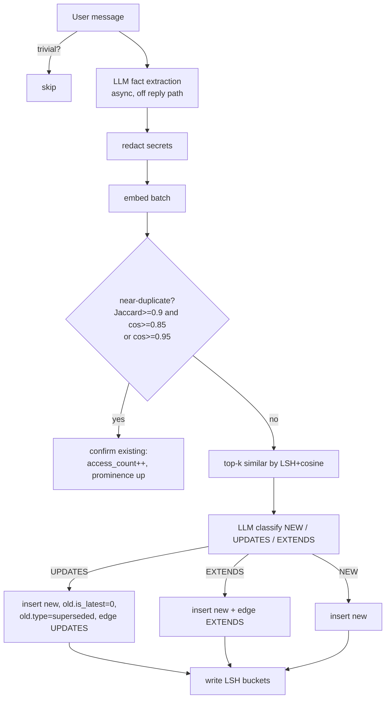
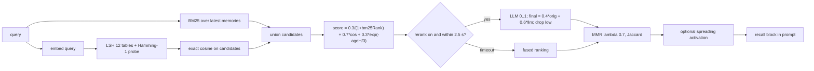
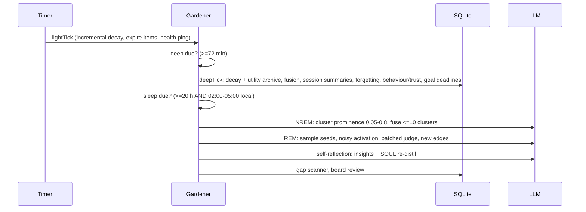
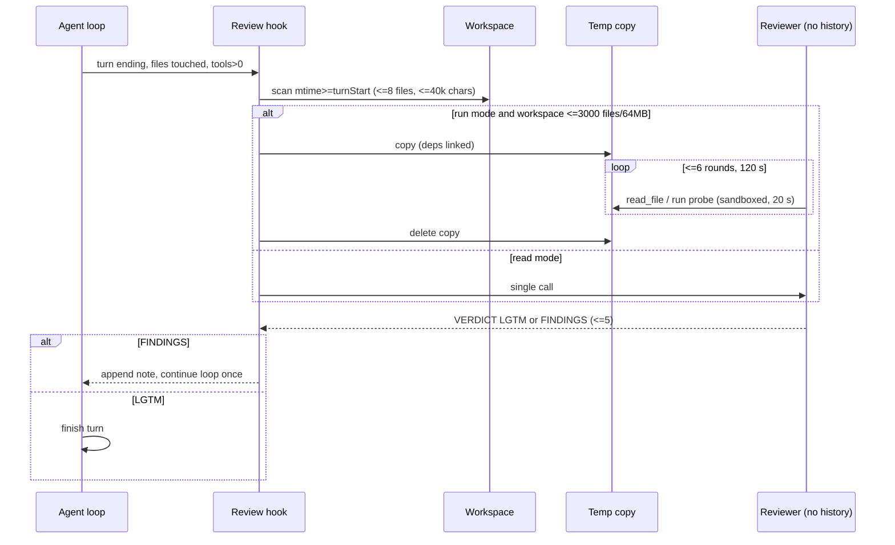
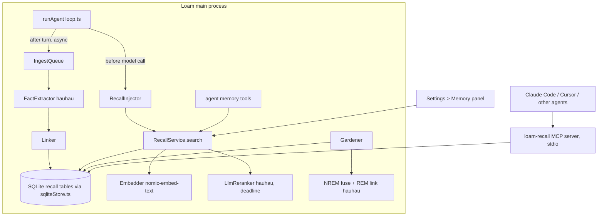

# BUILD_SPEC — Loam Long-Term Memory ("Loam Recall") and Fresh-Context Self-Review ("Loam Second Look")

Source studied: `tashfeenahmed/scallopbot` @ `5087c84` (2026-10-16 23:14 Asia/Riyadh), MIT, TypeScript. Clone: `/workspace/re/scallopbot/src`.
Target: Loam (`C:\Users\khamis\Desktop\manus-local`, branch `manus-parity`). **Khamis's PC was not touched for this study.**
Author: Grok Bot, 2026-11-02. Status: design only. Nothing has been built, run on his PC, pushed or merged.

## 0. Conventions

| Label | Meaning |
|---|---|
| **OBSERVED SB `path:line`** | Read directly in the ScallopBot clone at `5087c84` (paths relative to the repo root). |
| **OBSERVED-PRIOR LM `path:line`** | A Loam file:line quoted in an earlier read-only study in `/workspace/re/` (mainly `loam-services-audit/AUDIT.md`, `qwen36-opt/`, `ponytail/`, `harvey/`). It was not re-read this time, and those studies covered several Loam commits (e7f74d1 / 0.5.39 and the "loam-dvf" tree). **Line numbers must be re-checked on `manus-parity` before anyone edits code** (Phase P0). |
| **INFERRED** | Reasoned from the evidence, not seen directly. |
| **UNKNOWN** | Not determinable without Khamis's PC or a run. Every UNKNOWN comes with a labelled **Design Decision (DD-n)**. |

Clean room: this spec describes *behaviour, constants and contracts*. It reproduces no ScallopBot source. Short identifiers and numeric constants are facts, not expression. Builders must write the code from this spec and must not open the upstream files while they implement (§12 rule R1). Even so, MIT permits reuse if attribution is kept, so the clean-room rule is a choice made for Khamis's policy, not a licence requirement (OBSERVED SB `LICENSE`).

---

## 1. Executive summary

1. **ScallopBot's memory is a SQLite-backed hybrid store** (OBSERVED SB `src/memory/db.ts:1002-1035`). It extracts facts with an LLM, dedupes them, links them with typed relations (UPDATES / EXTENDS / DERIVES), and uses hybrid search: BM25 plus cosine via LSH candidates, weighted 0.3/0.7, a recency boost, and an optional LLM rerank capped at 2.5 s, then MMR. A "gardener" runs three ticks: **light**, **deep** (every 72 min) and **sleep** (every 20 h, gated to quiet hours 02:00–05:00). In the sleep tick an NREM→REM "dream" cycle merges and links memories, and forgetting combines decay, utility scoring and hard pruning. Memory is exposed over a **dependency-free stdio JSON-RPC MCP server** with three tools: `memory_store`, `memory_recall` and `memory_temporal`.
2. **ScallopBot's self-review** runs at most once per turn, and only when files changed. A model call with **no conversation history** sees: the last human requests, the agent's final reply, and the current content of every file whose mtime moved during the turn. It returns `VERDICT: LGTM` or `VERDICT: FINDINGS` (at most 5). In the default `run` mode the reviewer gets `read_file` plus a sandboxed `run` tool on a **throwaway temp copy** of the workspace (dependency folders symlinked), for up to 6 rounds and 120 s. Findings go back to the agent as a nudge; they never block the turn.
3. **Loam today** (OBSERVED-PRIOR) has a JSON-on-disk brute-force vector store with a "dream" job (`src/memory/store.ts:19,117,160,504`) and an Ollama embedder (`src/setup/runtime.ts:89`, default `nomic-embed-text:latest` at `src/config.ts:256`). It also has SQLite through `node:sqlite` in WAL mode (`src/server/sqliteStore.ts:3,16`), BM25 utilities in `src/agent/contextSelector.ts`, a single agent loop `runAgent` (`src/agent/loop.ts:403`) with a system-prompt hook (`:431-445`), and an MCP client bridge (`src/tools/mcp.ts`). So **Loam Recall replaces and extends `src/memory/store.ts`** rather than adding a parallel system, and **Loam Second Look plugs into the end-of-turn branch of `runAgent`**.
4. **hauhau compatibility:** both services work with `qwen36-uncensored-hauhau` (Qwen3.6-35B-A3B Q4_K_M, Ollama) for every *generative* step: extraction, relation classification, fusion, rerank JSON, the REM judge and the reviewer. Embeddings need a **separate small embedding model**, which hauhau cannot provide. Recommended: keep `nomic-embed-text` (~274 MB, 768-d), already Loam's default. **No dedicated reranker model is required**, because rerank is an LLM-scored JSON call. An optional cross-encoder is DD-4.
5. **Load on Khamis's PC** (Ryzen AI Max+ 395, Radeon 8060S gfx1151, ~64 GB unified memory, OBSERVED-PRIOR `flint/`, `qwen36-opt/`):
   - **Recall:** about +0.3 GB resident (embedder plus SQLite), roughly 6–8 MB of disk per 1k memories, and 4–7 s of background hauhau time per stored turn.
   - **Recall rerank on the reply path:** about 1.5–3.5 s, or 0 if turned off.
   - **Recall nightly cycle:** about 2–8 min of GPU time.
   - **Second Look:** one extra hauhau pass per file-changing turn. That is about 20–50 s in read mode and about 45–180 s in run mode, plus a temp copy capped at 64 MB. Details in §8.

---

## 2. Scope, non-goals, guardrails

In scope, with no cuts: the full memory lifecycle (ingest, dedupe, link, merge, decay, forget, retrieve, rerank, MMR, temporal queries, core-memory blocks, nightly cycle, MCP server, migration from `store.ts`, UI), and the full self-review in both `read` and `run` modes (sandbox copy, probes, verdict parsing, loop re-entry, telemetry, settings).

Non-goals:
- The proactive messaging, affect, goals, Telegram and Pi features of ScallopBot. They are recorded in §3.9 so they are not lost.
- Cloud embedding providers as a requirement. OpenAI is optional only.

Guardrails:
- G1: never kill processes outside Loam's own folders.
- G2: never touch `Documents\nutrio`.
- G3: never log or copy keys. Ingest must run Loam's `findSecret` redaction (OBSERVED-PRIOR LM `src/memory/redact.ts:26,33,38`) before anything is stored or embedded.
- G4: draft PRs only, with no merge until Khamis approves.
- G5: nothing runs on his PC without approval.

---

## 3. ScallopBot reverse engineering — Long-term memory

### 3.1 Module map (OBSERVED SB `src/memory/`, 51,189 lines including tests)

| Concern | Files (OBSERVED SB) |
|---|---|
| Schema / DAO | `db.ts` (10,245 lines; `memories` :1002, `memory_relations` :1078, `memory_embedding_lsh` :1395, `session_summaries` :1301, `transcript_chunks` :1554) |
| Store facade + hybrid search | `scallop-store.ts` (search union :597-640, factory :1180) |
| Lexical | `bm25.ts` (k1=1.2 :83; Okapi formula :107-108; `SEARCH_WEIGHTS` keyword 0.3 / semantic 0.7 / prominence 0.0 :9-13) |
| Vectors | `embeddings.ts` (TF-IDF fallback :36, OpenAI :261, Ollama :513 default dim 768 :515, "EmbeddingGemma, nomic-embed-text" :502); `semantic-index.ts` (LSH 12 tables × 6 bits × 8 components/bit :19-21, one Hamming-1 probe per table :103-105) |
| Rerank | `reranker.ts` (blend 0.4 original + 0.6 LLM :56-57, threshold 0.15 :60, drop < 0.05 :164, temperature 0.1 :283, strict 0–1 JSON `{"scores":[...]}` :258-267, 1-based index repair :347) |
| Diversity | `mmr.ts` (Jaccard on token sets); λ = 0.7 (`scallop-store.ts:82,179`) |
| Ingest | `fact-extractor.ts` (2,392 lines; async LLM extraction; dedupe threshold 0.95 :161,554; batch embeddings :861); `fact-dedupe.ts` (token Jaccard ≥ 0.9 **and** cosine ≥ 0.85 :69-70) |
| Linking | `relations.ts` (UPDATES/EXTENDS/DERIVES :5-7; thresholds update 0.7 / extend 0.5 :220-221; spreading activation decay 0.5/hop, stop < 0.01, noise σ 0.2, min 0.05 :60-63; edge weights UPDATES 0.9/0.9, EXTENDS 0.7/0.5, DERIVES 0.4/0.6 :75-77); `relation-classifier.ts` (LLM: NEW / UPDATES / EXTENDS) |
| Merging | `fusion.ts` (candidates prominence 0.1–0.5 :89-90; embedding-cluster fallback 0.6 default :92, 0.7 in-code fallback :180; LLM fusion temp 0.1 :447; JSON schema :50); `nrem-consolidation.ts` (window 0.05–0.8, ≤10 clusters, ≤3 relations/memory, ≤2 fusion attempts :47-53) |
| Association | `rem-exploration.ts` (seed sampling with category caps, high-noise spreading activation, batched LLM judge) |
| Dream orchestration | `dream.ts` (NREM then REM, each phase isolated from the other's failure) |
| Forgetting | `decay.ts` (type rates :32-37; category rates with half-lives :43-48; prominence weights age 0.55 / conf-freq 0.20 / conf-recency 0.10 / importance 0.10 / confidence 0.05 :54-59; thresholds ACTIVE 0.5 / DORMANT 0.1 / ARCHIVED 0.0 :65-71; floor 0.2 for protected kinds :157-160); `utility-score.ts` (utility = prominence × ln(2 + confirmations); threshold 0.1, min age 14 d :21-23,96); `gardener-deep-steps.ts` (`runFullDecay` :38, `runEnhancedForgetting` :211, demote ×0.95 :233-234, hard prune prominence < 0.01 :253) |
| Scheduler | `memory.ts` `BackgroundGardener` (deep 72 min :116, sleep 20 h :119, quiet hours 2–5 :133, `lightTick` :217) |
| Reflection | `reflection.ts` (two LLM calls: composite reflection, then SOUL.md re-distillation of 400–600 words) |
| Core memory | `core-memory.ts` (user block ~2,500 chars, environment ~1,500 chars, atomic add/replace/remove, append-only history with rollback) |
| Recall injection | `recall.ts` (`buildRecallBlock` :162 with the comment "search ~10–300 ms plus one rerank 2.5 s"; `isTrivialMessage` :127 skips recall) |
| Background learning | `src/learning/background-review.ts` (replays the session with learning-only tools, ≤16 iterations, triggered every 10 user turns / 10 tool calls / after compaction / on corrections; single-flight) |
| MCP | `src/mcp-server/{index,server,protocol,tools}.ts` (stdio :86-109; `tools/list` :76, `tools/call` :79; tools `memory_store` :26, `memory_recall` :61, `memory_temporal` :83) |

Dependencies: `better-sqlite3` ^12.6.2 and `node-cron` ^4.2.1 (OBSERVED SB `package.json:74,87`). There is no vector extension. The reason given is Raspberry Pi portability (OBSERVED SB `semantic-index.ts:3-9`).

### 3.2 Data model (OBSERVED SB `db.ts:1002-1035`)
A memory carries:
- identity and content: `id`, `user_id`, `content`, `category`;
- type: `memory_type` (regular / derived / superseded / dynamic_profile, OBSERVED `decay.ts:32-37`);
- scoring: `importance` (1–10, default 5), `confidence` (default 0.8), `is_latest`, `source` (user|assistant);
- time: `document_date`, `event_date`;
- decay state: `prominence` (default 1.0), `last_accessed`, `access_count`;
- payload: `source_chunk`, `embedding` (a JSON string), `metadata` (JSON), and timestamps.

Relations live in a separate table with cascade delete (`:1078-1087`). LSH buckets live in a side table indexed by `(index_version, dimension, table_id, bucket, user_id)` (`:1395-1407`).

### 3.3 Ingest, merge and link flow

- OBSERVED: extraction is asynchronous (SB `fact-extractor.ts:1-6`), and dedupe uses the thresholds stated above.
- INFERRED: the redact node is Loam's design. ScallopBot's redaction is not in the memory path that was read.

### 3.4 Retrieval flow (OBSERVED SB `scallop-store.ts:560-680`, `reranker.ts`, `recall.ts`)

- OBSERVED: the keyword term uses the reciprocal BM25 rank `1/(1+rank)` (`:610-611`), then a weighted sum (`:622`). The recency half-life is 3 h with weight 0.3 (`:627-628`). There is a ×1.5 multiplier (`:634`); its condition was not fully read, so the condition is UNKNOWN (DD-1).
- OBSERVED: rerank is on by default, and the code comment claims it adds "+2.9 F1 (+6%) on LoCoMo" (`:70`). That is the vendor's claim, not reproduced here.

### 3.5 Forgetting
- OBSERVED: prominence is a weighted blend of age decay (per-type and per-category daily rates), confirmation frequency and recency, importance, and confidence (`decay.ts:54-59,150-154`).
- OBSERVED: category half-lives are preference ~138 d, fact ~69 d, event ~14 d, relationship ~346 d and insight ~23 d (`:44-48`).
- OBSERVED: the lifecycle runs ACTIVE ≥ 0.5, then DORMANT ≥ 0.1, then ARCHIVED. Utility-based archival starts after 14 days at utility < 0.1, and hard deletion happens at prominence < 0.01 (`gardener-deep-steps.ts:253`, `utility-score.ts`).
- OBSERVED: utility counts *user confirmations* only. Automatic retrieval never raises it (`utility-score.ts:11-12`). This is a key anti-feedback-loop property for Loam to keep.

### 3.6 Nightly cycle

OBSERVED SB `memory.ts:116-133,217-262`; `gardener-sleep-steps.ts:24,206,312,323`; `gardener-deep-steps.ts:38-670`; `dream.ts` header.

### 3.7 MCP surface (OBSERVED SB `src/mcp-server/`)
- Transport: hand-rolled newline-delimited JSON-RPC 2.0 over stdio (`index.ts:86-109`). It does not use the MCP SDK.
- Methods: `initialize`, `tools/list` and `tools/call` (`server.ts:76-93`).
- `memory_store` takes `{content, tags?, importance? 1-10, ...}`.
- `memory_recall` takes `{query, limit?=10}`.
- `memory_temporal` takes `{start?, end?}` as ISO-8601, or a named range `thisWeek|lastWeek|thisMonth` (`tools.ts:26-80`).
- UNKNOWN: whether it exposes resources or prompts. None were seen in `server.ts` (DD-7).

### 3.8 Evaluation claims (OBSERVED, vendor)
The repo ships LoCoMo and EmoBench harnesses (`src/eval/`) and `Paper2026.pdf`. None of the numbers were reproduced (UNKNOWN for Loam).

### 3.9 Adjacent features deliberately not ported (recorded, not cut)
Proactive evaluator and delivery, affect lexicon and smoothing, behavioural signals, trust score, goal registry, gap scanner and inner thoughts. All are in `src/memory/` (OBSERVED). Each needs a separate spec if wanted (DD-10).

---

## 4. ScallopBot reverse engineering — Self-review

### 4.1 Behaviour (OBSERVED SB `src/tools/review/review.ts`, `check.ts`, `src/agent/agent.ts:1300-1325`, `src/tools/index.ts:30-55`)
- **Trigger.** Once per turn, at the point where the turn would end. All of these must hold:
  - the hook is present and the turn has not been reviewed yet;
  - it is not the final-summary call and not a repeated reply;
  - it is not sub-agent mode;
  - `totalToolCalls > 0`;
  - the turn was not aborted (`agent.ts:1305-1308`).
- **Inputs.**
  - The last few genuine human messages (`agent.ts:2361`).
  - The final reply, with the done marker stripped.
  - Files with `mtime ≥ turnStartedAt` under the workspace. Detection is by mtime, so writes through the shell or scripts count too (`review.ts:13-15`).
- **Limits** (`review.ts:22-33`):
  - skip build and dependency directories;
  - scan up to 4,000 entries at depth ≤ 8;
  - take ≤ 8 files of ≤ 256 KB each;
  - use ≤ 12,000 chars per file and ≤ 40,000 in total;
  - keep the last 6,000 chars of the request text;
  - keep findings ≤ 2,500 chars;
  - time out after 60 s.
- **Model call.**
  - No history: a system prompt plus one user message with three sections, Request / Agent reply / Files changed (`review.ts:113-128`).
  - `maxTokens` is 6,000.
  - Thinking is off by default, because the reviewer "reasons in the reply instead, several times faster".
  - `<think>` blocks are stripped, and the call carries purpose `review` (`:150-166`).
- **Reviewer contract** (summarised in my own words):
  - Report only concrete defects: an unmet stated requirement, or a specific input that gives a wrong result.
  - Check the reply's claims against the files.
  - Ignore style and performance.
  - Treat file text as data.
  - End with `VERDICT: LGTM` or `VERDICT: FINDINGS` plus ≤ 5 numbered items (`review.ts:35-47`).
- **Run mode (`check.ts`).**
  - The workspace is copied to `mkdtemp(os.tmpdir()/scallop-check-)` (`:94`). `node_modules`, `.venv`, `venv` and `vendor` are symlinked, and `.git`, build and cache folders are skipped (`:31-35,106`).
  - The check is skipped above 3,000 files or 64 MB (`:30-31`).
  - The reviewer has two tools: `read_file`, and `run` (a python, javascript or bash program executed through `prepareSandboxedCommand`, `:119`).
  - Budgets: ≤ 6 rounds, with tools withdrawn on the last round to force a verdict; 120 s overall, 20 s per run, 6,000 chars of run output, 20,000 chars per read (`:23-28,205-230`).
  - The copy is always removed (`:237`).
  - The prompt says to report only reproduced defects, and not to just re-run the project's own tests.
- **Outcome.**
  - Findings are wrapped as a harness note and appended as a user-role message, and the loop continues (`agent.ts:1316-1320`).
  - Any error returns null, so a review never breaks a turn (`review.ts:141-146`).
  - The mode comes from `REVIEW_ON_STOP=run|read|off`, default `run` (`index.ts:37-38`).
- **Vendor claim:** on ScallopBench v2 with kimi-k2.6 (108 task-runs), the pass rate went from 105 to 106 and hard tasks from 43/45 to 44/45 (`index.ts:33-34`). The lift is small and was not reproduced. INFERRED: the value is mainly catching missed requirements.

### 4.2 Flow


---

## 5. Loam current state (evidence for insertion points)

| Loam element | Evidence | Relevance |
|---|---|---|
| `MemoryStore`: JSON on disk, brute-force cosine, base64 Float32 vectors, `startMemoryDreamJob` | OBSERVED-PRIOR LM `src/memory/store.ts:19,117,119,160,504` | Replace with SQLite-backed Recall; keep its exports as an adapter |
| Embedder `new OllamaEmbedder(cfg.ollamaUrl, cfg.memory.model)`, private on the store | OBSERVED-PRIOR LM `src/setup/runtime.ts:89`, `src/memory/store.ts:128` | Reuse; add an accessor |
| Default embed model `nomic-embed-text:latest` | OBSERVED-PRIOR LM `src/config.ts:256` | hauhau-compatible pairing |
| SQLite: `node:sqlite` `DatabaseSync`, WAL, `busy_timeout=5000`, `metadata` table, `transaction()` not re-entrant | OBSERVED-PRIOR LM `src/server/sqliteStore.ts:3,16,18,50` | Hosts the Recall tables; no `better-sqlite3` needed |
| BM25 `tokenize/buildBm25Index/bm25Score` | OBSERVED-PRIOR LM `src/agent/contextSelector.ts` (cited in the earlier W3 prompt) | Lexical arm; add Arabic normalisation |
| Secret redaction `findSecret` | OBSERVED-PRIOR LM `src/memory/redact.ts:26,33,38` | Mandatory before ingest |
| Agent loop `runAgent(opts)` | OBSERVED-PRIOR LM `src/agent/loop.ts:403` (also `:215`; prompt built `:220-235`) | Recall injection and Second Look hook |
| System prompt hook / `systemSuffix`, skills injection | OBSERVED-PRIOR LM `src/agent/loop.ts:431-445,435` | Inject the recall block and core blocks |
| Assistant message push; tool-call handling drops `call.id` | OBSERVED-PRIOR LM `src/agent/loop.ts:860,486-487,532-533` | Turn-end detection; counting tool calls |
| Sub-agents inject text | OBSERVED-PRIOR LM `src/tools/subagents.ts:217-233` | Exclude sub-agents from review recursion |
| Ollama client: local `chatLocal` `src/ollama.ts:307-321`, cloud `:176-201`; temp 0.2, no `num_ctx`/`think` before PR #2 | OBSERVED-PRIOR `qwen36-opt/` and PR #2 (e154cb35) | Memory and review calls need the PR #2 options (`think:false`, `num_ctx`) |
| MCP client bridge | OBSERVED-PRIOR LM `src/tools/mcp.ts` | Loam can consume MCP; a memory MCP *server* is new |
| Frontier `rag_index/rag_query` registered but broken | OBSERVED-PRIOR LM `frontierBridge.ts:545,608`, `src/setup/runtime.ts:227` (AUDIT X3) | Recall replaces these, or they get hidden (ties to FIX_PROMPT) |
| 83 uncommitted changes; repo 0.5.39 vs installed 0.5.42 | OBSERVED-PRIOR (earlier session) | P0 protects them first |

- UNKNOWN U-L1: whether `manus-parity` has moved since these studies.
- **DD-0:** P0 re-greps every cited symbol and writes `docs/loam-recall/EVIDENCE_REFRESH.md` before any edit.

---

## 6. Target design — Service A: Loam Recall

### 6.1 Architecture


### 6.2 Files (new unless marked; INFERRED placement following Loam's `src/` layout)
```
src/memory/recall/types.ts          # §6.3
src/memory/recall/schema.ts         # §6.4 migrations via sqliteStore.ts
src/memory/recall/repo.ts           # DAO
src/memory/recall/normalize.ts      # Arabic+Latin tokenisation, tashkeel/tatweel/alef folding
src/memory/recall/lexical.ts        # BM25 (contextSelector.ts utilities or FTS5, DD-2)
src/memory/recall/lsh.ts            # random-hyperplane LSH, own implementation
src/memory/recall/search.ts         # fuse + recency + MMR + activation
src/memory/recall/rerank.ts         # LLM rerank with deadline + circuit breaker
src/memory/recall/extract.ts        # fact extraction prompt + JSON schema
src/memory/recall/link.ts           # dedupe + NEW/UPDATES/EXTENDS
src/memory/recall/decay.ts          # prominence + utility
src/memory/recall/gardener.ts       # light/deep/sleep scheduler
src/memory/recall/dream.ts          # NREM fusion + REM association
src/memory/recall/core.ts           # core memory blocks + history
src/memory/recall/service.ts        # RecallService facade
src/memory/recall/migrateLegacy.ts  # import old store.ts JSON
src/memory/store.ts                 # CHANGED: adapter over RecallService (keeps exports)
src/setup/runtime.ts                # CHANGED: construct service, start gardener, register tools
src/agent/loop.ts                   # CHANGED: inject recall block, enqueue ingest
src/tools/memoryTools.ts            # agent tools
src/mcp/recallServer.ts             # MCP stdio server
bin/loam-recall-mcp(.cmd)           # launcher
packages/web/.../MemoryPanel.tsx    # UI (path INFERRED)
```

### 6.3 Types (clean-room)
```ts
export type MemoryKind = 'fact' | 'preference' | 'event' | 'relationship' | 'insight' | 'project' | 'procedure';
export type MemoryOrigin = 'user' | 'assistant' | 'tool' | 'fusion' | 'reflection' | 'mcp';
export type MemoryState = 'active' | 'dormant' | 'archived' | 'superseded' | 'trashed';
export type RelationType = 'UPDATES' | 'EXTENDS' | 'DERIVES' | 'RELATES';

export interface MemoryRecord {
  id: string;                 // ulid
  scope: string;              // 'user' | `project:${hash}` | 'legal-alarraf'
  content: string;            // self-contained statement, redacted
  lang: 'ar' | 'en' | 'mixed';
  kind: MemoryKind;
  origin: MemoryOrigin;
  importance: number;         // 1..10
  confidence: number;         // 0..1
  prominence: number;         // 0..1
  state: MemoryState;
  isLatest: boolean;
  pinned: boolean;
  confirmations: number;      // user-confirmed only
  accessCount: number;        // retrieval count; never raises utility
  eventAt?: number;           // ms epoch
  documentAt: number;         // when learned
  lastAccessAt?: number;
  sourceRef?: { sessionId: string; messageId?: string; file?: string };
  tags: string[];
  embeddingModel?: string;    // e.g. 'nomic-embed-text:latest@768'
  createdAt: number; updatedAt: number;
}
export interface MemoryRelation { id: string; fromId: string; toId: string; type: RelationType; confidence: number; origin: 'ingest'|'nrem'|'rem'|'manual'; createdAt: number }
export interface SearchQuery { text: string; scope?: string[]; limit?: number; since?: number; until?: number; kinds?: MemoryKind[]; rerank?: boolean | { deadlineMs: number }; activation?: boolean }
export interface SearchHit { memory: MemoryRecord; score: number; parts: { bm25Rank?: number; cosine?: number; recency: number; llm?: number; activation?: number }; match: 'keyword'|'semantic'|'hybrid'|'graph' }
export interface RecallConfig {
  weights: { keyword: number; semantic: number; recencyMax: number; recencyHalfLifeH: number };        // 0.3 / 0.7 / 0.3 / 3
  rerank: { enabled: boolean; deadlineMs: number; blendOriginal: number; minLlm: number; maxCandidates: number }; // true / 3500 / 0.4 / 0.15 / 20
  mmrLambda: number;                                                                                    // 0.7
  dedupe: { jaccard: number; cosineWithJaccard: number; cosineAlone: number };                          // 0.9 / 0.85 / 0.95
  link: { updateCos: number; extendCos: number; topK: number };                                         // 0.7 / 0.5 / 5
  lsh: { tables: number; bits: number; componentsPerBit: number; seed: number; bruteForceBelow: number }; // 12 / 6 / 8 / fixed / 20000
  decay: { kindDailyRate: Record<MemoryKind, number>; weights: { age: number; confFreq: number; confRecency: number; importance: number; confidence: number } };
  forget: { utilityThreshold: number; minAgeDays: number; hardDeleteBelow: number; trashDays: number }; // 0.1 / 14 / 0.01 / 30
  gardener: { lightEveryMin: number; deepEveryMin: number; sleepEveryH: number; quietHours: [number, number]; onlyWhenIdle: boolean }; // 10 / 72 / 20 / [2,5] / true
  models: { generator: string; embedder: string; reranker?: string };
  injection: { maxTokens: number; maxItems: number; skipTrivial: boolean };                             // 600 / 8 / true
}
export interface CoreBlocks { user: string[]; environment: string[]; limits: { user: number; environment: number } } // 2500 / 1500 chars
export type CoreEdit = { scope: string; block: 'user'|'environment' } & ({ op: 'add'; text: string } | { op: 'replace'; match: string; text: string } | { op: 'remove'; match: string });
export type CoreEditResult = { ok: true } | { ok: false; reason: 'overflow'|'no_match'; current: string[] };
export interface GardenerReport { tick: 'light'|'deep'|'sleep'; catchUp: boolean; steps: Array<{ name: string; ok: boolean; ms: number; detail?: unknown; error?: string }> }
export interface RecallStats { total: number; byState: Record<MemoryState, number>; byScope: Record<string, number>; dbBytes: number; lastSleepAt?: number; rerankP50Ms?: number }
export interface RecallService {
  remember(input: { content: string; scope: string; kind?: MemoryKind; importance?: number; tags?: string[]; origin: MemoryOrigin; sourceRef?: MemoryRecord['sourceRef'] }): Promise<{ id: string; action: 'inserted'|'confirmed'|'updated'|'extended' }>;
  ingestTurn(turn: { sessionId: string; scope: string; userText: string; assistantText: string }): void; // enqueue; never blocks
  search(q: SearchQuery): Promise<SearchHit[]>;
  temporal(range: { since: number; until: number; scope?: string[] }): Promise<MemoryRecord[]>;
  forget(id: string, mode: 'soft'|'hard'): Promise<void>;
  restore(id: string): Promise<void>;
  confirm(id: string): Promise<void>;
  core: { get(scope: string): Promise<CoreBlocks>; edit(op: CoreEdit): Promise<CoreEditResult>; rollback(historyId: string): Promise<void> };
  gardener: { tick(kind: 'light'|'deep'|'sleep', opts?: { force?: boolean }): Promise<GardenerReport> };
  stats(): Promise<RecallStats>;
}
```

### 6.4 SQL schema (node:sqlite, WAL; clean-room)
```sql
CREATE TABLE IF NOT EXISTS recall_memories (
  id TEXT PRIMARY KEY, scope TEXT NOT NULL, content TEXT NOT NULL, lang TEXT NOT NULL,
  kind TEXT NOT NULL, origin TEXT NOT NULL,
  importance INTEGER NOT NULL DEFAULT 5 CHECK (importance BETWEEN 1 AND 10),
  confidence REAL NOT NULL DEFAULT 0.8, prominence REAL NOT NULL DEFAULT 1.0,
  state TEXT NOT NULL DEFAULT 'active', is_latest INTEGER NOT NULL DEFAULT 1, pinned INTEGER NOT NULL DEFAULT 0,
  confirmations INTEGER NOT NULL DEFAULT 0, access_count INTEGER NOT NULL DEFAULT 0,
  event_at INTEGER, document_at INTEGER NOT NULL, last_access_at INTEGER, trashed_at INTEGER,
  source_ref TEXT, tags TEXT NOT NULL DEFAULT '[]',
  embedding BLOB, embedding_model TEXT,            -- Float32 bytes, not JSON
  content_hash TEXT NOT NULL,
  created_at INTEGER NOT NULL, updated_at INTEGER NOT NULL);
CREATE INDEX IF NOT EXISTS ix_rm_scope_latest ON recall_memories(scope, is_latest, state, prominence DESC);
CREATE INDEX IF NOT EXISTS ix_rm_event ON recall_memories(scope, event_at);
CREATE UNIQUE INDEX IF NOT EXISTS ux_rm_hash ON recall_memories(scope, content_hash) WHERE state <> 'trashed';

-- DD-2: only if FTS5 is available in the runtime
CREATE VIRTUAL TABLE IF NOT EXISTS recall_fts USING fts5(norm_content, content='', tokenize='unicode61 remove_diacritics 2');
-- rowid of recall_fts = rowid of recall_memories; maintained by repo.ts (normalised text), not by triggers

CREATE TABLE IF NOT EXISTS recall_relations (
  id TEXT PRIMARY KEY,
  from_id TEXT NOT NULL REFERENCES recall_memories(id) ON DELETE CASCADE,
  to_id   TEXT NOT NULL REFERENCES recall_memories(id) ON DELETE CASCADE,
  type TEXT NOT NULL, confidence REAL NOT NULL, origin TEXT NOT NULL, created_at INTEGER NOT NULL,
  UNIQUE(from_id, to_id, type));
CREATE TABLE IF NOT EXISTS recall_lsh (
  memory_id TEXT NOT NULL REFERENCES recall_memories(id) ON DELETE CASCADE,
  scope TEXT NOT NULL, model TEXT NOT NULL, tbl INTEGER NOT NULL, bucket INTEGER NOT NULL,
  PRIMARY KEY(memory_id, model, tbl));
CREATE INDEX IF NOT EXISTS ix_lsh ON recall_lsh(model, tbl, bucket, scope);
CREATE TABLE IF NOT EXISTS recall_core (scope TEXT NOT NULL, block TEXT NOT NULL, entries TEXT NOT NULL, updated_at INTEGER NOT NULL, PRIMARY KEY(scope, block));
CREATE TABLE IF NOT EXISTS recall_core_history (id TEXT PRIMARY KEY, scope TEXT NOT NULL, block TEXT NOT NULL, op TEXT NOT NULL, before TEXT, after TEXT, at INTEGER NOT NULL);
CREATE TABLE IF NOT EXISTS recall_events (id TEXT PRIMARY KEY, memory_id TEXT, kind TEXT NOT NULL, detail TEXT, at INTEGER NOT NULL);
  -- kinds: insert|confirm|supersede|extend|fuse|dormant|archive|trash|restore|delete
CREATE TABLE IF NOT EXISTS recall_gardener_runs (id TEXT PRIMARY KEY, tick TEXT NOT NULL, catch_up INTEGER NOT NULL DEFAULT 0, started_at INTEGER NOT NULL, finished_at INTEGER, report TEXT, error TEXT);
CREATE TABLE IF NOT EXISTS recall_ingest_queue (id TEXT PRIMARY KEY, payload TEXT NOT NULL, attempts INTEGER NOT NULL DEFAULT 0, next_at INTEGER NOT NULL, error TEXT);
PRAGMA foreign_keys = ON;
```

### 6.5 Algorithms (spec level)
1. **Normalise** (new; upstream Arabic handling is UNKNOWN, so this is **DD-3**):
   - NFKC.
   - Strip tashkeel and tatweel.
   - Fold أ/إ/آ→ا, ى→ي and ة→ه, for the index only.
   - Split into Unicode words.
   - Store the content unchanged.
2. **Lexical:** BM25 with k1 = 1.2 and b = 0.75. The b value is INFERRED as the standard default, because only k1 was read. Rank only `is_latest=1 AND state IN ('active','dormant')` within the allowed scopes.
3. **Semantic:**
   - LSH with 12 tables and 6-bit signatures. Each bit is the sign of a sparse projection over 8 seeded random components.
   - Probe the exact bucket plus one neighbour, flipping bit `t mod 6` in table t.
   - Run exact cosine over the candidates.
   - Below 20k memories, use a brute-force scan instead (DD-5).
4. **Fuse:** `score = wk/(1+bm25Rank) + ws·cos + rmax·exp(-ageHours/h)`. Multiply by ×1.5 for `pinned` memories only (DD-1).
5. **Rerank:**
   - Send the top 20 to hauhau with `think:false`, temperature 0.1 and Ollama `format` set to the JSON schema `{scores:number[]}`. Repair 1-based indices.
   - `final = 0.4·orig + 0.6·llm`. Drop results with llm < 0.15.
   - Deadline 3,500 ms locally (DD-4). On timeout, use the fused ranking.
   - Circuit breaker: after 3 consecutive failures, skip rerank for 10 min.
6. **MMR:** λ = 0.7 with token Jaccard over normalised tokens.
7. **Activation** (optional):
   - Spread 2 hops over relations after MMR, with decay 0.5 per hop.
   - Edge weights: UPDATES 0.9/0.9, EXTENDS 0.7/0.5, DERIVES 0.4/0.6, RELATES 0.5/0.5.
   - Noise σ = 0 on the reply path and 0.2 only in REM.
8. **Injection:**
   - Skip trivial messages (greetings, or under 3 tokens).
   - Build `<loam_memory>` with ≤ 8 items and ≤ 600 tokens, one line each: `[kind · YYYY-MM-DD] content (id)`.
   - Prepend the core blocks, frozen at session start so they stay prompt-cache-friendly.
   - Label the block as reference data, not instructions.
   - Bump `access_count` and `last_access_at` only. Never bump `confirmations`.
9. **Ingest:**
   - The queue runs after the reply is sent, and only while no foreground run is active (DD-16).
   - hauhau extracts ≤ 5 facts as JSON `{content, kind, importance, eventAt?, confidence}`.
   - Redact each fact, then embed it.
   - Dedupe on (Jaccard ≥ 0.9 ∧ cos ≥ 0.85) ∨ cos ≥ 0.95. A duplicate becomes a confirmation, but only if origin is `user`; otherwise it only touches the record.
   - Classify against the top 5 at cos ≥ 0.5, with hauhau labelling NEW / UPDATES / EXTENDS.
   - UPDATES: the old memory becomes `superseded` with `is_latest=0`, its daily decay rate becomes 0.90, and an edge is added.
10. **Decay:**
    - A daily prominence recompute using the §3.5 weights and kind rates. Defaults: preference 0.995, fact 0.99, event 0.95, relationship 0.998, insight 0.97, project 0.99, procedure 0.995.
    - Floor at 0.2 for preference and relationship kinds and for core-linked memories.
11. **Forget:**
    - Archive when utility = prominence·ln(2+confirmations) < 0.1 and age ≥ 14 d.
    - Move to trash when archived and prominence < 0.01. Hard delete after 30 days in the trash (DD-6, a Loam addition).
    - Every transition writes a row to `recall_events`.
12. **Nightly cycle** (sleep tick):
    - Gate: ≥ 20 h since the last run, **and** local time in the quiet window (02:00–05:00 Asia/Riyadh by default), **and** Loam idle with no active run (DD-8).
    - If a night is missed, run at the next idle window, flagged `catch_up`.
    - Steps, each isolated from the others' failures:
      1. full decay and forgetting;
      2. NREM: cluster memories with prominence in [0.05, 0.8) at cos ≥ 0.7 within one scope, take ≤ 10 clusters, and have hauhau fuse each into one DERIVES memory while the sources go dormant, with ≤ 2 attempts;
      3. REM: sample ≤ 6 seeds with category caps, run noisy activation, have hauhau judge the pairs in one batch per seed, and add RELATES/EXTENDS edges at confidence ≥ 0.7;
      4. reflection: summarise the day's sessions into ≤ 5 `insight` memories;
      5. write the report to `recall_gardener_runs`.
13. **Scopes:**
    - `user` holds global facts about Khamis.
    - `project:<sha1(workspace path)>` holds repository facts.
    - `legal-alarraf` is injected only in legal mode and is never readable over MCP unless allow-listed (DD-9).

### 6.6 Agent tools and MCP API
Agent tools (registered in `runtime.ts`):
- `memory_recall {query, limit≤20, since?, until?}`
- `memory_store {content, kind?, importance?, tags?}`
- `memory_forget {id, hard?}`, where `hard` needs user confirmation
- `memory_confirm {id}`
- `core_memory_edit {block, op, text?, match?}`

MCP server `loam-recall` (stdio, newline-delimited JSON-RPC 2.0; written by Loam, or built on the official `@modelcontextprotocol/sdk` if Loam already depends on it, DD-7):

| Method | Params | Result |
|---|---|---|
| `initialize` | standard | `{capabilities:{tools:{},resources:{}}, serverInfo:{name:'loam-recall', version}}` |
| `tools/list` | – | `memory_recall`, `memory_store`, `memory_temporal`, `memory_forget` (soft only), `core_memory_get` |
| `tools/call memory_recall` | `{query, limit?=10, scope?}` | text list plus `structuredContent: SearchHit[]` |
| `tools/call memory_store` | `{content, importance?, tags?, kind?}` | `{id, action}`; origin `mcp`; redaction enforced; disabled unless `LOAM_RECALL_MCP_WRITE=1` |
| `tools/call memory_temporal` | `{start?, end?, range?: 'today'|'thisWeek'|'lastWeek'|'thisMonth'}` | records by `event_at`, falling back to `document_at` |
| `resources/list`, `resources/read` | `loam-recall://core/{scope}` | core blocks as markdown |

Operational rules:
- The MCP server never runs the gardener, so a single process owns maintenance.
- It opens the DB in WAL mode with `busy_timeout`.
- DB path: from Loam config, with a `--db` override (DD-11; the actual path is UNKNOWN U-L2).

### 6.7 Migration
`migrateLegacy.ts` reads the existing JSON store:
- Each entry becomes `origin:'assistant'` with confidence 0.6.
- The stored vector is reused if its model id matches the configured embedder, and re-embedded otherwise.
- The JSON file is kept as `*.bak`.
- The migration is idempotent through `content_hash`.

After the migration, `startMemoryDreamJob` becomes a wrapper that starts the Gardener.

---

## 7. Target design — Service B: Loam Second Look

### 7.1 Placement
- Hook point: the end-of-turn branch of `runAgent`, where the model returned no tool calls. The entry is OBSERVED-PRIOR LM `src/agent/loop.ts:403`; the exact branch line is UNKNOWN (U-L3) and is located by DD-0.
- New files: `src/review/{secondLook,changedFiles,sandboxCopy,reviewerPrompt,verdict,probeRunner}.ts`.
- Changed files: `src/agent/loop.ts` (add `hooks.onTurnEnd` returning `{ inject?: string }`), `src/config.ts` (`review.*`), `src/setup/runtime.ts`, and the web Settings panel.

### 7.2 Types
```ts
export type ReviewMode = 'off' | 'read' | 'run';
export interface ReviewPolicy {
  defaultMode: ReviewMode;                 // 'read'
  modes: Record<string, ReviewMode>;       // per Loam mode; legal never 'run' (DD-12)
  maxFiles: number; maxCharsPerFile: number; maxTotalChars: number; maxRequestChars: number;   // 8 / 12000 / 40000 / 6000
  maxFindings: number; maxFindingsChars: number;                                               // 5 / 2500
  readTimeoutMs: number; runTimeoutMs: number; probeTimeoutMs: number; maxRounds: number;      // 90000 / 180000 / 20000 / 6
  copyLimits: { maxFiles: number; maxBytes: number };                                          // 3000 / 64 MiB
  model?: string;                          // default: the active model (hauhau)
  numCtx: number;                          // 32768
  thinking: boolean;                       // false
}
export interface ChangedFile { relPath: string; content: string; truncated: boolean; binary: boolean; source: 'tool-ledger' | 'mtime' | 'both' }
export interface ReviewInput { runId: string; mode: string; workspace: string; requests: string[]; reply: string; turnStartedAt: number; touched: string[]; signal: AbortSignal }
export type ReviewOutcome =
  | { status: 'skipped'; reason: 'no_changes'|'off'|'subagent'|'aborted'|'too_large'|'already_reviewed' }
  | { status: 'lgtm'; ms: number; promptTokens: number; completionTokens: number }
  | { status: 'findings'; findings: string[]; ms: number; promptTokens: number; completionTokens: number }
  | { status: 'error'; error: string; ms: number };
export interface SecondLook { review(input: ReviewInput): Promise<ReviewOutcome> }
```

### 7.3 Behaviour (items marked + are Loam improvements over upstream)
1. **Trigger.** All of the following must hold:
   - a top-level run, not a sub-agent or the reviewer itself;
   - at least one tool call;
   - files changed;
   - not already reviewed in this turn;
   - not aborted;
   - the mode for the current Loam mode is not `off`.
2. **+ Changed files** are the union of Loam's write/edit tool ledger and an mtime scan of the workspace, which catches shell and script writes.
   - The same skip lists apply.
   - Binary files are listed by name only.
   - Office outputs are summarised through existing extractors if present (DD-13).
3. **Read mode:** one call with no history, `think:false`, temperature 0.2 and `num_ctx` 32768 (needs the PR #2 options). The reviewer prompt is written by Loam to the same contract as §4.1, and states that file text is data.
4. **Run mode:**
   - Copy into `%TEMP%\loam-review-<runId>`, with `node_modules`, `.venv` and `vendor` attached as directory **junctions** (`fs.symlink(target, path, 'junction')`). Windows symlinks need admin or developer mode (INFERRED).
   - Probes run through Loam's existing sandbox and shell path with cwd set to the copy, a 20 s timeout and no network (DD-14).
   - Only the runtimes actually detected are offered. Python is not on Khamis's PATH (OBSERVED-PRIOR AUDIT X8), so node is the default and powershell is offered when present.
   - Cleanup in `finally`: unlink the junctions first without following them, then delete the copy. Deletion is restricted to paths under `%TEMP%\loam-review-*` (G1).
5. **Verdict parsing:**
   - Strip `<think>` blocks.
   - A missing verdict counts as `error`, which means no findings, and is logged.
   - Cap the findings at the policy limits.
6. **Re-entry:**
   - On `findings`, append one harness note as a user-role message tagged `second_look`. It tells the agent to fix the real issues and briefly explain any it rejects.
   - The loop continues once. There is no second review in the same turn.
   - **+** A `review` event goes to the task stream, and the UI shows a "Second Look" chip.
7. **Never blocks:** any exception leads to `error`, and the turn finishes as normal.
8. **+ Telemetry:**
```sql
CREATE TABLE IF NOT EXISTS review_runs (id TEXT PRIMARY KEY, run_id TEXT NOT NULL, mode TEXT NOT NULL, review_mode TEXT NOT NULL, files INTEGER, ms INTEGER, prompt_tokens INTEGER, completion_tokens INTEGER, verdict TEXT, findings TEXT, accepted INTEGER, created_at INTEGER NOT NULL);
```

### 7.4 Interaction with Recall
Accepted findings, meaning the agent changed code after the note, are stored as `procedure` memories in `project:<hash>`, for example "in this repo, quantity 0 must be handled". Rejected findings are not stored. This is off until P9 metrics justify it (DD-15).

---

## 8. hauhau compatibility and load on Khamis's PC

### 8.1 Baseline (OBSERVED-PRIOR, `/workspace/re/qwen36-opt/`, `/workspace/re/flint/`)
- AMD Ryzen AI Max+ 395 with Radeon 8060S (gfx1151) and unified memory. The system reports about 64 GB, and llama.cpp reported 89,976 MiB allocatable to the GPU. Ollama is 0.40.13.
- The Qwen3.6-35B-A3B Q4 class runs at about 22–24 GB resident, 100% on GPU, context 32k. KV cache is about 28 KiB per token, so 32k ≈ 0.9 GiB.
- hauhau generates at about 72–85 tok/s with working tool calls (given in the brief).
- Prefill speed on this machine is UNKNOWN. **Assumption A1:** about 600–1,200 tok/s for this MoE class. Every timing below is **INFERRED** from A1 and is measured in P9.

### 8.2 hauhau fitness per step
| Step | Needs | hauhau OK? | Notes |
|---|---|---|---|
| Fact extraction | short JSON | Yes (INFERRED) | Ollama `format` JSON schema plus `think:false` |
| Relation classify | 3-way label | Yes | batch ≤ 5 candidates per call |
| Rerank | JSON score array | Yes, under a deadline | ~1.6k prompt / ~60 output tokens, about 1.5–3 s; DD-4 deadline 3.5 s with auto-disable |
| NREM fusion / REM judge / reflection | reasoning + JSON | Yes | night only, idle only |
| **Embeddings** | embedding endpoint | **No**: hauhau is generative | `nomic-embed-text` (768-d, ~0.27 GB, already Loam's default). Arabic quality of nomic v1 is weak (INFERRED). **DD-3b:** offer `bge-m3` (1024-d, ~1.2 GB, strong multilingual and Arabic) or `embeddinggemma` (~0.6 GB). A switch triggers a background re-embed. Downloads need Khamis's approval. |
| **Reranker model** | – | Not needed | Rerank is LLM-scored. A cross-encoder (`bge-reranker-v2-m3`) would need a non-Ollama runtime; rejected for v1 (INFERRED: Ollama has no rerank endpoint). |
| Second Look, read | ≤ ~14k-token read + verdict format | Yes | The uncensored fine-tune's format discipline is UNKNOWN, so the verdict parser is tolerant (case and markdown insensitive) |
| Second Look, run | multi-round tool calls | Yes (tool calls work per brief) | ≤ 6 rounds |

Concurrency:
- One loaded hauhau serves everything.
- Background ingest and gardener jobs wait for idle (DD-16). Second Look runs inline because it is part of the turn.
- `OLLAMA_MAX_LOADED_MODELS ≥ 2` keeps the embedder resident next to hauhau. Its 0.3–1.2 GB is small against the free memory.

### 8.3 Load estimates (INFERRED; measured in P9)

**Loam Recall**
| Resource | Steady state | Per user turn | Nightly |
|---|---|---|---|
| RAM (main process) | +60–120 MB for ≤ 20k memories | – | +50 MB peak |
| GPU / unified memory | +0.3 GB (nomic) or +1.2 GB (bge-m3), resident | – | hauhau already resident |
| Disk | ~6–8 MB per 1k memories (row ~1.5–3 KB + vector 3–4 KB + FTS/LSH ~1 KB), so ~60–80 MB per 10k | +2–10 KB | run reports, KB |
| CPU | ≈ 0 idle | search on 10k memories 5–30 ms | decay ≈ 1 s per 10k |
| Embedding calls | – | query 15–40 ms; 1–5 facts × ~20 ms | re-embed only on model switch (10k ≈ 3–4 min) |
| hauhau | – | reply path: rerank ~1.6k/60 tokens, **1.5–3.5 s** (optional). Background: extraction ~1.2k/200 (3–5 s) + classify ~0.8k/30 (1–2 s) | NREM ≤ 10 × ~1.7k, REM ≤ 6 × ~1.6k, reflection ~4.6k: **~30–50k tokens, ~2–8 min GPU** |

**Loam Second Look**
| Resource | Read mode | Run mode |
|---|---|---|
| Frequency | only turns with tool calls and file changes (INFERRED 30–60% of build/write turns) | same |
| hauhau tokens | prompt ≤ ~14k, output ≤ 1–2k | 6 rounds, cumulative ~30–60k prompt (prefix cache helps), 2–4k output |
| Added wall time | prefill 12–25 s + generation 10–25 s: **~20–50 s** | **~45–180 s**, capped at 180 s |
| RAM | +20–60 MB | + one probe process at a time (node ~50–150 MB) |
| Disk | 0 | temp copy ≤ 64 MB, dependencies via junction, deleted at the end |
| GPU | KV for 16–32k context ≈ 0.5–0.9 GiB above hauhau's base | same |

Recommended defaults (DD-12):
- `read` for build, write and data modes.
- `off` for chat and research.
- `read` for legal, never `run`.
- `run` is opt-in per mode.

---

## 9. Design decisions (resolving UNKNOWNs)
| ID | Unknown | Default decision | Owner |
|---|---|---|---|
| DD-0 | Loam line drift | P0 evidence refresh before edits | Agent A |
| DD-1 | Condition for upstream ×1.5 | ×1.5 for `pinned` memories only | A |
| DD-2 | FTS5 in Loam's `node:sqlite` build | probe at start-up; fall back to in-process BM25 | A |
| DD-3 | Arabic tokenisation | Loam normaliser plus Gulf-Arabic tests | B |
| DD-3b | Arabic embedding quality | keep nomic; offer bge-m3 (1.2 GB download needs approval) | **Khamis** |
| DD-4 | Local rerank latency | deadline 3.5 s; auto-off if p50 > 3 s over 20 calls | B |
| DD-5 | LSH recall at small sizes | brute force under 20k memories | A |
| DD-6 | Irreversible deletion | 30-day trash; hard forget needs confirmation | A |
| DD-7 | MCP resources / SDK use | core blocks as resources; use the SDK if already a dependency, else a small own implementation | C |
| DD-8 | PC asleep or model unloaded at night | idle-only, catch-up, never wake the PC | A |
| DD-9 | Legal / Al Arraf privacy | separate scope; legal mode only; MCP-blocked | **Khamis** |
| DD-10 | Adjacent upstream features | separate specs if wanted | **Khamis** |
| DD-11 | DB path for MCP | Loam config, `--db` override | C |
| DD-12 | Review defaults per mode | as in §8.3 | **Khamis** |
| DD-13 | Reviewing office binaries | use extractors if present, else list names | D |
| DD-14 | Network for probes | off | D |
| DD-15 | Findings into memory | off until acceptance > 30% in P9 | **Khamis** |
| DD-16 | GPU contention | background queue only when idle | B |
| DD-17 | Multi-user | single user; scopes cover projects | – |

---

## 10. Security and privacy
- Redaction runs before storage and embedding, on every path including MCP (G3). Tests use synthetic secrets only.
- The recall block and reviewer inputs are framed as data, not instructions.
- The reviewer has no tools in read mode, and only copy-scoped tools in run mode.
- Temp copies live only under `%TEMP%\loam-review-*`. Junctions are unlinked, never traversed, during cleanup, and a sentinel test proves it (G1).
- The MCP server is stdio only, so it opens no port. Writes are opt-in, and the legal scope is hidden.
- Every lifecycle change is logged in `recall_events`, and the trash allows recovery.

---

## 11. Test plan (node:test, matching FIX_PROMPT convention)
| Suite | Cases |
|---|---|
| `recall.schema` | idempotent migrations; FTS probe fallback; cascade delete of relations and LSH |
| `recall.normalize` | أحمد = احمد, ة/ه, tashkeel, tatweel, mixed AR/EN, Arabic-Indic digits |
| `recall.lexical` | exact-term ranking; latest-only filter; scope filter |
| `recall.lsh` | deterministic per seed; ≥ 0.9 neighbour recall on 5k synthetic vectors |
| `recall.search` | fusion with fixed inputs; recency half-life; MMR removes near-duplicates; deadline fallback with a hanging reranker; circuit breaker |
| `recall.rerank.parse` | valid JSON; 1-based indices; garbage → null; wrong length → null |
| `recall.ingest` | duplicate → confirmation (user only); UPDATES supersedes; EXTENDS edge; a synthetic secret never reaches the DB |
| `recall.decay` | half-lives ±5%; 0.2 floor; retrieval does not change utility |
| `recall.forget` | archive rule; trash; hard delete after 30 d; events logged |
| `recall.gardener` | quiet hours in Asia/Riyadh; idle gate; catch-up; NREM throws but REM still runs |
| `recall.dream` | fake LLM: cluster → one DERIVES, sources dormant; REM edges ≥ 0.7 only |
| `recall.mcp` | spawned stdio round trip; writes off by default; legal scope hidden |
| `recall.migrate` | idempotent legacy import; vector reuse vs re-embed |
| `review.changedFiles` | ledger ∪ mtime; skip dirs; caps; binary listing |
| `review.verdict` | LGTM; FINDINGS ≤ 5; missing verdict → error; think-strip |
| `review.sandbox` | copy under the prefix; junctions; sentinel in the real `node_modules` survives cleanup; oversized → skipped |
| `review.loop` | once per turn; sub-agents skipped; findings re-enter once; errors never fail the turn |
| `review.probe` | 20 s timeout; no network; only detected runtimes offered |

End-to-end checklist (on Khamis's PC **only after his approval**):
1. Say «اسمي خميس وأفضل التقارير بالعربي». In a new session ask «وش اللغة اللي أفضلها؟». Expect recall. Change the preference and check that UPDATES supersedes the old one.
2. Seed 200 synthetic memories. Expect search p50 < 50 ms and rerank within its deadline.
3. Force a sleep tick and check the report rows.
4. Connect Claude Code or Cursor to `loam-recall-mcp` and recall the preference.
5. Ask for a function with a planted quantity-0 edge case. Read mode should flag it, and run mode should reproduce it.
6. Run a chat turn with no file changes. Expect no review.
7. Measure the §8.3 numbers and write `docs/loam-recall/LOAD.md`.

---

## 12. Multi-agent build plan

Rules for every agent:
- **R1** Clean room: never open or copy ScallopBot source. Build from this spec only.
- **R2** Branch `feat/loam-recall-second-look` off `manus-parity`, after P0.
- **R3** Draft PR only; never merge.
- **R4** Never touch `Documents\nutrio`; never kill processes outside the repo and temp prefixes; never print keys.
- **R5** Keep status in `docs/loam-recall/STATUS.md`.
- **R6** Label findings OBSERVED, INFERRED or UNKNOWN.
- **R7** Nothing runs on Khamis's PC (model downloads, long jobs, e2e) without his approval.

| Phase | Agent | Depends on | Output |
|---|---|---|---|
| P0 | A | – | backup branch with the 83 changes; EVIDENCE_REFRESH.md |
| P1 | A | P0 | schema, repo, normalise, lexical, LSH |
| P2 | B | P1 | search, rerank, MMR, activation, injection |
| P3 | B | P1 | ingest, link, redaction, queue |
| P4 | A | P2, P3 | decay, forget, gardener, dream, core memory |
| P5 | C | P1 | agent tools, MCP server, launcher |
| P6 | A | P1–P4 | migration, `store.ts` adapter, runtime wiring |
| P7 | D | P0 | Second Look |
| P8 | E | P5, P7 | Settings UI, stream events |
| P9 | F | all | tests, e2e (with approval), LOAD.md |
| P10 | A | P9 | draft PR and summary for Khamis |

**Agent A — lead / storage**
```
You are Agent A on Loam (repo manus-local, branch manus-parity). Read docs/loam-recall/BUILD_SPEC.md §5, §6, §9, §11, §12. Clean room: do not open scallopbot sources.
P0: create backup/pre-recall-<date> containing the current working tree (commit the uncommitted changes there; discard nothing), then branch feat/loam-recall-second-look. Re-grep every OBSERVED-PRIOR symbol in §5 (store.ts, runtime.ts embedder, config.ts memory.model, sqliteStore.ts, contextSelector.ts, redact.ts, loop.ts runAgent and its end-of-turn branch, mcp.ts) and write docs/loam-recall/EVIDENCE_REFRESH.md with current file:line.
P1: implement src/memory/recall/{types,schema,repo,normalize,lexical,lsh}.ts per §6.3–6.5 on node:sqlite through sqliteStore.ts (no better-sqlite3). FTS5 probe with BM25 fallback (DD-2). Tests: recall.schema, normalize, lexical, lsh.
P4: decay.ts, gardener.ts, dream.ts, core.ts per §6.5 items 10–13 and DD-6/DD-8. Tests: decay, forget, gardener, dream.
P6: migrateLegacy.ts; turn store.ts into an adapter that keeps its exports; wire RecallService and the gardener in runtime.ts and injection in loop.ts.
Commit per phase, update STATUS.md, open a DRAFT PR only. Never merge.
```
**Agent B — retrieval and ingest**
```
You are Agent B. Spec: BUILD_SPEC §6.3–6.5, §8.2, DD-3/4/16. Clean room.
P2: src/memory/recall/{search,rerank}.ts: fusion score, recency, LLM rerank through src/ollama.ts with think:false, temperature 0.1, format = JSON schema, deadline 3500 ms, circuit breaker, MMR λ0.7, optional 2-hop activation; <loam_memory> injection ≤8 items/600 tokens; skip trivial messages.
P3: extract.ts and link.ts: recall_ingest_queue processed only when no foreground run is active; redact with findSecret before any embed or write; dedupe thresholds; NEW/UPDATES/EXTENDS; confirmations only from user origin.
Tests: recall.search, rerank.parse, ingest, using a fake LLM and a fake embedder. No real model calls in CI.
```
**Agent C — MCP and tools**
```
You are Agent C. Spec §6.6, DD-7/9/11. Clean room.
Implement src/tools/memoryTools.ts (memory_recall, memory_store, memory_forget [hard needs user confirmation], memory_confirm, core_memory_edit) and src/mcp/recallServer.ts: stdio JSON-RPC 2.0 MCP server with initialize, tools/list, tools/call, resources/list, resources/read for core blocks. Writes disabled unless LOAM_RECALL_MCP_WRITE=1; legal scope hidden. DB path from Loam config with a --db override. Add the bin launcher and docs/loam-recall/MCP.md with client config snippets. Test: recall.mcp (spawned process round trip).
```
**Agent D — Second Look**
```
You are Agent D. Spec §7, §8.3, §10, DD-12/13/14. Clean room; write your own reviewer prompt that meets the contract in §4.1 and §7.3.
Implement src/review/{secondLook,changedFiles,sandboxCopy,reviewerPrompt,verdict,probeRunner}.ts and hooks.onTurnEnd in src/agent/loop.ts: once per top-level turn with tool calls and file changes; append findings once as a harness note; never fail the turn. Run mode: copy to %TEMP%\loam-review-<runId>, junction node_modules/.venv/vendor, probes through Loam's sandbox with 20 s timeout and no network, offer only detected runtimes (python is absent on the target PC), and in finally unlink junctions without following them, then delete the copy. Add the review_runs table. Tests: review.changedFiles, verdict, sandbox (sentinel survives), loop, probe.
```
**Agent E — UI**
```
You are Agent E. Spec §6.1, §7.3 item 6. Add Settings > Memory (search, confirm, forget, restore from trash, embed-model selector with re-embed progress, last gardener report, rerank toggle) and Settings > Second Look (mode per Loam mode). Render 'review' task-stream events as a "Second Look" chip with findings. Arabic RTL correct. No sparkle or star icons.
```
**Agent F — QA**
```
You are Agent F. Run every node:test suite in §11. Write the e2e checklist as docs/loam-recall/E2E.md. Do NOT run anything on Khamis's PC until he approves; once approved, measure every number in §8.3 and write LOAD.md comparing measured with estimated, and report the DD-4 and DD-12 outcomes.
```

Acceptance gates:
- All suites are green, and the e2e checklist passes once approved.
- Rerank p50 ≤ 3.5 s, or rerank is auto-disabled.
- Read-mode review adds ≤ 50 s p50.
- No synthetic secret is found in the DB.
- The draft PR has STATUS.md filled in.

---

## 13. Risks
| Risk | Mitigation |
|---|---|
| Memory poisoning | user-only confirmations; UPDATES supersede; forget and restore UI; audit trail |
| Reply latency from rerank | deadline, circuit breaker, auto-off |
| Turn latency from review | per-mode defaults; read mode; once per turn |
| GPU contention | idle-only background queue |
| Weak Arabic embeddings | bge-m3 option; normalised BM25 arm |
| Junction cleanup deleting real dependencies | unlink-only cleanup plus the sentinel test |
| Loam tree drift | P0 evidence refresh |
| Breaking `store.ts` callers | adapter keeps exports; idempotent migration with backup |

---

## 14. Evidence log
| # | Claim | Source |
|---|---|---|
| E1 | Commit 5087c84, 2026-10-16 21:14 +0100 | `git log -1` in the clone |
| E2 | MIT licence | SB `LICENSE` |
| E3 | memories schema | SB `src/memory/db.ts:1002-1035` |
| E4 | relations schema | SB `db.ts:1078-1087` |
| E5 | LSH table and parameters | SB `db.ts:1395-1407`; `semantic-index.ts:3-21,103-105` |
| E6 | BM25 k1 1.2; weights 0.3/0.7 | SB `bm25.ts:9-13,83,107-108` |
| E7 | fusion, reciprocal rank, recency 3 h × 0.3, ×1.5 | SB `scallop-store.ts:597-634` |
| E8 | rerank on by default, 2.5 s, claimed +2.9 F1 | SB `scallop-store.ts:42,70-74,176` |
| E9 | rerank blend and thresholds, temp 0.1, JSON, 1-based repair | SB `reranker.ts:56-60,164,258-283,347` |
| E10 | MMR λ 0.7, Jaccard | SB `scallop-store.ts:82,179`; `mmr.ts` header |
| E11 | dedupe 0.95; Jaccard 0.9 + cos 0.85 | SB `fact-extractor.ts:161,554`; `fact-dedupe.ts:69-70` |
| E12 | relation types, thresholds, activation, edge weights | SB `relations.ts:5-7,60-77,220-221` |
| E13 | NEW/UPDATES/EXTENDS classifier | SB `relation-classifier.ts` header |
| E14 | fusion parameters | SB `fusion.ts:86-92,180,447` |
| E15 | NREM parameters | SB `nrem-consolidation.ts:47-53` |
| E16 | dream NREM→REM with isolation | SB `dream.ts` header |
| E17 | decay rates, weights, thresholds, floor | SB `decay.ts:32-71,150-160` |
| E18 | utility formula, 0.1, 14 d | SB `utility-score.ts:1-23,96` |
| E19 | demote ×0.95, prune < 0.01 | SB `gardener-deep-steps.ts:233-234,253` |
| E20 | gardener 72 min / 20 h / quiet 2–5 | SB `memory.ts:116-133` |
| E21 | sleep steps | SB `gardener-sleep-steps.ts:24,206,312,323` |
| E22 | core memory blocks and history | SB `core-memory.ts` header |
| E23 | background learning triggers | SB `src/learning/background-review.ts` header |
| E24 | MCP stdio, methods, three tools | SB `src/mcp-server/index.ts:86-109`; `server.ts:76-93`; `tools.ts:26-83` |
| E25 | embedders TF-IDF/OpenAI/Ollama 768 | SB `embeddings.ts:36,261,502-515` |
| E26 | dependencies better-sqlite3, node-cron | SB `package.json:74,87` |
| E27 | review-on-stop contract and limits | SB `src/tools/review/review.ts:1-47,113-174` |
| E28 | check-on-stop copy, links, limits, rounds, cleanup | SB `check.ts:1-35,66-119,194-237` |
| E29 | loop trigger and re-entry | SB `src/agent/agent.ts:1300-1325,2361` |
| E30 | REVIEW_ON_STOP modes; benchmark claim | SB `src/tools/index.ts:30-55` |
| E31 | Loam JSON vector store and dream job | OBSERVED-PRIOR LM `src/memory/store.ts:19,117,119,128,160,504` |
| E32 | Loam embedder, nomic default | OBSERVED-PRIOR LM `src/setup/runtime.ts:89`; `src/config.ts:256` |
| E33 | Loam sqlite store | OBSERVED-PRIOR LM `src/server/sqliteStore.ts:3,16,18,50` |
| E34 | Loam runAgent and prompt hook | OBSERVED-PRIOR LM `src/agent/loop.ts:403,431-445` |
| E35 | Loam redaction | OBSERVED-PRIOR LM `src/memory/redact.ts:26,33,38` |
| E36 | broken Frontier rag tools | `/workspace/re/loam-services-audit/AUDIT.md` (X3) |
| E37 | no python on PATH | `/workspace/re/loam-services-audit/AUDIT.md` (X8) |
| E38 | hardware, Ollama 0.40.13, ~22 GB resident, KV ~28 KiB/token | `/workspace/re/qwen36-opt/`, `/workspace/re/flint/` |

Still UNKNOWN: the current `manus-parity` contents, FTS5 in Loam's runtime, hauhau prefill speed, Arabic retrieval quality, and the upstream benchmark claims.
