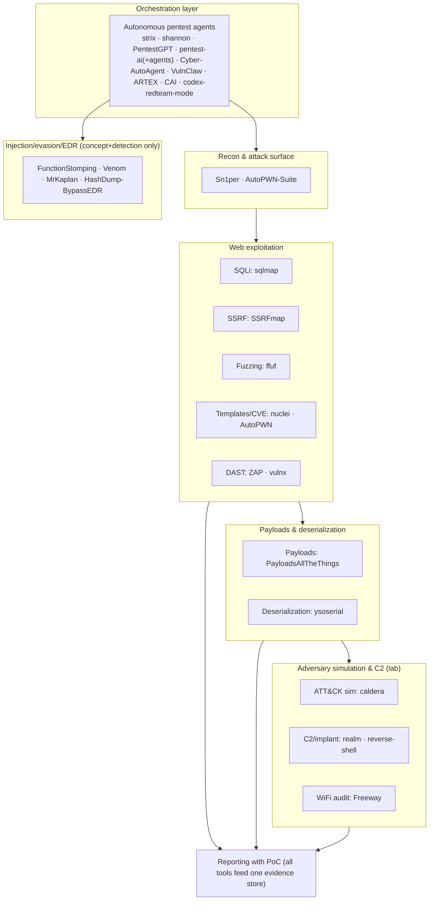
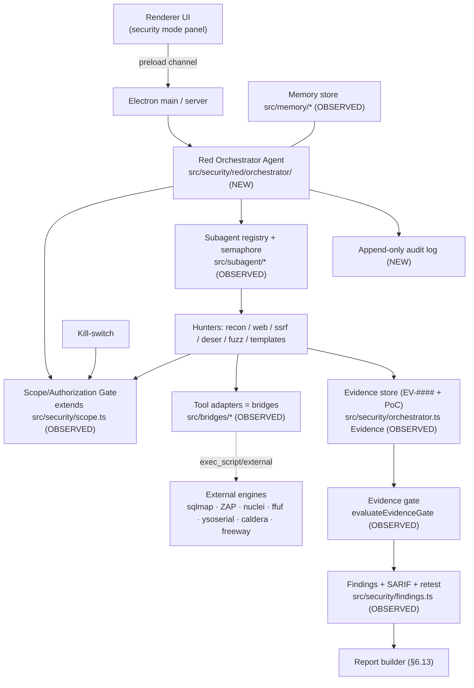
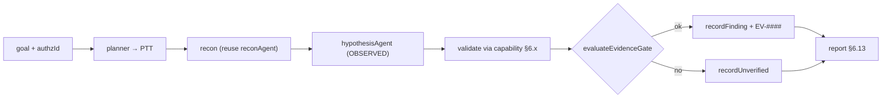
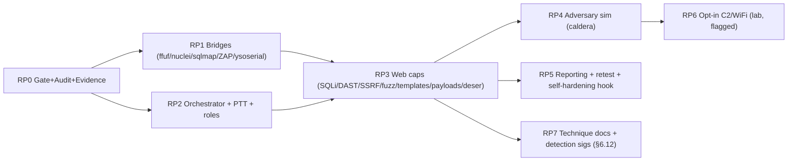

# RED_TEAM_BUILD_SPEC — Loam Unified Red-Team Capability (Authorized Pentest Only)

- **Owner:** Khamis Al Jabor (KHAMIS AL JABOR)
- **Document type:** single, self-contained, enterprise-grade build & reverse-engineering specification.
- **Scope of THIS file:** the red-team / offensive security tooling of the `LOAM_REDBLUE_MASTER` registry `red` group only. The defensive/blue scanners, reverse-engineering engines, memory/skills infrastructure and benchmarks live in the sibling file `ALL_SERVICES_BUILD_SPEC.md`; this file only cross-references them.
- **Status:** STUDY + WRITING ONLY. No code is written into Loam or any of Khamis's repositories; nothing is queued, nothing is executed on any PC, nothing is sent to anyone. Everything here is a *proposal* for a future, separately-approved build.
- **Assembly date:** 2026-10-24 (Riyadh, UTC+3).
- **Loam reference commit observed:** `5227df4` (v0.5.31), repo `github.com/khamis1992/loam`.

---

## Reading method (tags used throughout)

Every factual claim carries one tag:

- **OBSERVED** — read directly from source, a README, a licence file, or a captured command output. Carries an evidence pointer: a `file:line`, a repo `SHA`, or an `EV-####` id in the evidence log (§13).
- **INFERRED** — our analysis of how a tool maps into Loam. Not a fact about the upstream project.
- **UNKNOWN** — not determinable from available evidence. Every UNKNOWN is paired with a **Design decision** giving a concrete default so the build is never blocked.

Nothing in this document is invented. Where a detail could not be verified it is marked UNKNOWN rather than guessed.

---

# 0. Instructions for implementing agents

## 0.1 What this document is

This is a buildable specification for a **single, integrated red-team capability inside Loam** — not a pile of wrappers around 28 separate tools. The master registry lists 28 offensive projects (some summaries say 29); many overlap heavily (five tools "fuzz web parameters", four are "autonomous pentest agents", etc.). Section 3 **consolidates** them into ~13 unified capabilities, each with exactly one *base* to absorb and a short list of *grafted strengths* taken from the others. Sections 6+ are written per **unified capability**, not per repo. The full 28-row catalogue is kept only as a reference appendix (§12).

An implementing agent should treat this file as the contract: build the unified capability, reuse Loam's existing security core, route everything through the scope/authorization gate (§0.4), and prove each capability against a **local lab target only**.

## 0.2 Definition of Done (per capability)

A unified capability is "done" when all of the following hold:

1. **Integrated, not shelled-out-blindly.** The capability is a first-class Loam module under `src/security/red/<capability>/` (new tree, INFERRED placement) that reuses the existing `src/security` orchestrator, scope gate and evidence store (OBSERVED those exist, §4). External binaries, where used, are invoked only through a declarative **bridge manifest** (`src/bridges/*`, OBSERVED §4.4) whose declared `effect` is the minimum needed.
2. **Gated.** Every target-touching action calls the scope/authorization gate (§0.4) first and refuses to run outside the allow-list. There is no code path that reaches a network target without passing the gate.
3. **Evidence-backed.** Every finding produces an `Evidence` record with a stable `EV-####` id (OBSERVED `src/security/orchestrator.ts:81`) and, for any exploit-class finding, a reproducible PoC artifact. "No finding without proof" (the Shannon/strix doctrine) is enforced by `evaluateEvidenceGate` (OBSERVED `orchestrator.ts:223`).
4. **Auditable.** Every target-touching action appends an append-only audit entry (who/when/target/tool/scope-authorization-id/outcome).
5. **Sandboxed + bounded.** Runs inside the execution sandbox with rate limits, timeouts (bridge `timeoutSeconds` 1..900, OBSERVED `manifestSchema.ts:92`) and a working kill-switch.
6. **Tested on a lab target.** Acceptance criteria met against the local lab (§9), never against third-party or internet hosts.
7. **Licence-clean.** Any absorbed code respects the upstream licence; GPL/AGPL/NOASSERTION/archived sources are **clean-rebuilt** (behaviour re-implemented from the documented interface), not copied (§5.9).
8. **Reviewed.** Text, schemas and verification commands reviewed for accuracy before merge.

## 0.3 Authorized-use frame (read first, honour throughout)

> These are **dual-use penetration-testing tools**. In Loam they exist for **one purpose only: testing systems Khamis owns or is explicitly authorized to test**, with code and results that never leave the device.

- The master plan's own doctrine scopes offensive capability to *"اختبار أنظمتنا فقط"* ("testing our own systems only") and *"الكود لا يغادر"* ("the code never leaves") — see `MASTER_INPUT.md:215` (OBSERVED). This document takes that constraint as **binding and non-negotiable**, and resolves it ahead of the master's §5 "sovereign doctrine" rhetoric (`MASTER_INPUT.md:482-490`), which in places reads as "attack any target". That broader reading is **explicitly rejected here**: every spec, flow and phase below is written in the authorized-own-systems frame.
- **Legal/ethics note.** Scanning, exploiting, intercepting, jamming, bruteforcing or tracking systems, networks, radio spectrum or people you do not own or have written permission to test may be a crime (e.g. unauthorized-access and computer-misuse statutes, wiretap/RF regulations). Loam must make unauthorized use *hard by construction*, not merely discouraged. **Destructive actions require explicit, logged human approval** (§0.4, §5.6).
- Capabilities that exist *only* to harm third parties (RF jamming, phishing kits, people-tracking/stalking, credential/info stealers, bruteforcing others' devices, LLM-jailbreak corpora, indiscriminate exploit dumps) are **out of scope and excluded** — see the Excluded appendix (§11).

## 0.4 The scope / authorization gate (first-class requirement)

Every red capability routes through one shared gate before any packet leaves the box. This is the single most important control in the document.

Loam already contains the seed of this gate (OBSERVED):
- `assertLocalhost(target)` / `isLocalhostTarget(target)` / `LocalhostScopeError` — `src/security/orchestrator.ts:23-61`.
- `CampaignScope`, `normalizeScope`, `inScope(scope, input)`, `ScopeError`, `BudgetError`, `scopedTransport(...)` — `src/security/scope.ts:5-68`.

The red build **extends** these into an explicit authorization gate:

```
interface AuthorizationRecord {          // persisted, immutable once signed
  id: string;                            // AUTHZ-#### ; referenced by every audit entry
  owner: "khamis";                       // single-tenant
  scope: {
    allowHosts: string[];                // exact hosts / CIDRs; NO wildcards to public space
    allowPorts: number[];
    allowUrlPrefixes: string[];
    denyAlways: string[];                // RFC-1918 of other tenants, cloud metadata IPs, etc.
  };
  authorization: {
    statement: string;                   // "I own/authorize testing of <assets>"
    acknowledgedAt: string;              // ISO-8601, Asia/Riyadh
    expiresAt: string;                   // gate refuses after expiry
  };
  limits: {
    maxReqPerSec: number;                // default 10
    maxConcurrent: number;               // default 4
    maxTotalRequests: number;            // hard ceiling per campaign
    destructiveAllowed: boolean;         // default false -> requires per-action human approval
  };
}

function gate(target, action, authz): "allow" | "deny" {
  if (!authz || now > authz.authorization.expiresAt) return "deny";   // no/expired authorization
  if (matchesDenyList(target, authz.scope.denyAlways)) return "deny";
  if (!inScope(authz.scope, target)) return "deny";                   // allow-list only
  if (action.destructive && !authz.limits.destructiveAllowed)
     return requireHumanApproval(action);                             // explicit, logged
  if (rateLimiterExceeded(authz.limits)) return "deny";
  if (killSwitchEngaged()) return "deny";
  return "allow";
}
```

Gate properties (all mandatory):
- **Allow-list only.** Default-deny. A target is reachable only if it matches `allowHosts`/`allowUrlPrefixes`. No "scan the internet" mode exists.
- **Written-authorization record.** Each campaign binds to a signed `AuthorizationRecord` with an expiry; the gate refuses expired or missing authorizations.
- **Rate limits + budgets.** Per-second, concurrency and total-request ceilings (reuse `BudgetError`, OBSERVED `scope.ts:25`).
- **Kill-switch.** A single flag (and UI button) that immediately stops every in-flight red action and blocks new ones.
- **Full audit log.** Append-only; every target-touching action records `AUTHZ-id`, target, tool, parameters (secrets redacted via `redactEvidenceHeaders`, OBSERVED `orchestrator.ts:93`), and outcome.
- **Destructive = human-approved.** Exploit actions that modify/destroy state (writing a shell, dropping a table, launching an implant) require explicit per-action approval unless `destructiveAllowed` is set on the record, and are always logged.

**Design decision (default lab posture):** until an `AuthorizationRecord` is signed, the gate falls back to Loam's existing `assertLocalhost` behaviour — only `127.0.0.1`/`::1`/`localhost` targets are reachable (OBSERVED current default, `orchestrator.ts:33`). This makes the safe lab mode the zero-config default.

---

# 1. Executive summary

**Goal.** Give Loam one integrated, authorized-only red-team capability — not 28 bolted-on tools. Loam already ships, at commit `5227df4`, a localhost-scoped, multi-agent, evidence-gated pentest core (`src/security/*`, OBSERVED §4). This document reverse-engineers the 28 registry `red` projects, consolidates their overlapping functions into ~13 unified capabilities, and specifies how to graft the single strongest implementation of each onto that existing core.

**What already exists in Loam (OBSERVED, reuse — do not rebuild):**
- A recon → hypothesis → validate orchestrator with an evidence gate that blocks "findings without proof" (`src/security/orchestrator.ts`). This is the backbone the red agents plug into.
- Per-class exploit/detection engines already present: SSRF (`ssrf.ts`), deserialization (`deserialization.ts`), injection (`injection.ts`), SQL/NoSQL source flow (`source-sql.ts`, `source-nosql.ts`), template injection, XXE, path traversal, open redirect, CORS/CSRF, upload.
- A scope gate with allow-list, budgets and scoped transport (`src/security/scope.ts`).
- A findings model with SARIF export and retest/diff (`src/security/findings.ts`).
- A declarative **tool-adapter** system — "bridges" — that wraps external CLIs behind manifests whose permissions derive from a declared `effect` (`src/bridges/*`). This is exactly where sqlmap/nuclei/ffuf/ZAP belong.
- A subagent registry with concurrency control (`src/subagent/*`) and a persistent memory store (`src/memory/*`).
- An existing `pentest-app` skill (`skills/pentest-app`, OBSERVED).

**What the 28 red tools add (consolidated):** autonomous pentest-agent orchestration patterns (strix, Shannon, PentestGPT, pentest-ai, Cyber-AutoAgent, VulnClaw, ARTEX, CAI), production-grade exploit/scan engines (sqlmap, nuclei, ffuf, ZAP, SSRFmap, ysoserial, AutoPWN-Suite, vulnx), curated payload corpora (PayloadsAllTheThings), adversary simulation (Caldera/ATT&CK), a lab C2/implant framework (Realm), WiFi auditing (Freeway), and — strictly at concept/detection level for a lab — injection/evasion/EDR/anti-forensics realism (Idov31 FunctionStomping/Venom/MrKaplan, HashDump-BypassEDR).

**The consolidation result (§3):** one base + grafts per capability. For example, *autonomous orchestration* = **strix** base + Shannon's "exploit-before-report" gate + PentestGPT's reasoning/state loop; *SQLi* = **sqlmap** base (bridge) + our own SAST/DAST correlation; *DAST* = **ZAP** base (bridge) + nuclei templates; *fuzzing* = **ffuf** base (bridge); *payloads* = clean-rebuilt **PayloadsAllTheThings** corpus behind one payload API.

**Coverage:** 28 in-scope red tools covered via 13 unified capabilities; 10 `edge`-group projects excluded as third-party-harm-only (§11).

**Safety posture:** default-deny allow-list gate, written authorization with expiry, rate limits, kill-switch, full audit, destructive-action human approval, lab-only testing — all first-class (§0.4, §5).

**Top open decisions for Khamis (full list §10):** (1) default scope posture (localhost-only vs signed allow-list); (2) whether to ship a lab C2/implant (Realm) at all, or detection-only; (3) bundle vs on-demand download of heavy external engines (ZAP/sqlmap/nuclei); (4) depth of EDR-bypass/anti-forensics coverage (concept+detection only vs runnable in an isolated lab); (5) whether red findings auto-open blue hardening tasks (the self-hardening loop).

**Main UNKNOWNs (full list §13):** exact internal agent-loop designs of several closed-ish agent repos (resolved by clean-rebuild from documented behaviour); whether Loam's bridge sandbox can host long-lived C2 listeners on Windows; real Windows Defender/SmartScreen behaviour toward bundled offensive binaries; per-tool licence compatibility of any *copied* snippet (resolved by rebuild).

---

# 2. Red-tool catalogue (reference table)

All 28 in-scope projects. SHAs are HEAD at capture time (OBSERVED via `git ls-remote`, `evidence-red/red_repo_shas.txt`, EV-001). Licences are OBSERVED from the master registry and repo metadata; where a repo is NOASSERTION/none the absorb strategy is forced to clean-rebuild or reverse-engineer (§5.9). Languages are INFERRED from each project's well-known primary ecosystem unless marked OBSERVED. "Absorb" uses the master legend: **d**=direct call (bridge), **b**=clean rebuild, **o**=full reverse-engineer. "Loam placement" is INFERRED.

| # | Repo | HEAD SHA (short) | Licence | Lang | Category | What it does | Absorb | Loam placement (unified capability §) |
|---|---|---|---|---|---|---|---|---|
| 1 | usestrix/strix | dc40345 | Apache-2.0 | Python | autonomous agent | Agents that find, PoC-prove, fix and report vulns | d,b,o | §6.1 Orchestration (BASE) |
| 2 | KeygraphHQ/shannon | 4bd88c1 | AGPL-3.0 | TypeScript | autonomous web agent | "No report without exploit" web pentest | o,b | §6.1 Orchestration (graft: exploit-gate) |
| 3 | 0xSteph/pentest-ai | 85b5509 | MIT | Python | autonomous agent | Auto-pentester that proves each finding | d,b | §6.1 Orchestration (graft) |
| 4 | 0xSteph/pentest-ai-agents | e5d7aa0 | MIT | Python | agent pack | Turns a coding agent into an offensive assistant | d,b | §6.1 Orchestration (graft: prompts) |
| 5 | Netw0rkNoob/VulnClaw | 0b34878 | MIT | Python | agent + MCP | NL → recon/exploit via MCP + skills | d,b | §6.1 Orchestration (graft: MCP surface) |
| 6 | westonbrown/Cyber-AutoAgent | 54897ff | MIT | Python | autonomous agent | Self-directed cyber operations | b,o | §6.1 Orchestration (graft) |
| 7 | GreyDGL/PentestGPT | e8b1bb7 | MIT | Python | agent framework | USENIX-published pentest reasoning loop | b,o | §6.1 Orchestration (graft: PTT state) |
| 8 | aliasrobotics/cai | 6dc7925 | NOASSERTION/archived | Python | agent framework | Cybersecurity-AI agent framework | o | §6.1 Orchestration (rebuild patterns) |
| 9 | BaaRai/ARTEX | b3717f7 | AGPL-3.0 | Python | multi-agent | Autonomous multi-agent pentest system | o,b | §6.1 Orchestration (graft: role split) |
| 10 | chAng-L19/codex-redteam-mode | cd8db54 | MIT | prompt/config | offensive mode | A "red-team" reasoning mode for a coding agent | b | §6.1 (Loam mode) + §6.12 reporting |
| 11 | 1N3/Sn1per | a5450bc | NOASSERTION | Shell/Perl | recon platform | Attack-surface automation / recon orchestration | o | §6.2 Recon (graft: workflow) |
| 12 | apache/caldera | cb8d6a8 | Apache-2.0 | Python | adversary sim | MITRE ATT&CK adversary emulation | d,o | §6.9 Adversary simulation (BASE) |
| 13 | spellshift/realm | fbb3508 | GPL-3.0 | Rust/Go | C2 | Red-team engagement/C2 platform | o | §6.10 C2/implant lab (BASE, opt-in) |
| 14 | GamehunterKaan/AutoPWN-Suite | 23b691b | Apache-2.0 | Python | scan+exploit | Vuln scan + exploit automation | d,b | §6.2 Recon / §6.6 templates (graft) |
| 15 | FLOCK4H/Freeway | f7203a5 | MIT | Python | WiFi audit | WiFi testing/auditing toolkit | d,o | §6.11 WiFi audit (BASE, lab RF) |
| 16 | anouarbensaad/vulnx | bcf451d | GPL-3.0 | Python | web exploit | Web CMS vuln scanner / exploit bot | o | §6.3 Web exploitation (graft: CMS sigs) |
| 17 | swisskyrepo/SSRFmap | 290e07d | MIT | Python | SSRF exploit | SSRF fuzz + exploit modules | d,b | §6.4 SSRF (BASE) |
| 18 | frohoff/ysoserial | 218bcff | MIT | Java | deserialization | Java deserialization payload generator | d,o | §6.8 Deserialization (BASE) |
| 19 | swisskyrepo/PayloadsAllTheThings | 3ac2790 | MIT | Markdown/data | payload corpus | Curated payloads + bypass techniques | b,o | §6.7 Payload library (BASE, rebuild) |
| 20 | lukechilds/reverse-shell | a920db4 | MIT | JS | reverse shell | reverse-shell-as-a-service one-liner | d,b | §6.10 Callback handling (lab only) |
| 21 | sqlmapproject/sqlmap | c9745f8 | GPL-2.0 | Python | SQLi | Automated SQL injection + takeover | d,o | §6.3 SQLi (BASE, bridge) |
| 22 | projectdiscovery/nuclei | b901fb8 | MIT | Go | templates | Fast template-based vuln checks | d,b | §6.6 Vuln templates (BASE, bridge) |
| 23 | ffuf/ffuf | 8d65e03 | MIT | Go | fuzzing | Path/param/content fuzzing | d,b | §6.5 Fuzzing (BASE, bridge) |
| 24 | zaproxy/zaproxy | 1228a82 | Apache-2.0 | Java | DAST | Full DAST proxy + active scan | d,o | §6.3 DAST (BASE, bridge) |
| 25 | Idov31/FunctionStomping | 44af940 | GPL-3.0 | C++ | injection | Shellcode injection technique | o | §6.12 Injection/evasion (concept+detect) |
| 26 | Idov31/Venom | 3482d74 | GPL-3.0 | C++/C | evasion | Stealthy comms / evasion | o | §6.12 Injection/evasion (concept+detect) |
| 27 | Idov31/MrKaplan | 0fed7b2 | GPL-3.0 | PowerShell | anti-forensics | Red-team trace cleanup | o | §6.12 Anti-forensics (concept+detect) |
| 28 | AabyssZG/HashDump-BypassEDR | f1a93ad | Apache-2.0 | Python/C | EDR bypass | Hash dump + EDR bypass | o | §6.12 EDR bypass (concept+detect) |

> Row count note: the registry lists 28 distinct `red` repos (strix…HashDump). The master's prose table (`MASTER_INPUT.md:281-308`) and this table agree on 28; "29" in some summaries counts `reverse-shell` and the two 0xSteph repos separately — all are present above. Items 25–28 are covered at **architecture / how-it-works / detection** level only for lab realism, never as a how-to against third parties (§6.12, §11 rationale).

---

# 3. Consolidation pass — from 28 tools to 13 unified capabilities

This is the heart of the document. Instead of one redundant section per repo, we first **map tools to capabilities**, then **tabulate the overlap** (what is duplicate vs unique, and each tool's strongest point), then make a **best-of-breed decision** (one base to absorb + specific strengths to graft). Sections 6+ are then written per *unified capability*.

## 3.1 Capability map



The 13 unified capabilities:

| § | Unified capability | Source tools consolidated |
|---|---|---|
| 6.1 | Autonomous orchestration (hunt→PoC→report) | strix, shannon, PentestGPT, pentest-ai, pentest-ai-agents, Cyber-AutoAgent, VulnClaw, ARTEX, CAI, codex-redteam-mode |
| 6.2 | Recon & attack-surface mapping | Sn1per, AutoPWN-Suite |
| 6.3 | Web exploitation — SQLi & DAST | sqlmap, ZAP, vulnx |
| 6.4 | SSRF | SSRFmap |
| 6.5 | Path/param/content fuzzing | ffuf |
| 6.6 | Vuln templates / known-CVE checks | nuclei, AutoPWN-Suite |
| 6.7 | Payload library & transforms | PayloadsAllTheThings |
| 6.8 | Deserialization exploitation | ysoserial |
| 6.9 | Adversary simulation (ATT&CK) | caldera |
| 6.10 | C2 / implant & callback (lab only, opt-in) | realm, reverse-shell |
| 6.11 | WiFi audit (lab RF only) | Freeway |
| 6.12 | Injection / evasion / EDR / anti-forensics (concept + detection only) | FunctionStomping, Venom, MrKaplan, HashDump-BypassEDR |
| 6.13 | Reporting with reproducible PoC | (cross-cutting; consumes all of the above) |

## 3.2 Overlap tables (duplicate vs unique + strongest point)

### 3.2.a Autonomous pentest agents (10 tools — heaviest overlap)
| Tool | Does | DUPLICATE of | UNIQUE strength (strongest point) |
|---|---|---|---|
| **strix** | find→PoC→fix→report agents, Apache-2.0 | core loop ~ all | Clean, permissive licence; full lifecycle incl. **auto-fix** + report; closest to Loam's own orchestrator shape |
| shannon | web pentest agent, AGPL-3.0 | strix loop | **"No report without exploit"** hard gate (maps to `evaluateEvidenceGate`) |
| PentestGPT | reasoning loop, MIT, USENIX paper | strix loop | **Pentest Task Tree (PTT)** explicit state model; peer-reviewed reasoning decomposition |
| pentest-ai | auto-pentester, MIT | strix loop | Minimal, each finding self-proved; easy reference impl |
| pentest-ai-agents | agent pack for coding agent, MIT | pentest-ai | Ready **offensive prompt/skill pack** for an agent IDE |
| Cyber-AutoAgent | self-directed ops, MIT | strix loop | Autonomy/looping heuristics; tool selection |
| VulnClaw | NL→recon/exploit via MCP, MIT | strix loop | **MCP tool surface** + skills packaging (fits Loam bridges/MCP) |
| ARTEX | multi-agent pentest, AGPL-3.0 | strix+PTT | **Role split** across multiple cooperating agents |
| CAI | cybersecurity-AI framework, NOASSERTION/archived | framework ~ strix | Framework abstractions; but archived + no licence → rebuild only |
| codex-redteam-mode | offensive reasoning "mode", MIT | prompt layer | A drop-in **mode** definition (fits Loam `src/modes`) |

**Verdict:** one orchestrator; 9 of these 10 are the *same autonomous-pentest idea* re-expressed. Duplicate = the recon→exploit→report loop. Unique grafts = Shannon's exploit-gate, PentestGPT's PTT state, VulnClaw's MCP surface, ARTEX's role split, pentest-ai-agents' prompt pack, codex-redteam-mode's mode wrapper.

### 3.2.b Recon & attack surface (2 tools)
| Tool | Does | DUPLICATE of | UNIQUE strength |
|---|---|---|---|
| **Sn1per** | recon + attack-surface automation | partially AutoPWN | Mature **recon workflow / stage chaining**; integrates many scanners |
| AutoPWN-Suite | scan + exploit | partially Sn1per | **Vuln→exploit mapping** (NVD lookups) in one pass |

**Verdict:** recon workflow from Sn1per (rebuild the *orchestration*, not its shell glue); known-vuln mapping from AutoPWN feeds §6.6. Loam already has recon primitives (`reconAgent`, OBSERVED) + blue recon (httpx/subfinder, sibling file) — we reuse those, graft stage-chaining.

### 3.2.c Web exploitation engines (5 tools)
| Tool | Does | DUPLICATE of | UNIQUE strength |
|---|---|---|---|
| **sqlmap** | automated SQLi + DB takeover | vulnx(SQLi subset), ZAP(SQLi subset) | Deepest, most battle-tested **SQLi** engine; many DBMS/techniques |
| **ZAP** | full DAST proxy + active scan | nuclei(subset), vulnx | Broad **active DAST** across vuln classes; scriptable; proxy |
| **SSRFmap** | SSRF fuzz+exploit | ZAP SSRF (shallow) | Dedicated **SSRF** modules (gopher, cloud metadata, etc.) → §6.4 |
| nuclei | template checks | ZAP(subset) | Fast **known-CVE/template** breadth → §6.6 |
| vulnx | CMS exploit bot | sqlmap+ZAP | **CMS fingerprint + known-exploit** signatures (graft sigs only; GPL → rebuild) |

**Verdict:** SQLi=sqlmap base; general DAST=ZAP base; SSRF split to §6.4; templates split to §6.6; vulnx reduced to a CMS-signature graft. No redundant "web scanner" sections — sqlmap and ZAP are complementary (depth vs breadth), not duplicates.

### 3.2.d Payloads, deserialization, fuzzing (3 tools, mostly unique)
| Tool | Does | DUPLICATE of | UNIQUE strength |
|---|---|---|---|
| **PayloadsAllTheThings** | curated payloads/bypasses | — (data, not engine) | The **payload corpus**; feeds every web capability → §6.7 |
| **ysoserial** | Java deserialization gadgets | — | **Deserialization** gadget chains (unique) → §6.8 |
| **ffuf** | path/param fuzz | ZAP spider (shallow) | Fast, precise **fuzzing** primitive → §6.5 |

**Verdict:** all three largely unique — each becomes its own thin capability; ffuf and ysoserial are bridges, PayloadsAllTheThings is a clean-rebuilt data corpus behind one payload API.

### 3.2.e Adversary sim / C2 / WiFi (3 tools, distinct domains)
| Tool | Does | DUPLICATE of | UNIQUE strength |
|---|---|---|---|
| **caldera** | ATT&CK adversary emulation | — | **ATT&CK-mapped** TTP emulation + planner → §6.9 |
| **realm** | C2/engagement platform | reverse-shell(trivial) | Full **C2/implant** mgmt (lab only, opt-in) → §6.10 |
| reverse-shell | one-liner callback | realm(subset) | Minimal **callback** for lab validation; subsumed by realm |
| **Freeway** | WiFi audit | — | **802.11** audit primitives (lab RF only) → §6.11 |

### 3.2.f Injection / evasion / EDR / anti-forensics (4 tools — concept+detection only)
| Tool | Does | DUPLICATE of | UNIQUE strength (studied, not weaponized vs third parties) |
|---|---|---|---|
| FunctionStomping | shellcode injection technique | — | Specific injection primitive (how it works → detection signature) |
| Venom | stealthy comms/evasion | partially MrKaplan | Evasion channel (how it works → detection) |
| MrKaplan | anti-forensics cleanup | — | Trace-removal TTPs (how it works → tamper/log-integrity detection) |
| HashDump-BypassEDR | hash dump + EDR bypass | — | EDR-bypass TTP (how it works → EDR-tamper detection) |

**Verdict:** these are **not** built as attack tools in Loam. They are documented at architecture/how-it-works level so Loam's blue core can **detect** the technique on Khamis's own lab hosts, and so red-team exercises on an isolated lab are realistic. See §6.12 and the Red→Blue map (§7).

## 3.3 Best-of-breed decisions (one integrated capability per function)

| Capability | BASE to absorb | How absorbed | Grafted strengths (from) | Net Loam module |
|---|---|---|---|---|
| Orchestration (§6.1) | **strix** | clean-rebuild loop onto existing `src/security/orchestrator.ts` | exploit-gate (shannon), PTT state (PentestGPT), MCP surface (VulnClaw), role-split (ARTEX), prompt pack (pentest-ai-agents), mode wrapper (codex-redteam-mode) | `src/security/red/orchestrator/` |
| Recon (§6.2) | **existing `reconAgent` + blue recon** | reuse | stage-chaining (Sn1per), vuln→exploit map (AutoPWN) | `src/security/red/recon/` |
| SQLi (§6.3) | **sqlmap** | bridge (direct call, GPL stays external) | SAST/DAST correlation (Loam blue) | bridge `sqlmap` + `red/web/sqli.ts` |
| DAST (§6.3) | **ZAP** | bridge (Apache-2.0) | nuclei templates, our evidence gate | bridge `zap` + `red/web/dast.ts` |
| SSRF (§6.4) | **SSRFmap** patterns + existing `ssrf.ts` | clean-rebuild into existing engine | cloud-metadata/gopher modules | extend `src/security/ssrf.ts` |
| Fuzzing (§6.5) | **ffuf** | bridge (MIT) | wordlists from §6.7 | bridge `ffuf` + `red/web/fuzz.ts` |
| Templates (§6.6) | **nuclei** | bridge (MIT) | AutoPWN NVD mapping, our CVE-intel (sibling) | bridge `nuclei` + `red/templates.ts` |
| Payloads (§6.7) | **PayloadsAllTheThings** | clean-rebuild as structured corpus | per-class transforms | `src/security/red/payloads/` + data |
| Deserialization (§6.8) | **ysoserial** | bridge (MIT) + existing `deserialization.ts` | gadget catalog | bridge `ysoserial` + extend `deserialization.ts` |
| Adversary sim (§6.9) | **caldera** | direct call / reverse-engineer planner | ATT&CK mapping | bridge/service `caldera` + `red/advsim/` |
| C2/implant (§6.10) | **realm** (opt-in) | reverse-engineer, lab-only, off by default | reverse-shell for trivial callback | `src/security/red/c2/` (feature-flagged) |
| WiFi (§6.11) | **Freeway** | direct call, lab RF only | — | bridge `freeway` + `red/wifi/` |
| Evasion/EDR (§6.12) | (none — study only) | document + detection signatures | all four repos → signatures | `src/security/red/techniques/` (docs+sigs) |
| Reporting (§6.13) | **existing findings.ts + SARIF** | reuse | strix report format, PoC bundling | extend `src/security/findings.ts` |

**Outcome:** 28 tools → 13 capabilities → **one** integrated red product whose brain is Loam's existing orchestrator, whose hands are a handful of bridged best-in-class engines, and whose corpus (payloads) is clean-rebuilt and owned.

---

# 4. Unified red-capability architecture inside Loam

The red capability is **not** a new app. It is a subtree that reuses Loam's existing security core, subagent registry, bridge/tool-adapter system, memory store and IPC. This section names real Loam structures (OBSERVED at `5227df4`) and marks new additions INFERRED.

## 4.1 Component overview



## 4.2 The orchestrator agent (reuse + extend)

OBSERVED — `src/security/orchestrator.ts` already implements the exact shape we need:
- `reconAgent(opts)` → `ReconObservation[]` (`orchestrator.ts:269`).
- `hypothesisAgent(observations)` → `Hypothesis[]` (`orchestrator.ts:510`).
- `validateAgent(opts)` → `ValidationOutcome` (`orchestrator.ts:532`).
- `orchestrate(opts): Promise<OrchestratorResult>` top-level driver (`orchestrator.ts:642`), returning `OrchestratedFinding[]` and `UnverifiedClaim[]`.
- Evidence model: `interface Evidence` (`:61`), `nextEvidenceId()` → `EV0001`-style ids (`:81`), `redactEvidenceHeaders()` (`:93`), `isValidEvidence()` (`:191`), `demonstratesClaim()` (`:209`), `evaluateEvidenceGate()` (`:223`).
- Scope: `assertLocalhost()` (`:33`), `isLocalhostTarget()` (`:51`).

INFERRED extension — the red orchestrator wraps `orchestrate()` with:
1. the **authorization gate** of §0.4 (superset of `assertLocalhost`),
2. a **capability router** that dispatches hypotheses to the right unified capability (§6.x),
3. a **role split** (planner / hunter / validator / reporter) grafted from ARTEX and PentestGPT's PTT, run through `src/subagent` with `semaphore.ts` concurrency control (OBSERVED `src/subagent/semaphore.ts`).

```
// NEW: src/security/red/orchestrator/redOrchestrator.ts  (pseudocode, reuses existing orchestrate)
async function runCampaign(input: RedCampaignInput): Promise<RedCampaignResult> {
  const authz = loadAuthorization(input.authzId);                 // §0.4
  assertAuthorized(authz);                                        // throws ScopeError if missing/expired
  const plan = planner(input.goal, authz.scope);                 // PTT-style task tree (graft: PentestGPT)
  for (const task of plan.tasks) {                               // role split (graft: ARTEX)
    if (gate(task.target, task.action, authz) !== "allow") { audit("denied", task); continue; }
    const cap = route(task);                                     // -> §6.x capability
    const obs = await cap.hunt(task, scopedTransport(authz));    // reuse scope.ts transport
    const hyps = hypothesisAgent(obs);                           // reuse OBSERVED
    for (const h of hyps) {
      const outcome = await cap.validate(h, authz);              // produces Evidence + PoC
      if (evaluateEvidenceGate({ claim: h, evidence: outcome.evidence }).ok)  // OBSERVED gate
        recordFinding(enrichFinding(outcome.finding, outcome.requestIds));    // reuse findings.ts
      else recordUnverified(h);
      audit(outcome);
    }
  }
  return buildReport();                                          // §6.13 (SARIF + PoC bundle)
}
```

## 4.3 Scope/authorization gate & evidence store (data stores)

- **Authorization records** persisted under the Loam app data dir (INFERRED path `~/.loam/security/authz/AUTHZ-####.json`), immutable once signed; referenced by every audit entry.
- **Evidence store** reuses REA's content-addressed model (see `/workspace/re/rea/BUILD_SPEC.md` §6.3, EV-002): each `Evidence` record is keyed by a stable id and stores request/response, redacted headers, and — for exploit findings — a PoC artifact (request bundle, payload, DB-read sample, screenshot). INFERRED store path `~/.loam/security/evidence/EV-####/`.
- **Findings** flow through `src/security/findings.ts` (OBSERVED): `SecurityFinding extends PentestFinding`, `sarif(findings)` for SARIF export, `compareFindings()` for retest/diff and `coverageKey()` for a coverage ledger.
- **Audit log**: append-only JSONL under `~/.loam/security/audit/` (INFERRED), never truncated, secrets redacted.

## 4.4 Tool adapters = Loam bridges (OBSERVED surface)

External engines (sqlmap, ZAP, nuclei, ffuf, ysoserial, caldera, freeway) are **not** called ad-hoc. They are wrapped in Loam's existing declarative **bridge manifests** (`src/bridges/*`, OBSERVED):
- `BridgeEffect = "read" | "write_workspace" | "exec_script" | "external"` (`src/bridges/types.ts:4`). A red engine that touches the network declares `external`; one that only transforms local files declares `read`/`write_workspace`. **Permissions derive from the declared effect** (matches the REA least-privilege doctrine).
- Manifests declare typed params (`ParamType = "string" | "path" | "number" | "enum"`, `types.ts:6`), an `argv` template with `{placeholder}` substitution and conditional `{when,args}` tokens (OBSERVED `manifestSchema.ts:41-58`), an `output` of `json|text`, and `timeoutSeconds` bounded 1..900 (`manifestSchema.ts:92`).
- Bridges are discovered/loaded by `loadManifests()` and toggled per-id with `isBridgeEnabled`/`setBridgeEnabled` (OBSERVED `registry.ts`). Red bridges ship **disabled by default**.

Example (INFERRED) nuclei bridge manifest — declarative, least-privilege, gated by Loam before argv runs:
```json
{
  "id": "red-nuclei",
  "name": "nuclei (templates)",
  "description": "Run nuclei templates against an in-scope target.",
  "probe": { "names": ["nuclei"] },
  "commands": [{
    "id": "scan",
    "description": "Template scan a single in-scope URL.",
    "effect": "external",
    "params": {
      "target": { "type": "string" },
      "severity": { "type": "enum", "values": ["info","low","medium","high","critical"] }
    },
    "argv": ["-u", "{target}", "-severity", "{severity}", "-jsonl", {"when":"rateLimit","args":["-rl","10"]}],
    "output": "json",
    "timeoutSeconds": 600
  }]
}
```
The orchestrator still calls the §0.4 gate on `{target}` **before** the bridge executes; the bridge boundary is defense-in-depth, not the authorization itself.

## 4.5 IPC channels & modes (OBSERVED names)

- Renderer↔main uses Loam's preload channels (OBSERVED names include `terminal`, `desktopOperator`, `storage`, `system`, `env`; full list in `evidence-red/loam_structure.txt`). The red panel is INFERRED to live under the existing **security mode** surface rather than a new top-level channel; a dedicated `security:red` preload channel is the INFERRED addition.
- Modes are catalogued in `src/modes/catalog.ts` with `buildPhases.ts`/`detect.ts` (OBSERVED). codex-redteam-mode is absorbed as a **mode entry** here (a reasoning profile), not as a separate app.
- Server routes already include `approvalRules.ts`, `planApproval.ts`, `askUser.ts` (OBSERVED `src/server/routes/`) — the destructive-action human-approval path (§0.4) reuses these rather than inventing a new approval mechanism.

---

# 5. Enterprise + safety requirements

All requirements below are first-class and apply to every red capability. They are the "enterprise-grade" envelope the master plan demands, bent to the authorized-use frame.

## 5.1 Authorization gate (restated as hard requirement)
- Default-deny allow-list; signed, expiring `AuthorizationRecord`; no wildcard-to-public mode (§0.4).
- Zero-config default = localhost-only (reuse `assertLocalhost`, OBSERVED).
- Every capability MUST call the gate before any target-touching action; a capability that can reach a target without the gate fails the Definition of Done.

## 5.2 Audit & non-repudiation
- Append-only JSONL audit; one entry per target-touching action: timestamp (Asia/Riyadh), `AUTHZ-id`, operator, capability, tool, redacted params, target, outcome, evidence ids.
- Audit is never truncated by the app; rotation is copy-then-seal, never delete-in-place.
- Secrets redacted via `redactEvidenceHeaders` (OBSERVED `orchestrator.ts:93`) before persistence.

## 5.3 Sandboxing & isolation
- External engines run only through bridges (`exec_script`/`external` effect) inside Loam's execution sandbox; no engine gets ambient network or filesystem access beyond its declared effect.
- C2/implant (§6.10) and WiFi (§6.11) run only in an **isolated lab network/VM** that the gate's deny-list protects from touching anything else.
- INFERRED: reuse Loam's existing `backendSandbox.ts` (OBSERVED `src/agent/backendSandbox.ts`) as the sandbox substrate.

## 5.4 Rate limits & budgets
- Per-campaign `maxReqPerSec` (default 10), `maxConcurrent` (default 4, enforced by `src/subagent/semaphore.ts`, OBSERVED), `maxTotalRequests` hard ceiling.
- Reuse `BudgetError` (OBSERVED `scope.ts:25`); exceeding a budget aborts the campaign, not just the request.
- Bridge `timeoutSeconds` bounded 1..900 (OBSERVED).

## 5.5 Kill-switch
- One global flag + UI control; engaging it (a) aborts all in-flight bridge executions via their abort signals (`scopedTransport` already takes an `AbortSignal`, OBSERVED `scope.ts:68`), (b) blocks new gate approvals, (c) writes a `killswitch_engaged` audit entry.
- Must stop C2 listeners and WiFi captures as well as HTTP hunters.

## 5.6 Destructive-action approval
- Any action that writes, deletes, persists an implant, or changes target state is `destructive:true` and requires explicit human approval unless `destructiveAllowed` is set on the authorization record.
- Reuse existing approval routes `approvalRules.ts`/`planApproval.ts`/`askUser.ts` (OBSERVED).
- Default `destructiveAllowed=false`.

## 5.7 Observability & performance budgets
- Structured telemetry per campaign: targets touched, requests sent, findings/unverified counts, evidence bytes, p50/p95 action latency.
- INFERRED reuse of `src/telemetry/*` (OBSERVED dir).
- Performance budgets (INFERRED defaults, tune per Khamis): recon stage ≤ 2 min/host; template scan ≤ 10 min/target; full web campaign ≤ 30 min/target; orchestrator overhead ≤ 5% of wall-clock; evidence write ≤ 50 ms p95.

## 5.8 Windows packaging
- Loam is Windows-only Electron (OBSERVED PR#1 badge change, v0.5.31). External engines have mixed Windows stories:
  - Go engines (nuclei, ffuf) — single static Windows binary, easy bundle/download. OBSERVED language Go.
  - Python engines (sqlmap, SSRFmap, caldera, vulnx, AutoPWN, Freeway) — need a bundled Python or packaged exe; Freeway needs a compatible WiFi adapter + driver (UNKNOWN on Khamis's hardware).
  - Java engines (ZAP, ysoserial) — need a bundled JRE.
  - realm — Rust/Go agent + server; Windows implant build is a separate toolchain (lab only).
- **Design decision:** heavy engines are **downloaded on first use** (signed, hash-pinned) rather than inflating the installer; see Open decision O-3.
- SmartScreen/Defender may flag bundled offensive binaries (UNKNOWN real behaviour, needs a test on Khamis's machine — U-5). Mitigation: on-demand download + user-initiated enable per bridge.

## 5.9 Licence discipline (per-tool)
Absorb strategy is constrained by licence (OBSERVED licences, §2). Rule: **never copy** GPL/AGPL/NOASSERTION/none/archived code into Loam's tree; either call it as an external process (licence stays at arm's length) or **clean-rebuild** the behaviour from its documented interface.

| Tool(s) | Licence | Constraint | Chosen absorb |
|---|---|---|---|
| nuclei, ffuf, SSRFmap, pentest-ai(+agents), VulnClaw, AutoPWN, reverse-shell, PayloadsAllTheThings, codex-redteam-mode, strix | MIT/Apache-2.0 | permissive | bridge (direct) or rebuild; strix loop clean-rebuilt onto our orchestrator |
| sqlmap | GPL-2.0 | copyleft | **external process only** (bridge); no code copied |
| ZAP, caldera, AutoPWN, HashDump, strix | Apache-2.0 | permissive + patent grant | bridge/direct; may reference |
| ysoserial | MIT | permissive | bridge (external jar) |
| shannon, ARTEX | AGPL-3.0 | network-copyleft | **clean-rebuild only** (behaviour, not code); do not link |
| vulnx | GPL-3.0 | copyleft | clean-rebuild signatures only |
| realm, FunctionStomping, Venom, MrKaplan | GPL-3.0 | copyleft | reverse-engineer *concept*; realm lab-only external; Idov31 = docs+detection only |
| Sn1per, CAI | NOASSERTION/archived | no grant | **rebuild workflow only**; no code reuse |

## 5.10 Legal / ethics (restated)
- Unauthorized scanning/exploitation/interception/jamming/tracking may be criminal. The gate makes authorized-only the default and unauthorized hard-by-construction.
- Destructive actions require explicit human approval and are always logged.
- The `edge` group is excluded entirely (§11).

---

# 6. Unified red capabilities

Each section = one integrated capability (not one repo). Format: **source tools & grafts → real surface/how it works → module interface (reference code/pseudocode) → data model → flow → absorb plan**. All targets are gated (§0.4) and lab-only in testing (§9).

## 6.1 Autonomous orchestration (hunt → PoC → report)

**Base:** strix (Apache-2.0). **Grafts:** exploit-gate (shannon), Pentest Task Tree (PentestGPT), MCP surface (VulnClaw), role split (ARTEX), offensive prompt pack (pentest-ai-agents), mode wrapper (codex-redteam-mode), autonomy heuristics (Cyber-AutoAgent), minimal self-proof pattern (pentest-ai), framework abstractions (CAI, rebuild only).

**How these agents work (OBSERVED/INFERRED).** The common pattern across all 10 is a loop: *recon → hypothesize vulns → attempt exploit → if proven, record with evidence → report*. Differences are in state tracking and gating:
- shannon enforces "no finding is reported unless an exploit demonstrates it" — directly maps to Loam's `evaluateEvidenceGate` (OBSERVED), which already checks `demonstratesClaim(evidence)` (`orchestrator.ts:209`).
- PentestGPT maintains a **Pentest Task Tree (PTT)** so a long engagement doesn't lose state between steps (OBSERVED from its USENIX paper abstract / README; INFERRED structure).
- VulnClaw exposes its actions as **MCP tools** so an LLM drives recon/exploit in natural language.
- ARTEX splits work across cooperating agents (planner/attacker/validator).

**Why Loam barely needs new code here.** OBSERVED: `src/security/orchestrator.ts` already *is* a recon→hypothesis→validate loop with an evidence gate and `EV-####` ids. The orchestration capability therefore = (a) wrap `orchestrate()` with the authorization gate and capability router (§4.2), (b) add a PTT state object, (c) expose the loop as MCP tools + a Loam **mode**.

**Module interface (INFERRED, pseudocode):**
```
// src/security/red/orchestrator/ptt.ts
interface PttNode { id: string; goal: string; status: "todo"|"doing"|"proven"|"unverified"|"blocked";
                    children: PttNode[]; evidenceIds: string[]; }
interface RedCampaignInput { goal: string; authzId: string; profile: "quick"|"campaign"; }
interface RedCampaignResult { findings: SecurityFinding[]; unverified: UnverifiedClaim[];
                              ptt: PttNode; reportPath: string; }
// runCampaign() as in §4.2 — reuses orchestrate(), evaluateEvidenceGate(), enrichFinding()
```

**Data model:** `PttNode` tree persisted per campaign; each proven node links `EV-####` evidence ids; result reuses `SecurityFinding`/`UnverifiedClaim` (OBSERVED).



**Absorb plan:** clean-rebuild strix's loop onto the existing orchestrator (do not fork strix); graft shannon's gate (already present), PTT from PentestGPT, MCP tools from VulnClaw, roles from ARTEX; register codex-redteam-mode as a Loam mode; AGPL/archived sources (shannon, ARTEX, CAI) contribute *ideas only* (§5.9).

## 6.2 Recon & attack-surface mapping

**Base:** Loam's existing `reconAgent` + blue recon (httpx/subfinder, sibling file). **Grafts:** Sn1per stage-chaining, AutoPWN-Suite vuln→exploit mapping.

**How they work.** Sn1per chains many scanners (DNS, port, web, screenshotting) into staged workflows (OBSERVED from README; INFERRED pipeline). AutoPWN-Suite pairs a port/service scan with NVD lookups to suggest exploits (OBSERVED README).

**Loam module (INFERRED):**
```
// src/security/red/recon/recon.ts
interface ReconScope { authzId: string; hosts: string[]; }
interface ReconAsset { host: string; ports: number[]; services: {port:number; name:string; version?:string}[];
                       webPaths: string[]; techFingerprint: string[]; }
async function discover(scope: ReconScope): Promise<ReconAsset[]> // gated per host, reuses scopedTransport
async function mapKnownVulns(assets: ReconAsset[]): Promise<CveLead[]> // feeds §6.6 (nuclei) + sibling cve-intel
```
**Data model:** `ReconAsset[]` → feeds hypotheses in §6.1 and template selection in §6.6. **Absorb plan:** reuse Loam recon; rebuild Sn1per's *stage ordering* (not its shell); AutoPWN's NVD mapping becomes a thin call into the sibling file's CVE-intel.

## 6.3 Web exploitation — SQLi & DAST

**SQLi base:** sqlmap (GPL-2.0 → **external bridge only**). **DAST base:** ZAP (Apache-2.0 → bridge). **Graft:** vulnx CMS signatures (GPL-3.0 → rebuilt signatures only); correlation with Loam's own SAST (`source-sql.ts`, OBSERVED).

**sqlmap surface (OBSERVED CLI).** Key flags: `-u <url>`, `--data`, `--cookie`, `--level`, `--risk`, `--technique`, `--dbms`, `--batch`, `--dump`, `--os-shell`. sqlmap enumerates injectable params, fingerprints the DBMS, and escalates (data dump → file read → OS shell).
**ZAP surface (OBSERVED).** Daemon mode `zap.sh -daemon` with a REST API; spider → passive scan → active scan; output JSON/SARIF-adjacent.

**Loam bridge + module (INFERRED):**
```json
// bridge red-sqlmap (external, disabled by default)
{"id":"red-sqlmap","commands":[{"id":"test","effect":"external",
  "params":{"url":{"type":"string"},"data":{"type":"string"},"level":{"type":"number"}},
  "argv":["-u","{url}","--batch","--level","{level}","--technique","BEUSTQ","--output-dir","{workdir}"],
  "output":"text","timeoutSeconds":900}]}
```
```
// src/security/red/web/sqli.ts
async function testSqli(target: GatedTarget): Promise<SecurityFinding[]> {
  gate(target);                                   // §0.4
  const raw = await bridge("red-sqlmap","test",{url:target.url,level:1});
  const proof = parseSqlmap(raw);                 // injectable params + DBMS + sample read
  if (proof.injectable) return [finding("sqli", proof.toEvidence())]; // EV-#### + PoC request
  return [];
}
```
**Destructive guard:** `--dump`/`--os-shell` are `destructive:true` → human approval (§5.6); default run is detection+single-row proof only.
**DAST module:** `runDast(target)` drives ZAP daemon (spider→active), maps alerts to `SecurityFinding`, dedups against nuclei (§6.6) and our SAST. **Absorb:** sqlmap & ZAP stay external (licence/maturity); vulnx contributes CMS fingerprints rebuilt as nuclei-style templates.

## 6.4 SSRF

**Base:** SSRFmap patterns (MIT) rebuilt into Loam's **existing** `src/security/ssrf.ts` (OBSERVED: `SsrfCase`, `SsrfProof`, `runSsrfCases`).

**How SSRFmap works (OBSERVED README).** Takes a request file + a vulnerable parameter, then runs modules: cloud metadata (169.254.169.254), gopher/dict/file schemes, port scan via SSRF, internal service reach. Each module mutates the param and observes the response/side-channel.

**Loam extension (INFERRED, extends OBSERVED engine):**
```
// extend src/security/ssrf.ts
interface SsrfModule { id: "metadata"|"gopher"|"portscan"|"fileRead"|"internalHttp"; build(param:string): string[]; }
// runSsrfCases already exists (OBSERVED ssrf.ts:75); add module set + SsrfProof capture
```
**Data model:** reuse OBSERVED `SsrfCase`/`SsrfProof`. **Gate:** metadata/internal targets must still be in the authorization allow-list (lab metadata endpoint for testing). **Absorb:** clean-rebuild SSRFmap's module list into the existing engine; no fork.

## 6.5 Path / param / content fuzzing

**Base:** ffuf (MIT → bridge). **Graft:** wordlists from the payload library (§6.7).

**ffuf surface (OBSERVED CLI).** `-u https://host/FUZZ -w wordlist -mc 200,301 -fs <size> -t <threads> -of json`. FUZZ keyword marks the injection point (path, param name, value, header).

**Loam bridge + module (INFERRED):**
```json
{"id":"red-ffuf","commands":[{"id":"fuzz","effect":"external",
  "params":{"url":{"type":"string"},"wordlist":{"type":"path","access":"read"},"threads":{"type":"number"}},
  "argv":["-u","{url}","-w","{wordlist}","-t","{threads}","-mc","200,301,302,401,403","-of","json","-o","{out}",
          {"when":"rateLimit","args":["-rate","10"]}],
  "output":"json","timeoutSeconds":600}]}
```
```
// src/security/red/web/fuzz.ts
async function fuzzContent(target: GatedTarget, kind:"dir"|"param"|"vhost"): Promise<ReconAsset> // feeds §6.2/§6.1
```
**Absorb:** direct bridge; wordlists sourced from §6.7 clean-rebuilt corpus. Rate-limited via gate budgets.

## 6.6 Vuln templates / known-CVE checks

**Base:** nuclei (MIT → bridge). **Grafts:** AutoPWN NVD mapping (§6.2), Loam's own CVE-intel (sibling file), vulnx CMS signatures.

**nuclei surface (OBSERVED).** `nuclei -u <url> -t <templates> -severity <...> -jsonl -rl <rate>`. YAML templates define request + matcher; thousands of community templates for known CVEs/misconfigs.

**Loam module (INFERRED):**
```
// src/security/red/templates.ts
async function runTemplates(target: GatedTarget, leads: CveLead[]): Promise<SecurityFinding[]> {
  const sel = selectTemplates(leads);             // from recon fingerprint + CVE-intel
  const raw = await bridge("red-nuclei","scan",{target:target.url,severity:"medium"});
  return parseNuclei(raw).map(toFinding);         // each hit → EV-#### + request PoC
}
```
**Own templates (INFERRED).** Loam maintains a private template dir for its own apps' known issues (the "self-scan" loop with the sibling blue file). **Absorb:** direct bridge; nuclei templates remain MIT and can be referenced; our own templates are new.

## 6.7 Payload library & transforms

**Base:** PayloadsAllTheThings (MIT) — **clean-rebuilt** as a structured corpus behind one payload API (not a vendored markdown dump).

**What it is (OBSERVED).** A large curated collection of payloads and bypass techniques per vuln class (XSS, SQLi, SSRF, XXE, SSTI, command injection, upload, etc.), plus WAF-bypass notes. It is data + prose, not an engine.

**Loam module (INFERRED):**
```
// src/security/red/payloads/payloads.ts
type VulnClass = "xss"|"sqli"|"ssrf"|"xxe"|"ssti"|"cmdi"|"upload"|"lfi"|"redirect"|"deser";
interface Payload { id:string; class:VulnClass; template:string; tags:string[]; needsEncoding?:string[]; }
function getPayloads(cls: VulnClass, ctx: {encoding?:string; waf?:string}): Payload[]
function transform(p: Payload, t:"url"|"html"|"base64"|"double"|"unicode"): string
```
**Data model:** payloads stored as structured JSON keyed by class, with transform helpers; consumed by §6.3/§6.4/§6.5/§6.8 and the existing xss/injection engines (OBSERVED those exist). **Absorb:** clean-rebuild the corpus into owned JSON (MIT allows reuse, but structured rebuild makes it queryable + avoids a giant vendored tree). Transforms are new code.

## 6.8 Deserialization exploitation

**Base:** ysoserial (MIT → bridge jar) + Loam's **existing** `src/security/deserialization.ts` (OBSERVED: `DeserCase`, `DeserProof`, `runDeserCases`).

**How ysoserial works (OBSERVED).** `java -jar ysoserial.jar <GadgetChain> '<command>'` emits a serialized Java object that, when deserialized by a vulnerable app with the right library on the classpath, triggers the gadget chain. Gadgets: CommonsCollections*, Spring*, etc.

**Loam bridge + module (INFERRED):**
```json
{"id":"red-ysoserial","commands":[{"id":"gen","effect":"exec_script",
  "params":{"gadget":{"type":"enum","values":["CommonsCollections1","CommonsCollections6","Spring1","URLDNS"]},
            "cmd":{"type":"string"}},
  "argv":["-jar","{jar}","{gadget}","{cmd}"],"output":"text","timeoutSeconds":60}]}
```
```
// extend src/security/deserialization.ts
async function proveDeser(target: GatedTarget, gadget:string): Promise<DeserProof> {
  const payload = await bridge("red-ysoserial","gen",{gadget, cmd:"<benign-oob-callback>"}); // URLDNS/OOB first
  // deliver via normalizeDeserCases/runDeserCases (OBSERVED); confirm via out-of-band callback in lab
}
```
**Safety:** default proof uses a benign out-of-band callback (URLDNS / DNS pingback to a lab collector), **not** command execution; `cmd` execution is `destructive:true` → human approval. **Absorb:** ysoserial jar runs external; reuse the existing deser engine for delivery + proof capture.

## 6.9 Adversary simulation (MITRE ATT&CK)

**Base:** apache/caldera (Apache-2.0). **Absorb:** direct call / reverse-engineer the planner.

**What it is (OBSERVED).** Caldera emulates adversary behaviour: an operator defines an **adversary profile** (ordered ATT&CK abilities), agents run on lab hosts, and a **planner** sequences abilities to reach objectives, producing an operation report mapped to ATT&CK technique ids.

**Loam integration (INFERRED).** Caldera runs as a local service in the **lab only**; Loam drives it via its REST API through a bridge, imports operation results, and maps each executed ability to a `SecurityFinding`/evidence record for the report. The value for Loam is **ATT&CK-mapped coverage** of its own detection (ties to the self-hardening loop and the blue file's detection blocks).
```
// src/security/red/advsim/caldera.ts
interface AdversaryProfile { id:string; abilities:{attackId:string; name:string}[]; }
async function runOperation(profile: AdversaryProfile, labHosts: string[]): Promise<AttckCoverage>
```
**Gate:** `labHosts` must be in the authorization allow-list and on the isolated lab net. **Absorb:** direct (Apache-2.0); optionally reverse-engineer the planner to embed ATT&CK sequencing natively later.

## 6.10 C2 / implant & callback (lab only, opt-in, off by default)

**Base:** spellshift/realm (GPL-3.0 → reverse-engineer concept, run external, lab only). **Subsumes:** lukechilds/reverse-shell (MIT) for trivial callback validation.

**What realm is (OBSERVED).** A red-team engagement/C2 platform: a server + cross-platform implant ("imix"), task graph, and an interface for operators to run tasks on implanted lab hosts.

**Why this is the most safety-sensitive capability.** A C2/implant is exactly the kind of capability that is dangerous off-lab. Therefore:
- **Off by default**, behind a feature flag + a separate explicit enable.
- Only operable against lab hosts in the authorization allow-list, on an isolated network the gate deny-list fences off from everything else.
- The implant build (Windows) is a separate opt-in toolchain; Loam ships **no** prebuilt implant binary.
- All C2 tasks are `destructive:true` → human approval.

**reverse-shell (OBSERVED)** is a one-line JS callback (`bash -i >& /dev/tcp/...`-style served over HTTP) — Loam uses only a **lab listener** to validate that an exploit achieved code-exec, nothing more. No persistence, no spreading.
```
// src/security/red/c2/labListener.ts   (feature-flagged, lab only)
async function awaitCallback(labPort:number, authzId:string, timeoutSec:number): Promise<CallbackProof>
```
**Design decision (O-2):** default = **detection-only / no C2 shipped**; Realm integration is a later opt-in if Khamis wants full engagement simulation. Until then, §6.10 provides only the lab callback listener for exploit proof.

## 6.11 WiFi audit (lab RF only)

**Base:** FLOCK4H/Freeway (MIT → direct, lab RF only).

**What it does (OBSERVED README).** 802.11 auditing: scanning APs/clients, deauth testing, handshake capture — classic WiFi assessment primitives. Requires a monitor-mode-capable adapter.

**Authorized-use framing (critical).** WiFi testing is only lawful on **your own network/equipment**. Loam's gate for WiFi uses a **BSSID/SSID allow-list** (Khamis's own APs) and refuses any BSSID not on it. Deauth/jamming-adjacent actions are `destructive:true` → human approval, and are constrained to the owned lab AP.
```
// src/security/red/wifi/freeway.ts
interface WifiScope { authzId:string; allowBssids:string[]; adapter:string; }
async function scan(s: WifiScope): Promise<{bssid:string; ssid:string; clients:string[]}[]>
async function captureHandshake(s: WifiScope, bssid:string): Promise<CaptureProof> // bssid must be allow-listed
```
**UNKNOWN (U-6):** whether Khamis has a monitor-mode adapter on Windows (most consumer Windows drivers can't do monitor mode). **Design decision:** treat WiFi as **lowest priority / optional**, document it, and gate it behind hardware detection; most value is on the blue side (jamming/deauth *detection* signature, §7).

## 6.12 Injection / evasion / EDR / anti-forensics (concept + detection only)

**Sources (studied, NOT weaponized against third parties):** Idov31/FunctionStomping (C++, GPL-3.0), Idov31/Venom (C/C++, GPL-3.0), Idov31/MrKaplan (PowerShell, GPL-3.0), AabyssZG/HashDump-BypassEDR (Python/C, Apache-2.0).

**Framing.** Per the task's hard constraint, these are covered at **architecture / how-it-works / detection** level so that (a) red-team exercises on Khamis's **own isolated lab** are realistic, and (b) Loam's **blue** core can detect the technique. They are **not** built as runnable attack modules against systems Khamis does not own, and this file gives **no step-by-step how-to** for evading protections on others' systems.

| Technique | How it works (concept, OBSERVED from README level) | What Loam BUILDS (detection, ties to §7 + blue file) |
|---|---|---|
| FunctionStomping | Overwrites a loaded function's bytes in a remote process to run shellcode without a new RWX allocation | Detection signature: unexpected writes to executable image regions; integrity check of loaded module code |
| Venom | Stealthy comms / evasive channel | Behavioural signature: anomalous beaconing / covert channel heuristics (feeds C2/beacon detect block) |
| MrKaplan | Anti-forensics: clears red-team artifacts/logs on Windows | Log-integrity / tamper detection: append-only audit (§5.2), detect event-log clears & timestomping |
| HashDump-BypassEDR | Dumps secrets while bypassing EDR hooks | EDR-tamper detection: detect unhooking / LSASS-access patterns on lab hosts |

**Loam placement (INFERRED):** `src/security/red/techniques/*.md` (documentation + ATT&CK ids) + detection signatures contributed to the blue `blocks/*` catalogue (see sibling file + `/workspace/re/loam-security-system/BUILD_SPEC.md` §6.7). **Absorb:** reverse-engineer the *concept* for detection; **no code copied** (GPL + policy). On an isolated lab, running the upstream tool as-is for a realism exercise is the operator's choice outside Loam; Loam's job is to **detect** it.

## 6.13 Reporting with reproducible PoC

**Base:** Loam's existing `src/security/findings.ts` (OBSERVED: `SecurityFinding`, `sarif()`, `compareFindings`). **Graft:** strix-style finding+fix+report structure.

**What a report contains (INFERRED):** per finding — title, severity, ATT&CK/CWE id, affected target, the `EV-####` evidence chain, a **reproducible PoC** (exact request bundle / payload / gadget / steps), suggested remediation (ties to the blue hardening block), and retest status via `compareFindings` (OBSERVED). Export formats: SARIF (OBSERVED `sarif()`), plus a human Markdown/PDF bundle.
```
// extend src/security/findings.ts
interface RedReport { campaignId:string; authzId:string; findings:SecurityFinding[];
                      unverified:UnverifiedClaim[]; poc:{findingId:string; artifactPath:string}[];
                      attckCoverage?:AttckCoverage; sarifPath:string; }
```
**Self-hardening hook (O-5):** optionally, each proven red finding auto-opens a blue hardening task (the "attacks itself, hardens itself" loop) — default **off**, opt-in.

---

# 7. Red → Blue cross-reference (brief)

Every red capability has a defensive counterpart built in the **sibling file** (`ALL_SERVICES_BUILD_SPEC.md`) and the existing study `/workspace/re/loam-security-system/BUILD_SPEC.md` (§6.7 `blocks/*`). This file only names the link; the blue build is out of scope here.

| Red capability (this file) | Blue counterpart (sibling file / blocks) |
|---|---|
| §6.1 orchestration findings | feed hardening tasks + self-scan loop |
| §6.3 SQLi / DAST | SAST `source-sql.ts` (OBSERVED) + DAST detection block |
| §6.4 SSRF | SSRF detection block + `ssrf.ts` defensive paths |
| §6.6 templates / CVE | CVE-intel + dependency scanners (sibling) |
| §6.8 deserialization | deser detection block |
| §6.9 adversary sim (ATT&CK) | detection coverage measured against emulated TTPs |
| §6.10 C2/callback | C2/beaconing detection block |
| §6.11 WiFi | RF/deauth-jamming detection signature |
| §6.12 injection/evasion/EDR/anti-forensics | image-integrity, EDR-tamper, log-tamper detection blocks |

---

# 8. Multi-agent phased build plan (PROPOSAL — nothing queued)

> Every phase below is a **proposal only**. No task is queued, scheduled, or executed. Each phase lists: owned files, dependencies, merge point, testable acceptance criteria, verification commands, and a copy-ready prompt. Each phase outputs a *working capability contract*, not loose files. All testing is against the **local lab only** (§9).



| Phase | Owns (new files) | Depends | Merge point | Acceptance criteria | Verify |
|---|---|---|---|---|---|
| **RP0** Gate/Audit/Evidence | `src/security/red/gate.ts`, `audit.ts`, extend `scope.ts`/`orchestrator.ts` evidence | — | gate used by all | signed authz required; expired→deny; denylist→deny; localhost default; audit append-only; kill-switch aborts | unit tests on gate decisions + audit immutability |
| **RP1** Tool bridges | `src/bridges` manifests for ffuf/nuclei/sqlmap/ZAP/ysoserial (disabled default) | RP0 | adapters ready | each bridge parses manifest, probes binary, runs against lab, honours timeout + rate flag | bridge manifest parse tests + lab dry-run |
| **RP2** Orchestrator | `src/security/red/orchestrator/*` (ptt, redOrchestrator, roles) + mode entry | RP0 | brain ready | campaign runs recon→hyp→validate with PTT; evidence gate blocks unproven; MCP tools exposed | unit + lab campaign producing ≥1 proven finding |
| **RP3** Web caps | `src/security/red/web/{sqli,dast,fuzz}.ts`, `templates.ts`, `payloads/*`, extend `ssrf.ts`/`deserialization.ts` | RP1,RP2 | web exploitation integrated | each cap finds its planted bug in lab, emits EV-#### + PoC, destructive actions gated | lab target per class green |
| **RP4** Adversary sim | `src/security/red/advsim/caldera.ts` | RP3 | ATT&CK coverage | runs a lab operation, maps abilities to findings | lab caldera op report imported |
| **RP5** Reporting | extend `findings.ts`, `report/*` | RP3 | reports+retest | SARIF + PoC bundle + retest diff; self-hardening hook (off default) | SARIF validates; retest diff correct |
| **RP6** C2/WiFi (opt-in) | `src/security/red/c2/*`, `wifi/*` (flagged, off) | RP4 | lab-only engagement | only lab hosts reachable; off by default; destructive→approval | lab callback + wifi scan on owned AP |
| **RP7** Technique docs+sigs | `src/security/red/techniques/*.md` + detection sigs | RP3 | realism+detection | each technique documented at concept level; detection sig added to blue blocks | detection fires on lab emulation |

**Copy-ready prompt per phase (template, proposal only):**
```
You are implementing phase <RPx> of RED_TEAM_BUILD_SPEC.md for Loam (repo khamis1992/loam, commit 5227df4).
STUDY/BUILD scope: only the files listed under "Owns" for <RPx>. Reuse existing src/security/* (orchestrator, scope, findings)
and src/bridges/* — do not rebuild them. Honour the authorized-use frame: every target-touching action calls the §0.4 gate;
default localhost-only; all tests against the local lab target only (§9). No action touches third-party or internet hosts.
Deliver: the files, unit tests, and the verification commands from the phase table passing against the lab. Do NOT merge to main;
open for review. Respect licence discipline §5.9 (no GPL/AGPL/NOASSERTION code copied; external process or clean-rebuild only).
Acceptance: <paste the row's acceptance criteria>. Output a short capability-contract note (inputs/outputs) before finishing.
```

**Lock rule:** a phase may not start until its dependency has produced a *callable capability contract* (inputs/outputs), not just files.

---

# 9. Test strategy (local lab target only)

- **Lab only.** All red testing runs against a deliberately-vulnerable target Khamis controls, on an isolated network/VM. No internet or third-party host is ever a target. The gate's default-localhost posture enforces this at the code level.
- **Recommended lab targets (all self-hosted, OBSERVED as standard deliberately-vulnerable apps):** OWASP Juice Shop, DVWA, WebGoat, bWAPP, a local Caldera range, and a lab WiFi AP Khamis owns. (These are named as *suggestions*; nothing is downloaded or run by this document.)
- **Per-capability acceptance:** each capability must find a *planted* vulnerability in the lab, emit an `EV-####` evidence record with a reproducible PoC, and have `evaluateEvidenceGate` pass — with the gate refusing the same action against an out-of-scope host.
- **Negative tests (safety):** (a) action against a non-allow-listed host → gate denies + audit entry; (b) expired authorization → deny; (c) destructive action without approval → blocked; (d) kill-switch engaged → all in-flight aborted; (e) rate-limit exceeded → `BudgetError`.
- **Regression / retest:** `compareFindings` diff between runs must correctly classify new/persistent/not-observed/unverified (OBSERVED `findings.ts:15`).
- **No third-party net egress in CI:** tests run offline against lab containers; a network guard asserts no out-of-scope connection is attempted.

---

# 10. Open decisions for Khamis (each with a default)

| id | Decision | Options | Default (recommended) |
|---|---|---|---|
| **O-1** | Default scope posture | localhost-only vs signed allow-list campaigns | **localhost-only** until a signed `AuthorizationRecord` exists; allow-list is opt-in per campaign |
| **O-2** | Ship a C2/implant (Realm)? | full C2 vs detection-only lab listener | **detection-only lab listener**; Realm is a later opt-in, off by default |
| **O-3** | Heavy engine delivery | bundle in installer vs download on first use | **download on first use** (signed, hash-pinned) to keep the Windows installer small + avoid SmartScreen flags |
| **O-4** | Evasion/EDR/anti-forensics depth | concept+detection only vs runnable in isolated lab | **concept + detection signatures only** in Loam; running upstream tools stays an operator choice outside Loam on an isolated lab |
| **O-5** | Red→Blue auto-loop | each proven finding auto-opens a blue hardening task | **off by default**, opt-in (keeps red runs non-mutating) |
| **O-6** | Destructive default | `destructiveAllowed` default on authorization records | **false** (every destructive action human-approved) |
| **O-7** | WiFi priority | build §6.11 now vs defer | **defer** (needs monitor-mode hardware, U-6); keep blue RF-detection instead |
| **O-8** | Agent base | strix vs PentestGPT vs rebuild-only | **strix base** (Apache-2.0) + grafts; AGPL/archived sources contribute ideas only |

---

# 11. Excluded (harmful to third parties) — appendix

Per the task's hard exclusions, the `edge` group is **not** specified or given rebuild guidance. Reason for every row: **sole purpose is harming third parties, not testing Khamis's own systems.** Listed here for completeness and so the boundary is explicit.

| Project (edge) | Category | Why excluded |
|---|---|---|
| EmenstaNougat/ESP32-BlueJammer | RF/BLE/WiFi jamming | Jamming others' spectrum; generally illegal; no authorized-own-system use |
| Cyber-Dioxide/CyberPhish | phishing kit | Built to deceive/harvest real users' credentials |
| HunxByts/GhostTrack | people/location tracking | Tracking/stalking real individuals |
| madhanmaaz/live-location-tracker | live people tracking | Tracking/stalking real individuals |
| shivamksharma/DevBrute | bruteforce | Guessing into others' accounts |
| utsanjan/Android-Pin-Bruteforce | device bruteforce | Breaking into others' devices |
| Sunil56224972/Cridential-Stealer | info/credential stealer | Spyware; steals others' data |
| elder-plinius/L1B3RT4S | LLM jailbreak corpus | Purpose is defeating model safety; no own-system pentest value |
| Exploit-Garbage/0day-Rubbish | indiscriminate exploit dump | Bulk unvetted exploits; no authorized-test framing |
| sherlock/maigret/spiderfoot/blackbird (osint_people bundle) | mass people OSINT | Mass tracking/profiling of individuals |

**Note on §6.12 vs this appendix:** FunctionStomping/Venom/MrKaplan/HashDump-BypassEDR are *kept* (standard, publicly-documented red-team tradecraft) but are covered **only** at concept + detection level on Khamis's own lab — never as a how-to against third parties. The edge group above is excluded entirely.

---

# 12. Full red catalogue — reference appendix

The complete 28-row catalogue is in §2 (repo, SHA, licence, language, category, what-it-does, absorb, Loam placement). It is not repeated here; §2 is the single source of truth. Consolidation (§3) reduces these 28 tools to the 13 unified capabilities of §6.

---

# 13. Evidence / Unknowns / Decisions log

## 13.1 Evidence
| id | Claim | Source |
|---|---|---|
| EV-001 | HEAD SHAs of all 28 in-scope red repos | `evidence-red/red_repo_shas.txt` (git ls-remote, 2026-10-24) |
| EV-002 | Loam ships a localhost-scoped, evidence-gated pentest orchestrator | `evidence-red/loam_surfaces.txt`: `src/security/orchestrator.ts` assertLocalhost/Evidence/nextEvidenceId/evaluateEvidenceGate/reconAgent/hypothesisAgent/validateAgent/orchestrate |
| EV-003 | Loam scope gate primitives | `src/security/scope.ts` CampaignScope/normalizeScope/inScope/ScopeError/BudgetError/scopedTransport |
| EV-004 | Findings + SARIF + retest | `src/security/findings.ts` SecurityFinding/sarif/compareFindings/coverageKey |
| EV-005 | Per-class engines exist | `src/security/` ssrf.ts, deserialization.ts, injection.ts, source-sql.ts, xxe.ts, template-injection.ts, path-traversal.ts, etc. |
| EV-006 | Declarative bridge/tool-adapter system | `src/bridges/{types,manifestSchema,registry}.ts`: BridgeEffect, ParamType, argv templating, timeoutSeconds 1..900, loadManifests |
| EV-007 | Subagent registry + semaphore, memory store | `src/subagent/*`, `src/memory/*` |
| EV-008 | Existing pentest-app skill; approval routes | `skills/pentest-app`; `src/server/routes/{approvalRules,planApproval,askUser}.ts` |
| EV-009 | Loam HEAD 5227df4, v0.5.31, Windows-only | `evidence-red/loam_structure.txt` git log + package.json |
| EV-010 | Master authorized-use doctrine ("own systems only; code never leaves") | `MASTER_INPUT.md:215` |

## 13.2 Unknowns (each with a Design decision)
| id | Unknown | Design decision (default) |
|---|---|---|
| U-1 | Exact internal agent-loop of AGPL/archived agents (shannon, ARTEX, CAI) | Clean-rebuild loop from documented behaviour onto existing orchestrator; ideas only, no code |
| U-2 | PentestGPT PTT internal data structure | Rebuild as the `PttNode` tree in §6.1; refine against paper if needed |
| U-3 | Whether Loam's bridge sandbox can host long-lived C2 listeners on Windows | Treat C2 as opt-in/off-default (O-2); lab listener only until validated |
| U-4 | Per-tool primary language where not directly read | Tagged INFERRED in §2 from each project's well-known ecosystem; verify at build time |
| U-5 | Windows Defender/SmartScreen behaviour toward bundled offensive binaries | On-demand signed download + per-bridge user enable (O-3); test on Khamis's machine before bundling |
| U-6 | Monitor-mode WiFi adapter availability on Khamis's Windows PC | Defer WiFi (O-7); detect hardware before enabling §6.11 |
| U-7 | Licence compatibility of any *copied* snippet | Never copy GPL/AGPL/NOASSERTION/none; external process or clean-rebuild only (§5.9) |
| U-8 | Exact Loam app-data path for authz/evidence/audit stores | INFERRED `~/.loam/security/...`; confirm against Loam's real app-data resolver at build time |

## 13.3 Decisions log
- Resolved the master's §5 "attack any target / no out-of-scope" rhetoric in favour of its own §0 authorized-use doctrine (`MASTER_INPUT.md:215`) and the task's binding authorized-use frame. Every capability is own-systems-only and gated.
- Excluded the entire `edge` group (§11); kept the four tradecraft tools (§6.12) at concept+detection level only.
- Consolidated 28 tools → 13 capabilities (§3) to produce one integrated product rather than 28 wrappers.
- Chose to reuse Loam's existing `src/security/*` core rather than introduce a parallel engine.

---

*End of RED_TEAM_BUILD_SPEC.md — study and writing only; no code written into Loam, nothing queued, nothing run, nothing sent.*
